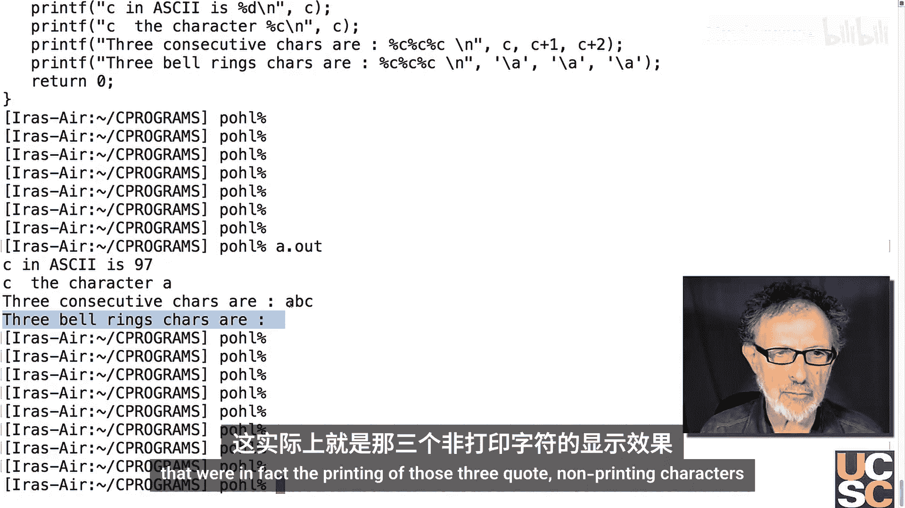

# 019：char类型详解 🎼


在本节课中，我们将要学习C语言中的基础数据类型之一：`char`。`char`类型让我们能够处理大量的文本处理任务。

## 概述

`char`是构成字符串的基本元素。虽然我们稍后会详细学习字符串，但可以提前了解，字符串本质上是一个`char`类型的数组，并在末尾有一个哨兵字符（通常是零值）。因此，`char`是一个基础数据类型。

## char字面量与ASCII码

一个`char`字面量或常量可以包含小写字母等字符。在代码中，它被表示为单引号包裹的形式，例如 `'x'`。

数字也可以作为字符，例如 `'7'`。如果没有引号，`7` 将被视为整型字面量。

此外，我们已经使用过一些**非打印字符**，这些字符不会直接显示在屏幕上，但会执行某些操作。最常见的例子是 `\n`，它表示换行。

你不需要记住所有字符的编码，但可以在大多数资料或网上找到标准ASCII码表。该表包含128个字符，其中包含可打印字符和一些能触发计算机系统特定操作的非打印字符。

例如，大写字母 `'A'` 的整数值是 **65**。在ASCII表中，大写字母是连续排列的，因此 `'B'` 是66，`'C'` 是67，依此类推，直到 `'Z'`（90）。同样，小写字母 `'a'` 的整数值是 **97**，一直连续到 `'z'`（122）。

这可能会让人有些困惑：当数字被用作字符时，它们也有对应的整数值。字符 `'0'` 的整数值是 **48**。十进制数字字符从 `'0'` 到 `'9'` 是连续排列的，对应的整数值范围是48到57。

键盘上的其他字符，如标点符号、运算符（如 `$`）等，在ASCII表中也都有对应的整数值。除非你有超强的记忆力，否则通常需要查阅表格。当然，你可以直接使用引号表示它们，编译器会处理其内部的整数值。

这些字符都可以存储在一个字节（8位）中，因此可以用一个`char`变量存储任何ASCII值。

## 非打印字符

非打印字符非常重要，它们能在计算机系统上触发特定操作。

*   `\n`：这是一个特殊的非打印字符。你不能直接使用 `n`，因为那会被打印为字母“n”。反斜杠 `\` 起到了“转义”的作用。`\n` 的整数值是10，它的作用是在屏幕上换到新的一行。
*   `\a`：这也是一个非打印字符，整数值是7。如果在程序中使用它，系统会响铃或发出提示音。

以上就是可以使用的字符集。接下来，让我们通过一个简单的程序来演示如何使用`char`类型。

## 示例程序

我编写了这个程序，以一种简单的方式展示`char`的用法，并演示字符如何被打印。

```c
#include <stdio.h>

int main() {
    char c = 'a';
    printf("The character %c has an ASCII value %d\n", c, c);

    printf("Three consecutive characters: %c, %c, %c\n", c, c+1, c+2);

    printf("\a\a\a");
    return 0;
}
```

在这个程序中：
1.  变量 `c` 被声明为 `char` 类型，并被赋值为字符 `'a'`。
2.  第一个 `printf` 语句使用 `%d` 格式说明符将 `c` 作为整数打印，因此会显示其ASCII值。接着，它又使用 `%c` 格式说明符将其作为字符打印。
3.  第二个 `printf` 语句展示了字符值是连续的。它打印了 `c`、`c+1` 和 `c+2`。虽然 `c+1` 和 `c+2` 是整数表达式，但它们会被解释为字符。因此，程序会利用ASCII表来决定打印什么内容。
4.  第三个 `printf` 语句包含了三个 `\a`（响铃字符）。如果你在本地系统上运行此程序，应该会听到三声不同的提示音或响铃。`\a` 是一个非打印字符。当然，字符串中的 `\n` 也是一个非打印字符，它由 `printf` 函数解释并执行换行操作。如果我将 `\a` 放在这里，并尝试用 `%c` 打印它，那么在屏幕上将看不到任何输出，但会触发系统响铃。

让我们运行这个程序（假设已编译）：
```
The character a has an ASCII value 97
Three consecutive characters: a, b, c
```
程序输出显示，字符 `c`（即 `'a'`）的ASCII值是97，正如本课开头所述。当作为整数打印时，显示97；作为字符打印时，显示“a”。三个连续的字符被打印为“a”、“b”、“c”，符合预期。至于那三声响铃，虽然屏幕上没有打印出内容，但在本地运行时我听到了“叮、叮、叮”的声音，这正是打印那三个非打印字符 `\a` 的效果。

## 总结



本节课中，我们一起学习了C语言中的 `char` 数据类型。我们了解了字符字面量的表示方法、ASCII码表的结构（包括可打印字符和如 `\n`、`\a` 这样的非打印字符），并通过一个示例程序演示了如何声明 `char` 变量、如何以整数和字符两种格式打印它，以及如何利用字符的整数值进行连续字符的操作。理解 `char` 类型是后续处理字符串和文本数据的基础。