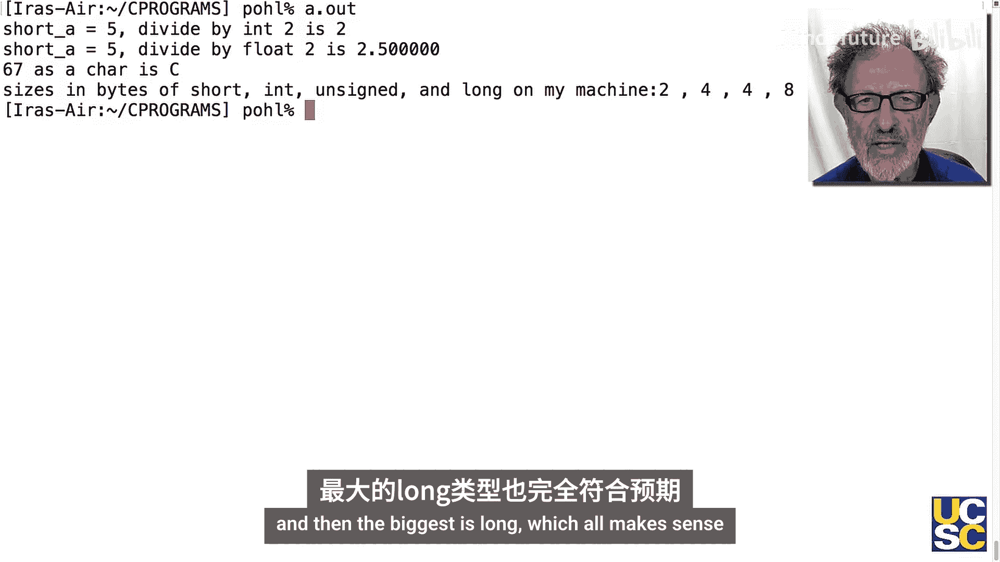

# 020：int类型详解


## 概述
在本节课中，我们将深入学习C语言中最重要的数据类型之一：`int`（整数类型）。我们将探讨`int`的不同变体、它们在内存中的存储方式、表示范围以及在实际编程中的使用注意事项。

## 数据类型的重要性
上一节我们介绍了数据类型的基本概念，本节中我们来看看`int`类型的具体细节。`int`是C语言中用于处理整数数据的基础数据类型。掌握`int`是理解更复杂数据类型（如浮点类型）的关键。在学习编程时，专注于像`int`这样典型且重要的部分，能帮助你高效地掌握大部分核心知识。

## int类型及其变体
`int`类型有几个重要的变体，它们提供了不同的数据范围和存储方式。

以下是`int`的主要变体：
*   **short**：使用更少字节，表示范围较小。
*   **long**：使用更多字节，表示范围更大。
*   **unsigned**：仅表示非负整数（正数和零），从而扩大了正数的表示范围。

## 整数的表示与范围
在现代典型机器上，一个`int`通常存储在**32位**（即4个字节）中。这意味着它可以表示大约正负**21亿**范围内的整数。具体范围是：
*   最大正数：**2,147,483,647**
*   最小负数：**-2,147,483,648**

这种表示范围的不对称性源于计算机中常用的**二进制补码**表示法。在这种表示法中，最高位（最左边的位）用于表示符号（0为正，1为负）。

对于`unsigned int`，由于所有位都用于表示数值本身，其表示范围变为从**0**到大约**42亿**。

## 字面量表示法
在代码中为不同整数类型赋值时，可以使用特定的后缀来明确指定字面量的类型。

以下是不同整数类型字面量的表示方法：
*   `35`：普通`int`
*   `35L` 或 `35l`：`long`类型
*   `35U` 或 `35u`：`unsigned`类型
*   `35UL` 或 `35ul`：`unsigned long`类型

## 类型使用与常见陷阱
了解你正在使用的数据类型对于输入、输出和运算都至关重要。混合使用不同类型时，必须清楚每个操作数的数据域。

一个经典的编程错误与除法运算符`/`有关。在C语言中，`/`的行为取决于操作数的类型。

以下是整数除法与浮点数除法的区别：
*   **整数除法**：当两个操作数都是整数时，`/`执行整数除法，结果会**丢弃余数**。例如：`2 / 3` 的结果是 `0`。
*   **浮点数除法**：当至少一个操作数是浮点数（如`float`或`double`）时，`/`执行浮点数除法，结果会保留小数部分。例如：`2.0 / 3`、`2 / 3.0` 或 `2.0 / 3.0` 的结果都是 `0.666...`。

在计算整数数据的平均值时，如果忘记将其中一个操作数转换为浮点类型，就很容易犯这个错误。

## 代码示例与分析
让我们通过一段代码来具体说明这些概念。你可以运行并修改这段代码来加深理解。

```c
#include <stdio.h>

int main() {
    short short_a = 5;
    int normal_a = 67;
    unsigned unsigned_a = 67u;
    long long_a = 67l;

    printf("short_a = %hd, 除以整数 2 得：%d\n", short_a, short_a / 2);
    printf("short_a = %hd, 除以浮点数 2.0 得：%f\n", short_a, short_a / 2.0);
    printf("67 作为字符打印是：%c\n", normal_a);

    printf("我的机器上：\n");
    printf("short 类型的大小 = %lu 字节\n", sizeof(short_a));
    printf("int 类型的大小 = %lu 字节\n", sizeof(normal_a));
    printf("unsigned int 类型的大小 = %lu 字节\n", sizeof(unsigned_a));
    printf("long 类型的大小 = %lu 字节\n", sizeof(long_a));

    return 0;
}
```

运行这段代码，你可能会看到类似以下的输出：
```
short_a = 5, 除以整数 2 得：2
short_a = 5, 除以浮点数 2.0 得：2.500000
67 作为字符打印是：C
我的机器上：
short 类型的大小 = 2 字节
int 类型的大小 = 4 字节
unsigned int 类型的大小 = 4 字节
long 类型的大小 = 8 字节
```

输出分析：
1.  `short_a / 2` 执行整数除法，结果为 `2`。
2.  `short_a / 2.0` 执行浮点数除法，结果为 `2.5`。
3.  整数 `67` 对应的ASCII字符是大写字母 `C`。
4.  `sizeof` 运算符显示了不同数据类型在当前机器上所占的字节数，这与之前的描述一致。



## 总结
本节课中我们一起学习了C语言的`int`整数类型。我们了解了`int`及其变体（`short`、`long`、`unsigned`）的用途、表示范围和字面量写法。我们重点分析了整数除法与浮点数除法的关键区别，这是一个常见的编程陷阱。最后，通过代码示例，我们直观地验证了这些理论概念，并学会了如何使用`sizeof`运算符查看类型大小。理解这些基础知识是进行有效C语言编程的重要一步。