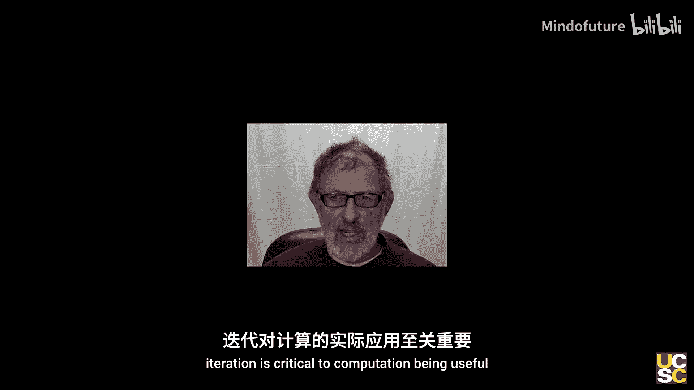
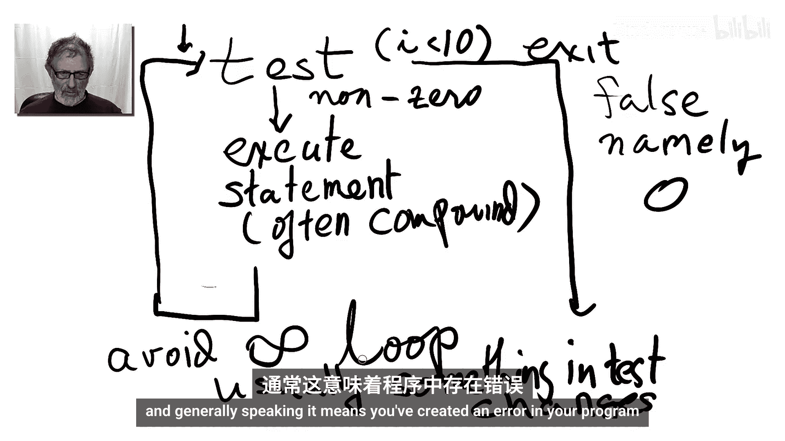
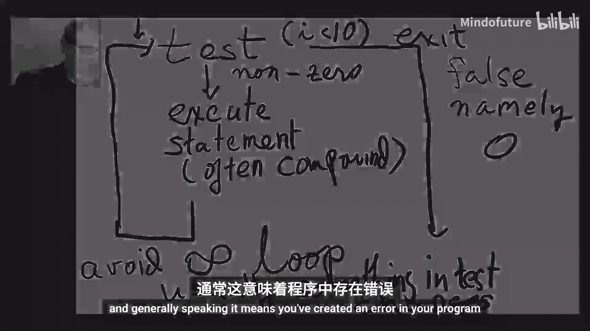
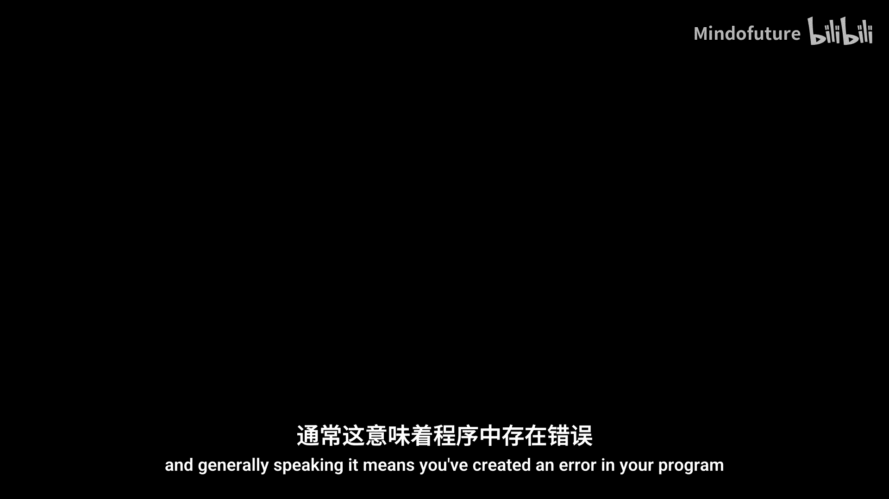

# 024：迭代语句 - while循环



## 概述
在本节课中，我们将要学习C语言中一个至关重要的概念：**迭代**。迭代是使计算机变得强大的核心，它允许程序重复执行一系列操作，从而处理海量数据或复杂任务。我们将重点探讨最基本的迭代语句——**`while`循环**，理解其语法、执行逻辑以及如何避免常见错误。

## 什么是迭代？
如果所有计算都简单到只需几行指令就能一步步完成，那么我们可能就不需要计算机了。计算机之所以强大，是因为它能在极短时间内执行数百万甚至数万亿次操作，这是人类或机械计算器无法做到的。因此，掌握迭代是编写有用程序的关键。

上一节我们介绍了程序的基本结构，本节中我们来看看如何让程序“重复工作”。

## `while`循环：语法与语义
`while`语句是最基础的迭代形式。理解它将有助于后续学习更复杂的`for`循环。

其基本语法结构如下：
```c
while (表达式) {
    // 语句块
}
```

以下是其执行语义（即工作原理）：
1.  首先，检查**表达式**的值。
2.  如果表达式的结果为**0**（在C语言中代表“假”），则跳过整个循环体中的语句，直接执行循环之后的代码。
3.  如果表达式的结果为**非0**（代表“真”），则执行循环体`{}`内的所有语句。
4.  执行完循环体后，流程会**跳回第一步**，重新检查表达式的值。
5.  这个过程会一直重复，直到某次检查发现表达式结果为0，循环才会终止。

## 一个经典的`while`循环示例
让我们通过一个具体例子来理解。以下代码将打印数字0到9：

```c
int i = 0; // 初始化一个计数器
while (i < 10) { // 测试条件：i 是否小于 10？
    printf("i = %d\n", i); // 循环体：打印当前 i 的值
    i++; // 循环体：将 i 的值增加 1。这是改变循环状态的关键步骤！
}
```

代码执行流程分析：
*   `i`初始值为0。表达式`i < 10`为真，进入循环。
*   打印`i = 0`，然后将`i`自增为1。
*   跳回测试`i < 10`（此时i=1），为真，继续循环。
*   此过程重复，依次打印1, 2, 3...直到`i`变为10。
*   当`i`等于10时，表达式`i < 10`为假，循环终止。

这个简单的循环包含了复杂循环的所有核心特征：一个**控制变量**（`i`）、一个**测试条件**（`i < 10`）和循环**内部执行的动作**（打印和自增）。

## `while`循环的执行流程图
传统上，我们用流程图来可视化循环的执行逻辑。下图展示了`while`循环的流程：

```
      +-------------------+
      |   开始 while 循环   |
      +-------------------+
               |
               v
      +-------------------+
      |  计算表达式值       |
      |  (例如：i < 10)    |
      +-------------------+
               |
      +--------+--------+
      |                 |
   值为0 (假)       值非0 (真)
      |                 |
      v                 v
+-----------+     +-----------+
| 退出循环，  |     | 执行循环体  |
| 执行后续代码 |     | 内的语句    |
+-----------+     +-----------+
                          |
                          v
                  +-----------+
                  | 返回并重新  |
                  | 测试表达式  |
                  +-----------+
```

流程说明：程序进入`while`语句后，先进行条件测试。若为假则退出；若为真则执行循环体，执行完毕后**返回**并再次测试条件，形成循环。

## 重要注意事项：避免无限循环
在循环中，**必须确保循环条件有朝一日会变为假**。如果循环条件永远为真，程序就会陷入**无限循环**。

例如，如果在上面的例子中忘记写`i++;`这条语句，`i`的值将永远为0，`i < 10`也永远为真，循环会永不停止地打印`i = 0`。

无限循环会耗尽计算机资源，通常意味着程序中存在逻辑错误，需要仔细检查循环体内的代码是否正确地改变了影响测试条件的变量。

## 总结
本节课中我们一起学习了C语言中**`while`循环**的核心知识。我们了解到：
1.  **迭代**是编程的核心，使计算机能高效处理重复任务。
2.  `while`循环的**语法**是 `while (表达式) { 语句块 }`。
3.  其**执行逻辑**是：先判断，后执行，执行完再返回判断，直到条件不满足。
4.  一个典型的循环包含**初始化**、**条件测试**和**状态更新**三个部分。
5.  必须小心避免因忘记更新循环变量而导致的**无限循环**。







掌握`while`循环为理解所有迭代结构打下了坚实基础。在接下来的课程中，我们将学习另一种更紧凑的迭代语句——`for`循环。