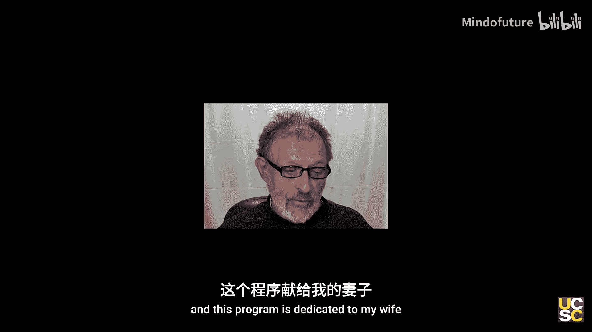
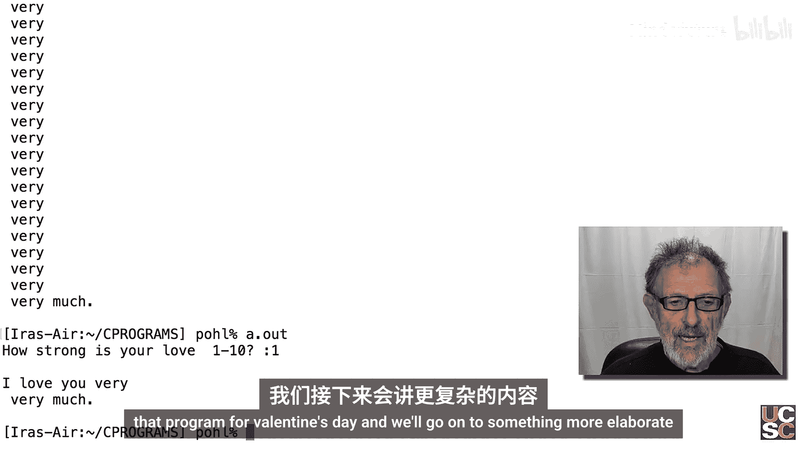

# 026：while循环代码示例

## 概述
在本节课中，我们将深入学习C语言中的`while`循环。`while`循环是迭代的核心结构，我们将通过一个简单的“情人节”程序来演示其工作原理。我们将分析代码的关键部分，并理解如何通过循环控制重复执行一段代码。

## 程序示例：情人节表白程序
我们将编写一个程序，它询问用户“你有多爱对方”，并根据输入的数字，重复打印“非常”这个词，最后以“爱你”结束。这个程序旨在演示`while`循环的基本用法。

以下是程序的核心代码结构：



```c
#include <stdio.h>

int main() {
    int repeat;
    printf("How strong is your love? (1-10): ");
    scanf("%d", &repeat);
    printf("I love you ");
    while (repeat > 0) {
        printf("very ");
        repeat--;
    }
    printf("much.\n");
    return 0;
}
```

## 代码解析
上一节我们介绍了程序的目标，本节中我们来看看代码的具体实现细节。

### 变量声明与初始化
程序首先声明了一个整型变量`repeat`。这个变量将决定循环重复的次数，即“非常”这个词被打印的次数。

### 用户输入
程序使用`printf`和`scanf`函数与用户交互。`scanf(“%d”, &repeat)`语句用于读取用户输入的一个整数，并将其存储在变量`repeat`中。

### while循环结构
`while`循环是C语言中最基本的循环结构。其语法格式为：
**`while (condition) { statement; }`**
只要`condition`（条件）为真，循环体内的`statement`（语句）就会重复执行。

在我们的程序中，循环条件是 **`repeat > 0`**。只要`repeat`的值大于0，循环就会继续。

### 循环体与迭代控制
循环体内执行两个操作：
1.  **`printf(“very “);`**：打印单词“very”。
2.  **`repeat--;`**：这是一个自减运算符，它将变量`repeat`的值减1。这是控制循环次数的关键，它确保循环在执行指定次数后，条件`repeat > 0`会变为假，从而终止循环。

### 循环后的输出
当`while`循环结束后，程序执行最后的`printf(“much.\n”);`语句，完成整个表白消息的输出。

## 程序执行示例
让我们看看程序在不同输入下的运行结果。

以下是几种可能的输入和对应的输出：

*   **输入 `10`**：输出为 “I love you very very very very very very very very very very much.”（打印10次“very”）。
*   **输入 `1`**：输出为 “I love you very much.”（打印1次“very”）。
*   **输入 `0`**：输出为 “I love you much.”（不进入循环，直接打印“much”）。
*   **输入负数（如 `-5`）**：输出为 “I love you much.”（条件`repeat > 0`初始即为假，不进入循环）。




## 总结
本节课中我们一起学习了`while`循环的实践应用。我们通过一个有趣的情人节程序，理解了如何声明循环控制变量、编写循环条件、在循环体内执行操作并更新控制变量。`while`循环是迭代的基础，掌握它对于理解更复杂的循环结构（如`for`循环）至关重要。你可以尝试修改这个程序，创造属于自己的版本。