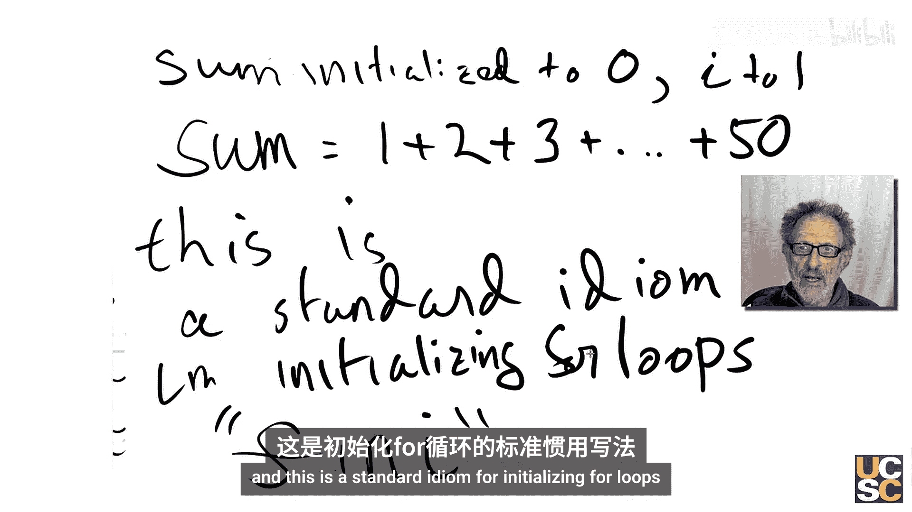

# 029：奇特运算符 - 条件运算符和逗号运算符


在本节课中，我们将学习C语言中两个较为特殊的运算符：条件运算符（三元运算符）和逗号运算符。我们将了解它们的语法、语义、使用场景以及需要注意的细节。

## 条件运算符（三元运算符）

上一节我们介绍了各种运算符，本节中我们来看看一个独特的运算符——条件运算符。它是C语言中**唯一的三元运算符**，其语法形式为 `表达式1 ? 表达式2 : 表达式3`。

其工作原理是：首先计算`表达式1`，该表达式通常是一个关系或逻辑表达式，其结果为0（假）或非0（真）。如果`表达式1`的结果为真（非0），则整个条件表达式的值为`表达式2`的值；如果为假（0），则整个表达式的值为`表达式3`的值。

以下是一个使用示例：
```c
c = (a < b) ? a : b;
```
这段代码等价于一个`if-else`语句：
```c
if (a < b) {
    c = a;
} else {
    c = b;
}
```
条件运算符的优势在于**简洁**，可以用一行代码完成简单的条件赋值。它的优先级非常低，在C语言的16个优先级中排在第14位（倒数第三），这意味着在复杂表达式中，它通常最后被计算。

## 逗号运算符

了解了条件运算符后，我们再来看看另一个特殊的运算符——逗号运算符。它的语法形式为 `表达式1, 表达式2`。

逗号运算符的语义是：
1.  首先计算`表达式1`。
2.  然后计算`表达式2`。
3.  整个逗号表达式的最终值是`表达式2`的值。

逗号运算符是一个**序列点**，这意味着`表达式1`的所有副作用（例如赋值、自增等）都必须在计算`表达式2`之前完成。这对于保证程序执行顺序的确定性非常重要，因为C语言中许多运算符（如加法`+`）的操作数计算顺序是未定义的，编译器可能为了优化而改变顺序。

逗号运算符的优先级是**所有运算符中最低的**，甚至低于赋值运算符。

以下是一个逗号运算符的示例：
```c
c = (a = 0, b = 1);
```
执行后，变量`a`被赋值为0，变量`b`被赋值为1，整个括号表达式的值为1（即`b`的值），因此变量`c`也被赋值为1。

逗号运算符最常见的、也是被广泛接受的用法是在`for`循环中，用于同时初始化多个变量。

以下是`for`循环中使用逗号运算符的惯用示例：
```c
int sum, i;
for (sum = 0, i = 1; i <= 50; i++) {
    sum += i;
}
```
在这个循环中：
*   `sum = 0, i = 1` 是初始化部分，它利用逗号运算符同时将`sum`初始化为0，将`i`初始化为1。
*   `i <= 50` 是循环条件。
*   `i++` 是每次迭代后的步进操作。
这个循环的功能是计算从1到50的整数和。

## 总结

本节课中我们一起学习了C语言中两个特殊的运算符。
*   **条件运算符（`? :`）** 是唯一的三元运算符，用于根据条件选择两个表达式中的一个，其优点是代码简洁。
*   **逗号运算符（`,`）** 用于顺序执行两个表达式，并以第二个表达式的值作为结果。它是一个序列点，能保证执行顺序，最常见的用途是在`for`循环的初始化部分。




理解这两个运算符的语法和语义，有助于你编写更简洁、高效的C语言代码。