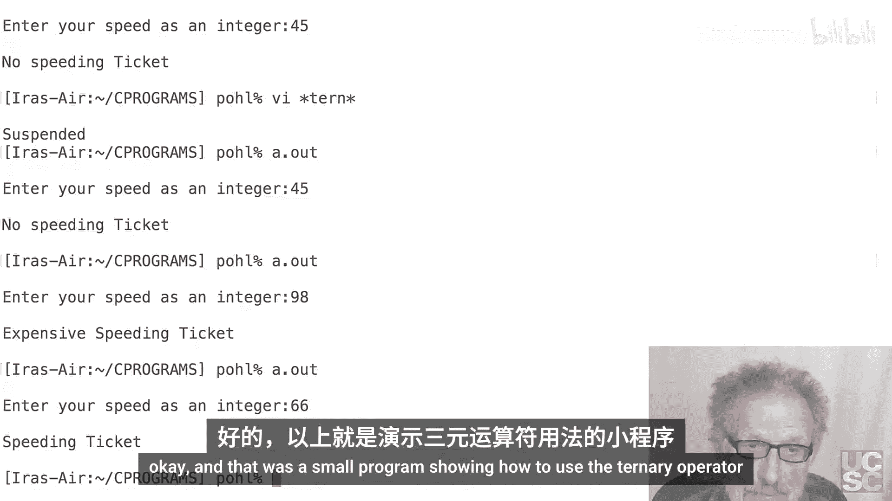

# 030：三元运算符代码示例


## 概述
在本节课中，我们将学习如何使用三元运算符来改进一个判断超速罚单的程序。我们将把之前使用`switch`语句的程序，改写为使用嵌套三元运算符的版本，使其能更灵活地处理速度范围，而非固定的几个数值。

上一节我们介绍了三元运算符的基本语法，本节中我们来看看如何在实际代码中应用它，特别是处理多个条件的情况。

## 代码解析与改写

以下是原程序的逻辑：它根据用户输入的速度，判断属于哪种罚单情况。原程序使用`switch`语句，但只能精确匹配65、70、90这三个值，不够灵活。

我们将使用嵌套三元运算符来实现基于范围的判断。核心思路是：
1.  首先判断速度是否小于65（不超速）。
2.  如果不满足条件1，则进一步判断速度是否小于等于70（普通超速）。
3.  如果以上都不满足，则属于严重超速。

对应的嵌套三元运算符代码如下：
```c
int result = (speed < 65) ? 65 : ((speed <= 70) ? 70 : 90);
```
这段代码的含义是：如果 `speed < 65` 为真，则 `result` 为65；否则，判断 `speed <= 70`，如果为真则 `result` 为70，否则 `result` 为90。

接下来，我们根据`result`的值来输出相应的罚单信息。由于三元运算符已经确保了`result`的值只会是65、70或90，因此`switch`语句中可以不再需要`default`分支。

以下是完整的程序逻辑步骤：

1.  提示用户输入速度。
2.  使用上述嵌套三元运算符计算一个代表罚单类型的值（65， 70， 90）。
3.  使用`switch`语句根据这个值打印对应的罚单信息。

## 程序测试
让我们运行程序来测试一下。在程序底部，我们会输入不同的速度值进行验证。

*   输入速度45，程序输出“没有罚单”。
*   输入速度98，程序输出“高额罚单”。
*   输入速度66，程序输出“普通罚单”。

测试结果表明，程序能正确根据速度范围输出对应的结果。

## 总结
本节课中我们一起学习了如何利用嵌套三元运算符来简化多条件判断的逻辑。通过将之前的`switch`案例改写成基于范围判断的版本，我们使程序变得更加灵活和健壮。这个例子展示了三元运算符在使代码更简洁、表达更清晰方面的优势。



你可以尝试修改这个程序，例如增加对非法速度（如负数）的检查，并让`default`分支来处理这种意外情况，这将是一个很好的练习。