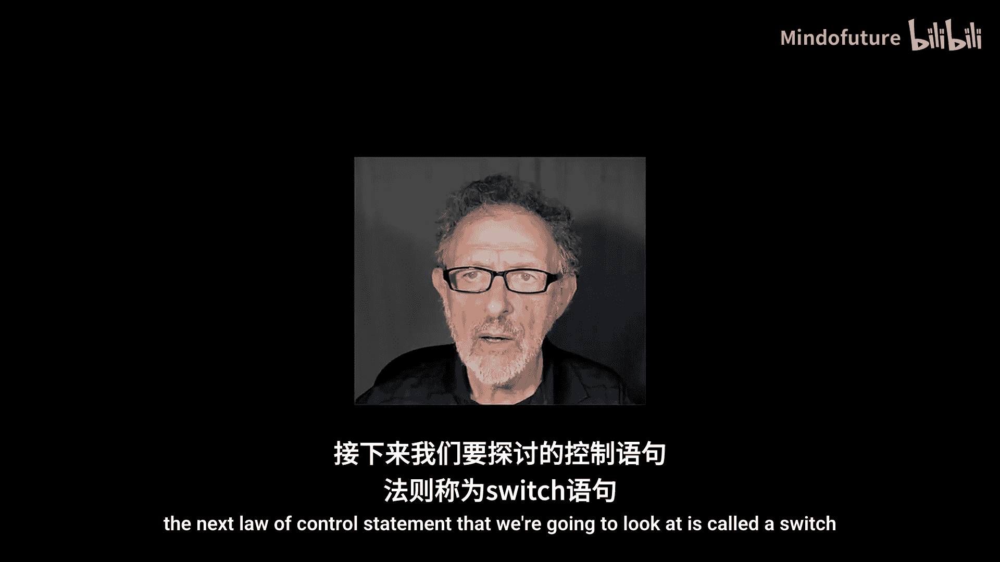
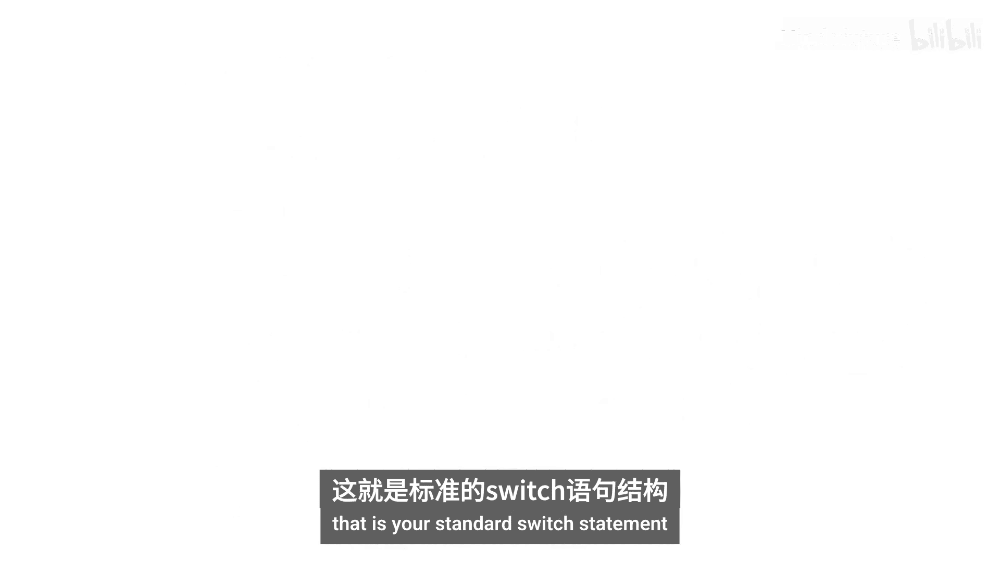

# 031：break、continue与switch语句



在本节课中，我们将学习C语言中用于控制程序流程的另外两个重要语句：`break`和`continue`，并重点介绍`switch`语句的结构与用法。这些工具能帮助我们编写更清晰、更高效的条件分支代码。

---

## 控制流语句：switch

上一节我们介绍了基础的`if-else`条件判断。本节中，我们来看看`switch`语句。从某种程度上说，`switch`是`if-else`的一种泛化，因为你可以用`if-else`实现几乎相同的功能。但对于某些特定的控制流程，`switch`语句在结构上更为优雅，生成的代码也更具可读性。

`switch`语句基于一个**整型表达式**进行判断。这个表达式可以是一个简单的整数变量`i`，然后根据`i`的不同值（通常是较小的值），执行不同的代码块。

让我们看一个例子。

以下是`switch`语句的基本语法示例：

```c
switch (i) {
    case 1:
        a = 2 * i;
        break;
    case 2:
        a = 3 * i;
        break;
    default:
        a = 0;
}
```

在这个例子中：
*   关键字`switch`后跟着一个整型表达式`i`，在进入`switch`之前，`i`必须已被赋值。
*   我们定义了三个`case`（情况）。每个`case`以关键字`case`开头，后跟一个**整型常量**（例如`1`），然后是一个冒号。
*   冒号后面是一系列在该`case`匹配时要执行的语句。
*   每个`case`块通常以`break;`语句结束。`break`的作用是：执行到这里时，直接跳出整个`switch`语句，继续执行右大括号`}`之后的代码。这是`switch`的标准写法。

### 关于“贯穿”行为

如果没有`break`语句，就会发生“贯穿”行为。例如，如果删除了`case 1:`后面的`break`，那么当`i`等于1时，程序会执行`a = 2 * i;`，然后继续执行`case 2:`中的代码`a = 3 * i;`，直到遇到下一个`break`或`switch`结束。这通常不是我们想要的结果，因此需要谨慎使用。

### default 分支

`default`是一个特殊的关键字，代表所有未被前面`case`匹配到的值。它类似于`if-else`链中的最后一个`else`。如果`switch`表达式的值不匹配任何`case`，程序就会跳转到`default`分支执行。如果代码中没有`default`分支，那么`switch`语句将不执行任何操作，直接结束。

### 语法要点总结

*   `switch`后的表达式必须是**整型**（如`int`、`short`、`long`、`char`），不能是浮点型。
*   `case`标签必须是**整型常量**。
*   `switch`语句体必须用大括号`{}`包围。
*   通常，每个`case`分支都以`break;`结尾，以防止“贯穿”。
*   使用`default`分支来处理所有其他情况是一个好习惯。

---



本节课中我们一起学习了`break`和`continue`在循环中的基本作用，并深入探讨了`switch`语句的语法、执行流程以及`break`在其中防止“贯穿”的关键作用。掌握这些控制语句，能让你更灵活地编写条件分支逻辑。