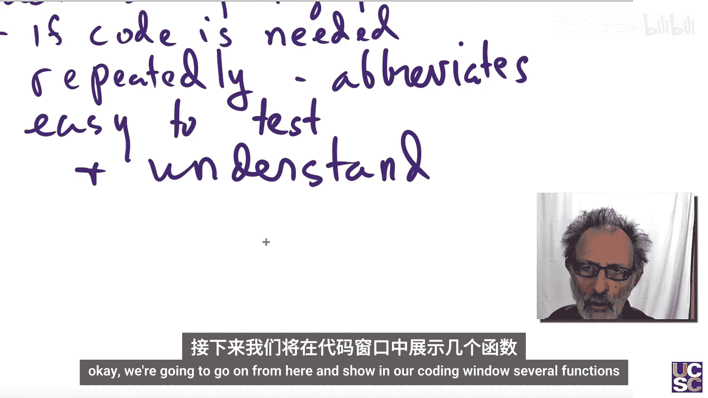
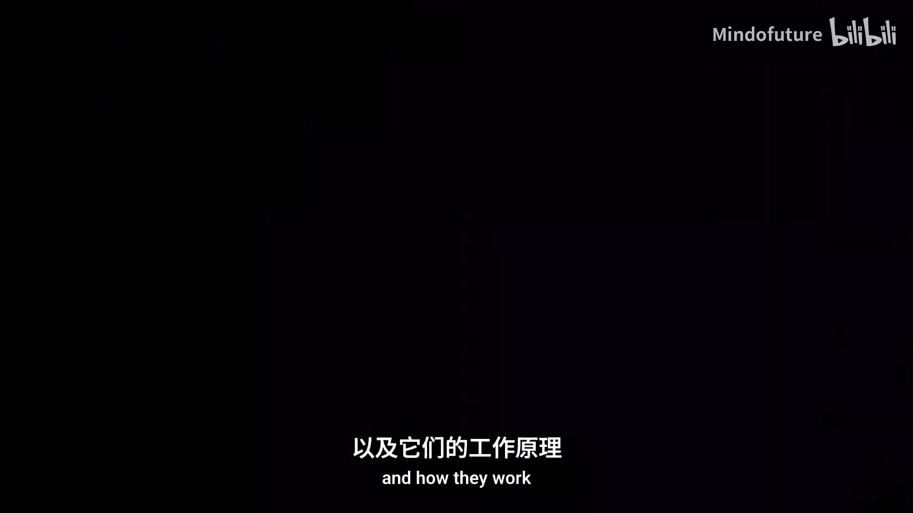

# 032：函数定义


## 概述
在本节课中，我们将要学习C语言中一个至关重要的概念：**函数**。我们将了解函数是什么、为什么它们如此重要、如何定义函数以及如何调用函数。理解函数是编写结构化、可重用和易于维护代码的关键。

## 什么是函数？📚
上一节我们介绍了编程的基本结构，本节中我们来看看构成复杂程序的基石——函数。

函数可以被看作是代码的“段落”。正如段落将句子组织成连贯的思想一样，函数将单个语句组织起来，以实现一个特定的、连贯的目的。我们其实从一开始就在使用函数，例如程序入口 `int main(void)`，以及输入输出函数 `printf` 和 `scanf`。

函数之所以重要，主要有以下几个原因：
*   **代码复用**：函数是代码复用的核心。标准库（如 `stdio.h`）中的函数可以被无数次调用，无需重写。
*   **封装**：函数是一种封装技术。它将复杂的代码逻辑打包成一个独立的单元，隐藏内部细节，只通过接口（函数名和参数）与外界交互。
*   **结构化**：大型系统由数百万行代码组成。通过将系统分解为一系列相互调用的函数，我们可以更好地组织和管理代码。
*   **易于测试**：一个设计良好的函数通常只做一件事，并且代码量控制在一页以内。这使得我们可以独立地、有效地测试这个功能单元。

## 如何设计函数？✍️
在开始编写函数之前，了解一些设计原则很有帮助。

以下是编写函数时应考虑的几个要点：
*   **单一职责**：一个函数应该只做好一件事。例如，`sqrt` 函数只计算平方根，`rand` 函数只生成随机数。
*   **代码长度**：函数的代码量最好控制在一页之内。这类似于一个段落的长度，便于理解和测试。
*   **明确接口**：函数应有清晰的输入（参数）和输出（返回值）。理想情况下，我们可以为函数定义**前置条件**（调用函数前必须满足的条件）和**后置条件**（函数执行后保证会达成的结果），这有助于测试。

## 函数的语法结构📝
了解了函数的重要性与设计原则后，我们来看看在C语言中定义函数的具体语法。

一个标准的函数定义包含以下几个部分：
```
返回类型 函数名(参数列表) {
    // 变量声明（可选）
    // 可执行语句
}
```

各部分解释如下：
*   **返回类型 (`type`)**：指定函数执行完毕后返回的数据类型，例如 `int`、`float`。如果函数不返回任何值，则使用 `void`。
*   **函数名 (`function_name`)**：函数的标识符，应具有描述性，如 `printf`、`calculateArea`。
*   **参数列表 (`parameter_list`)**：传递给函数的值，是一个用逗号分隔的变量声明列表。可以为空，写作 `void` 或留空。
*   **函数体 (`body`)**：由一对花括号 `{}` 包围的代码块。内部可以包含变量声明和一系列可执行语句。

## 函数定义示例🎯
现在，让我们通过一个简单的例子来具体看看如何定义和调用一个函数。

以下是一个函数定义的例子：
```c
void write_address(void) {
    printf("123 Main Street\n");
    printf("North Pole, H0H 0H0\n");
}
```
*   **返回类型**：`void`，表示该函数不返回任何值。
*   **函数名**：`write_address`。
*   **参数列表**：`(void)`，表示该函数不需要任何参数。
*   **函数体**：包含两个 `printf` 语句，用于打印地址。

这个函数封装了“打印地址”这个操作。当我们需要在程序的不同位置打印这个地址时，只需**调用**这个函数即可，无需重复编写 `printf` 语句。

调用该函数的方式非常简单：
```c
write_address();
```
只需写下函数名，后跟一对括号和分号。我们可以想象在 `main` 函数中调用它，那么这两行地址就会被打印出来。





## 总结
本节课中我们一起学习了C语言的核心概念——**函数**。我们了解到函数是代码的“段落”，它通过封装特定功能来实现代码的**复用**、**结构化**和**易于测试**。我们学习了函数的设计原则，并掌握了函数定义的标准语法：`返回类型 函数名(参数列表) { 函数体 }`。最后，通过一个打印地址的简单示例，我们实践了如何定义和调用一个 `void` 类型的无参函数。理解并熟练运用函数，是迈向编写高质量C语言程序的重要一步。