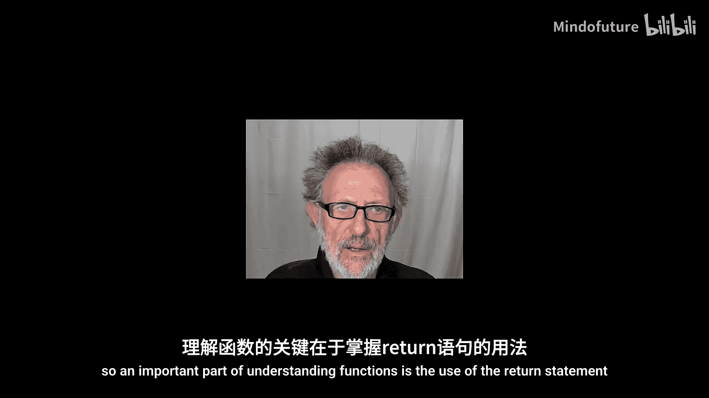
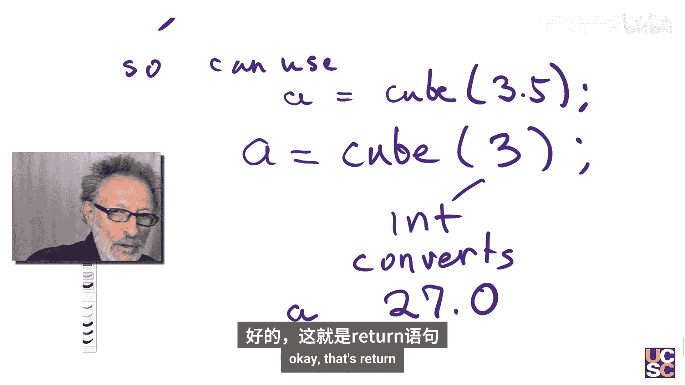

# 034：return语句



## 概述

在本节课中，我们将要学习C语言中`return`语句的使用。`return`语句是理解函数工作原理的重要组成部分，它用于控制程序流程并从函数中返回一个值。

## return语句简介

`return`语句是一个流程控制关键字。我们从最初的程序开始就已经见过它，在`main`函数的结尾处，我们总是写`return 0;`。这是一种约定，虽然可以不用，但显式地使用它被认为是更好的编程风格。

## return语句的语法

`return`语句的语法有两种形式：一种是`return;`（不带表达式），另一种是`return`后跟一个表达式，例如`return 表达式;`。

以下是三个简单的例子：
*   `return;`
*   `return 0;`
*   `return (a + b);`

请注意，表达式`(a + b)`的括号不是必需的，但为了代码清晰，通常都会加上。即使是一个简单的整数常量如`0`，人们也倾向于加上括号。

## return语句在函数中的使用

上一节我们介绍了语法，本节中我们来看看`return`语句在函数中的具体应用。

下面是一个简单的函数示例，它计算一个数的立方：

```c
double cube(double x) {
    return (x * x * x);
}
```

这个函数名为`cube`，它接收一个`double`类型的参数`x`，计算`x * x * x`，并通过`return`语句返回一个`double`类型的值。如果返回的表达式的类型与函数声明的返回类型不匹配，C语言会进行类型转换，但转换规则可能很复杂，通常应尽量避免。

## 函数调用与返回值

了解了函数如何返回值后，我们来看看如何调用它并使用其返回值。

我们可以这样调用`cube`函数：
```c
a = cube(3.5);
```
在这个例子中，`3.5`被传递给`cube`函数，函数内部计算`3.5 * 3.5 * 3.5`，然后将结果值返回并赋值给变量`a`。

需要特别注意的是，如果我们这样调用：
```c
a = cube(3);
```
整数`3`会先被转换为`double`类型`3.0`，然后进行计算。最终变量`a`得到的将是`double`类型的`27.0`，而不是整数`27`。

## 总结



本节课中我们一起学习了C语言的`return`语句。我们了解了它的两种语法形式，看到了它在函数中如何用于返回值，并通过示例理解了函数调用时参数传递和返回值的过程。`return`语句是函数与程序其他部分进行数据交换的关键机制。