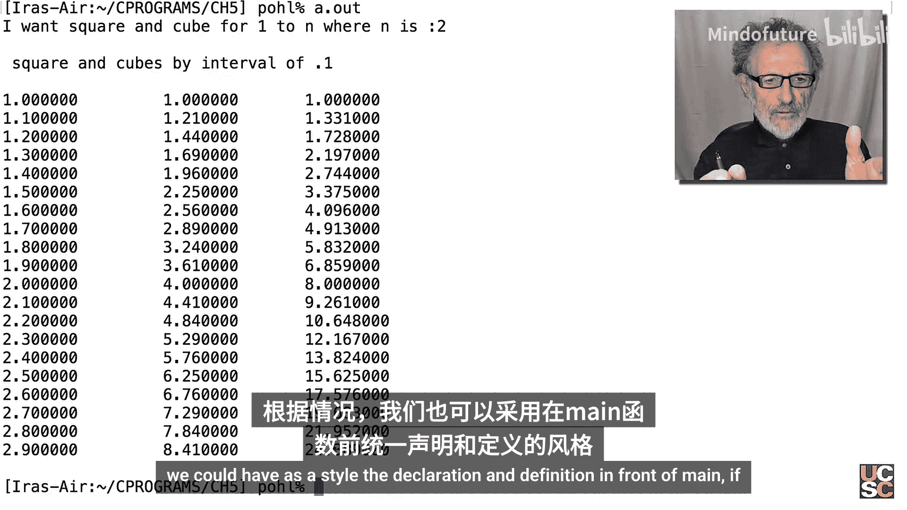
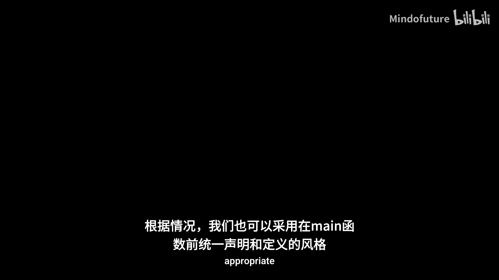

# 036：函数原型代码示例


## 概述
在本节课中，我们将通过一个打印平方与立方表的示例，来学习如何使用函数原型（prototype）来组织C语言代码。我们将看到如何声明函数、定义函数，以及如何在一个程序中有效地使用它们。

## 函数原型与声明
上一节我们讨论了函数的基本概念，本节中我们来看看如何在实际代码中使用函数原型。

函数原型告诉编译器一个函数的存在、它的返回类型以及它接受的参数类型。这允许我们在定义函数之前就调用它。在原型中，参数名是可选的，但参数类型是必需的。

以下是函数原型的语法示例：
```c
double square(double);
double cube(double);
```
这里，我们声明了两个函数：`square` 和 `cube`。它们都接受一个 `double` 类型的参数，并返回一个 `double` 类型的值。

## 主程序结构
现在，让我们看看主函数 `main` 如何利用这些声明的函数。

主程序使用了一个嵌套的 `for` 循环来生成表格。外层循环控制表格的行数（从1到n），内层循环以0.1为步长计算每个值的平方和立方。这种结构虽然简单，但体现了计算机高效执行重复计算的能力。

以下是主程序的核心循环结构：
```c
for (i = 1; i <= n; ++i) {
    for (j = 0.0; j < 1.0; j += 0.1) {
        x = i + j;
        // 调用 square 和 cube 函数
    }
}
```

## 函数定义
在程序文件的末尾，我们提供了 `square` 和 `cube` 函数的实际定义。这是编译器最终理解函数如何工作的地方。

以下是函数定义的示例：
```c
double square(double x) {
    return x * x;
}

double cube(double x) {
    return x * x * x;
}
```

## 程序运行示例
当我们运行程序并输入 `n=2` 时，程序会输出从1.0到2.9之间，以0.1为间隔的每个数的平方和立方值。

例如，输出结果会包含：
*   1.0 的平方是 1.0，立方是 1.0。
*   1.5 的平方是 2.25，立方是 3.375。
*   2.0 的平方是 4.0，立方是 8.0。

## 代码组织风格
关于代码组织，有两种常见的风格：
1.  将函数原型放在文件顶部（`main` 函数之前），而将函数定义放在 `main` 函数之后。
2.  直接将完整的函数定义放在 `main` 函数之前。

两种方式都是可行的。本示例采用了第一种风格，即先声明后定义，这有助于提高代码的可读性和模块化。





## 总结
本节课中我们一起学习了如何通过函数原型来结构化C语言程序。我们实践了声明函数、在 `main` 函数中调用函数、以及最终定义函数的具体实现。通过打印平方与立方表的例子，我们看到了如何利用循环和函数来高效地组织代码逻辑。记住“分而治之”的原则，先声明后使用，是编写清晰、可维护程序的好习惯。