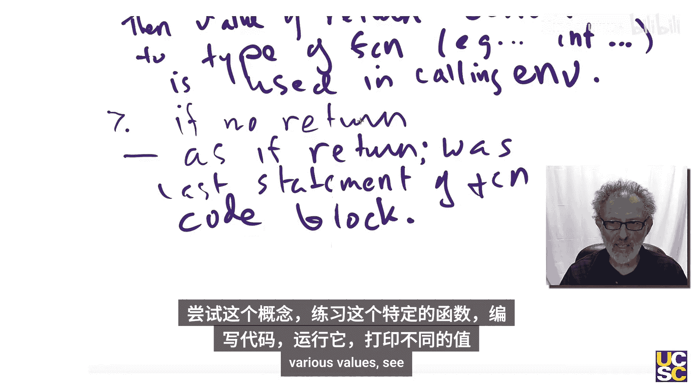
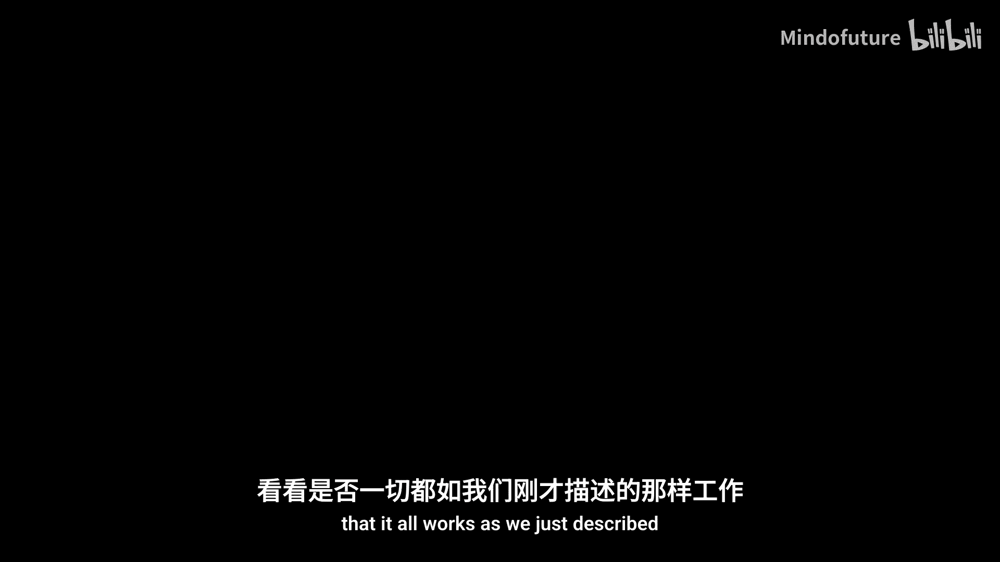

# 037：按值调用解释的函数变量


在本节课中，我们将要学习C语言中一个极其重要的核心概念：函数调用中的“按值调用”。我们将通过一个具体的例子，详细解释函数参数是如何工作的，以及为什么理解这一点对编程至关重要。

## 函数与按值调用

上一节我们介绍了函数的基本概念，本节中我们来看看函数调用时参数的具体行为。在C语言中，函数参数的传递方式是“按值调用”。

这个概念的核心在于：当调用一个函数时，传递给函数的**实际参数**的值会被复制一份，这份副本被赋给函数内部的**形式参数**。函数内部对形式参数的任何修改，都不会影响到外部实际参数的值。

## 一个简单的求和函数

为了更好地理解，我们来看一个计算从1加到n的求和函数。

```c
int sum_to_n(int n) {
    int sum = 0;
    for ( ; n > 0; n--) {
        sum += n;
    }
    return sum;
}
```

这个函数名为 `sum_to_n`，它接收一个整数参数 `n`。函数内部定义了一个局部变量 `sum` 并初始化为0。然后使用一个 `for` 循环，只要 `n` 大于0，就将当前的 `n` 加到 `sum` 上，同时将 `n` 减1。最后，函数返回计算得到的 `sum` 值。

## 按值调用的执行过程

以下是函数被调用时，按值调用的具体执行步骤：

1.  **计算实参表达式**：首先，计算调用函数时传入的**实际参数**（或表达式）的值。例如，调用 `sum_to_n(5)` 时，实参就是 `5`。实参也可以是一个复杂的表达式，如 `sum_to_n(3 * m + 2)`。

2.  **类型转换**：如果必要，将计算出的实参值转换为函数形式参数所声明的类型。在我们的例子中，形式参数 `n` 是 `int` 类型。如果实参是 `double` 类型（如 `3.5`），它会被转换为 `int` 类型（`3`）。

3.  **值复制**：这是按值调用的关键步骤。将转换后的值**复制**给函数内部的形式参数 `n`。你可以将其想象为在函数内部创建了一个名为 `n_local` 的局部变量，并执行了 `n_local = 实参值` 的操作。

4.  **执行函数体**：函数体开始执行，使用这个局部副本 `n_local` 进行计算。注意，即使函数内部的循环将 `n` 递减到了0，这个操作也仅仅作用于内部的副本 `n_local`。

5.  **返回结果**：当执行到 `return` 语句时，函数结束。`return` 后面的表达式会被计算，并在必要时转换回函数的返回类型（本例中是 `int`），然后将这个值返回给调用者。

6.  **无显式返回**：如果函数执行到代码块末尾都没有遇到 `return` 语句，则相当于在最后隐式地执行了一个 `return`。

## 关键点与示例

让我们通过一个具体的调用场景来巩固理解：

```c
int main() {
    int m = 5;
    int result = sum_to_n(m); // 调用函数
    printf(“从1加到%d的和是：%d\n”, m, result);
    printf(“调用后m的值仍然是：%d\n”, m);
    return 0;
}
```

在这个例子中：
*   变量 `m` 的值是 `5`。
*   调用 `sum_to_n(m)` 时，`m` 的值 `5` 被复制给了函数内部的参数 `n`。
*   函数内部，`n` 从 `5` 递减到 `0`，但这只是内部副本的变化。
*   函数返回计算结果 `15`（1+2+3+4+5）。
*   回到 `main` 函数，打印 `result` 得到 `15`，打印 `m` 的值，它**仍然是 `5`**，没有受到函数内部操作的影响。

## 总结





本节课中我们一起学习了C语言函数调用的核心机制——按值调用。我们明白了，函数参数传递的本质是**值的复制**。函数内部操作的是实参值的一个**独立副本**，因此不会改变原始实参变量的值。这是一个基础且至关重要的概念，请务必通过编写代码、运行示例并观察结果来加深理解。掌握按值调用，是理解后续更复杂参数传递方式（如指针）的基石。