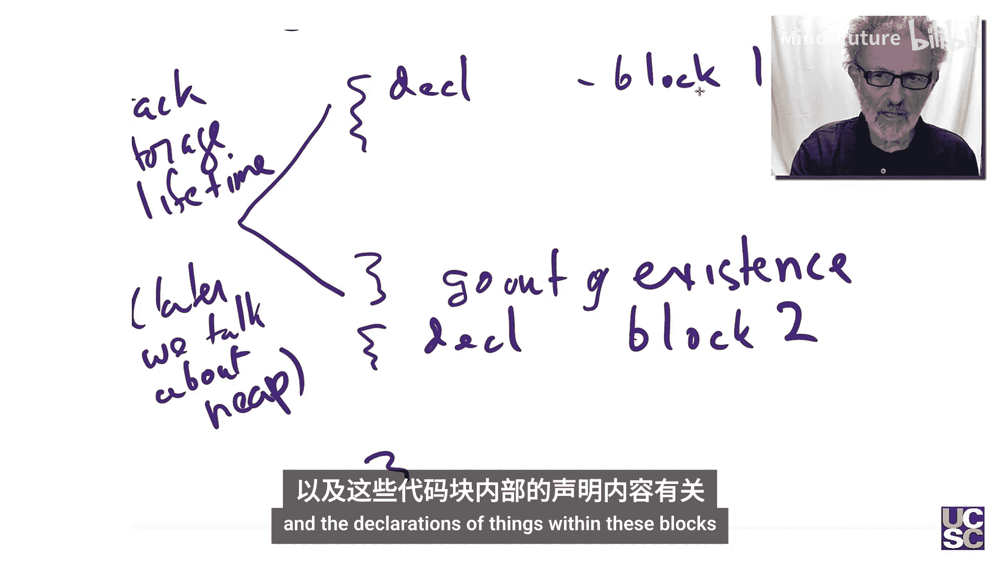

# 038：函数定义和作用域规则


## 概述
在本节课中，我们将要学习C语言中的作用域规则。作用域规则决定了程序中变量和函数的标识符在何处可以被访问，以及它们的生命周期。理解这些规则对于编写结构清晰、资源高效的程序至关重要。

## 作用域规则简介
上一节我们介绍了函数的基本概念，本节中我们来看看作用域规则。作用域规则涉及声明，这些声明通常出现在代码块的头部。代码块可以有不同的结构，例如嵌套的代码块和并行的代码块。

## 简单代码块的作用域
以下是简单代码块中变量作用域的例子。

```c
int main(void) {
    int i = 5; // 变量i的声明和初始化
    // 变量i的生命周期从此处开始，在整个main函数块内可用
    {
        int j = i + 2; // 变量j的声明和初始化
        // 在此内层块中，可以同时访问i和j
        printf("i = %d, j = %d\n", i, j); // 输出：i = 5, j = 7
    }
    // 退出内层块后，变量j的生命周期结束，不再存在
    printf("i = %d\n", i); // 输出：i = 5
    // printf("j = %d\n", j); // 如果尝试访问j，会导致语法错误
    return 0;
}
```
对于简单变量，这种生命周期管理可能不关键。但对于涉及大量存储的变量（如大型数组），这会影响内存资源的使用效率，在大型程序中变得非常重要。

## 嵌套代码块与名称隐藏
更复杂的情况是嵌套代码块中同名变量的声明。

```c
int main(void) {
    int i = 5; // 外层块变量i_outer
    {
        int i = 3; // 内层块变量i_inner
        // 内层声明会隐藏外层同名变量
        printf("inner i = %d\n", i); // 输出：inner i = 3
        // 此处无法直接访问外层变量i（值为5）
    }
    // 退出内层块后，内层变量i消失，外层变量i恢复可见
    printf("outer i = %d\n", i); // 输出：outer i = 5
    return 0;
}
```
当重用名称时，程序会优先使用最局部（即最内层）代码块中的标识符。在C语言中，一旦内层块隐藏了外层变量，就无法在内层块中直接访问被隐藏的外层变量（C++提供了相关机制，但C语言没有）。

## 并行代码块的作用域
我们还有一种结构是并行的代码块。

```c
int main(void) {
    // 块1
    {
        int a = 10;
        // 变量a的生命周期仅限于此块内
    }
    // 块2
    {
        int a = 20; // 这是一个全新的变量，与块1中的a无关
        // 变量a的生命周期仅限于此块内
    }
    return 0;
}
```
在并行块中，每个块内的变量拥有各自独立的生命周期。块1中变量的生命周期从其声明处开始，到块1结束时终止。块2中的变量则拥有另一段完全独立的生命周期。

## 函数调用与作用域
函数调用时也会创建独立的作用域。

```c
void myFunction() {
    int localVar = 100; // 局部变量
    // localVar的生命周期仅存在于函数myFunction执行期间
}

int main(void) {
    myFunction();
    // printf("%d\n", localVar); // 错误：此处无法访问myFunction的局部变量
    return 0;
}
```
当函数被调用时，其内部声明的变量被放置在称为“栈”的内存区域中。编译器通过栈来管理这些变量的存储空间。目前我们所见的所有变量存储管理都与代码块及其内部的声明相关。后续课程中，我们将看到另一种基于“堆”的存储管理方式。




## 总结
本节课中我们一起学习了C语言的作用域规则。我们了解到：
1.  变量的可访问性（作用域）和存在时间（生命周期）由其声明所在的代码块决定。
2.  内层代码块可以声明与外层同名的变量，此时会隐藏外层变量。
3.  并行代码块中的变量互不影响，拥有各自独立的作用域。
4.  函数内部声明的变量是局部的，其生命周期仅限于函数执行期间。
理解这些规则有助于我们更好地组织代码，有效管理程序的内存使用。