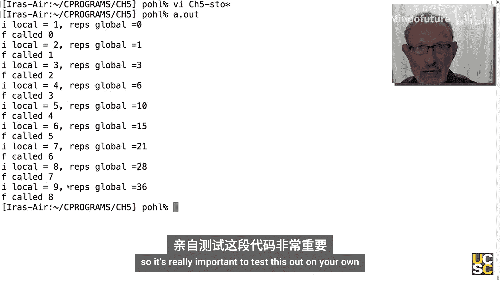

# 039：存储类代码示例


在本节课中，我们将通过一个具体的代码示例来探索C语言中不同存储类的概念。我们将学习`extern`、`static`、`auto`和`const`关键字如何影响变量的生命周期和作用域。

## 概述

上一节我们介绍了存储类的基本概念。本节中，我们来看看一个具体的代码示例，它演示了`extern`、`static`、`auto`和`const`这些关键字的实际用法。这个示例本身可能没有直接的实用价值，但它是一个很好的工具，可以帮助我们理解不同存储类的语义和行为。

## 代码解析

以下是示例代码的核心部分，我们将逐一分析。

### 全局变量与 `extern`

首先，我们声明了一个全局变量`rips`，并使用`extern`关键字。`extern`意味着这个变量在整个程序执行期间都存在，并且可以被任何函数访问。

```c
extern int rips = 0;
```

实际上，这里直接使用`int rips = 0;`效果是相同的。`extern`明确表示这是一个全局变量。

### 静态局部变量 `static`

接下来，在函数`f`内部，我们定义了一个静态局部变量`called`。

```c
static int called = 0;
```

`static`关键字意味着这个变量在函数第一次被调用时初始化为0。之后每次调用该函数，`called`的值都会保留上一次退出时的状态，而不是重新初始化为0。在函数中，我们执行`called++`，因此每次调用，`called`的值都会递增。

### 自动变量 `auto`

在`main`函数中，我们使用`auto`关键字声明了变量`i`。

```c
auto int i = 1;
```

`auto`是默认的存储类，通常可以省略。它表示变量`i`是自动的，即进入`main`函数时被创建在栈上，并在退出时销毁。

### 常量限定符 `const`

同时，我们使用`const`声明了一个常量`MAX`。

```c
const int MAX = 10;
```

`const`不是一个存储类，而是一个类型限定符。它表示`MAX`的值在初始化后不能被改变。这是现代C和C++中用于增强类型安全的一个特性。

## 程序执行流程

现在，让我们看看`main`函数中的逻辑。

1.  `i`被初始化为1。
2.  循环条件`i < MAX`意味着`i`将从1递增到9。
3.  在循环体内：
    *   打印当前的`i`和全局变量`rips`的值。
    *   调用函数`f`。
    *   函数`f`会更新静态变量`called`，并修改全局变量`rips`（`rips += called`）。
4.  每次循环，`i`递增，`rips`的值根据`called`的累计值增加。

以下是程序执行时变量变化的逻辑推演：

*   第一次循环：`i=1`，`rips`初始为0。调用`f`，`called`从0变为1，`rips`变为`0+1=1`。
*   第二次循环：`i=2`，`rips=1`。调用`f`，`called`从1变为2，`rips`变为`1+2=3`。
*   第三次循环：`i=3`，`rips=3`。调用`f`，`called`从2变为3，`rips`变为`3+3=6`。
*   依此类推，最终当`i=9`时，循环结束。函数`f`总共被调用了9次。

## 理解与练习

这个示例的变量交互看起来可能有些复杂。如果感到困惑，最好的方法是亲自动手实践。

以下是帮助你深入理解的一些建议：

*   将这段代码复制到你的编译环境中并运行它，观察输出结果。
*   尝试修改代码，例如增加新的函数，在其中使用不同的存储类。
*   通过打印语句跟踪每个关键变量（`rips`， `called`， `i`）在每次函数调用和循环迭代时的值。

通过这样的练习，你可以巩固对以下概念的理解：
*   **全局变量** (`extern`)：整个程序生命周期可见。
*   **静态局部变量** (`static`)：函数内持久存在，保持上次调用的值。
*   **自动变量** (`auto`)：默认，在代码块内创建和销毁。
*   **常量** (`const`)：值不可变。

## 总结




本节课中我们一起学习了C语言存储类的一个综合代码示例。我们看到了`extern`如何定义全局变量，`static`如何让局部变量在函数调用间保持状态，`auto`作为默认存储类的含义，以及`const`用于定义常量。虽然这个示例本身较为特殊，但它是理解变量作用域和生命周期的绝佳练习。掌握这些概念对于编写结构清晰、可维护的C语言程序至关重要。