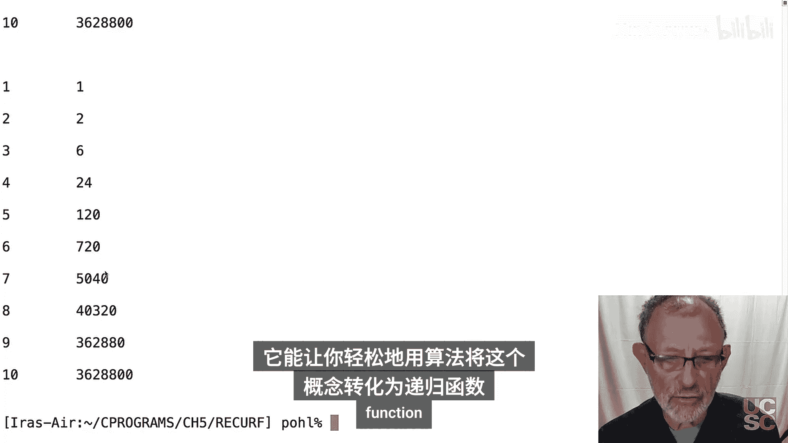

# 041：递归与迭代实现阶乘


在本节课中，我们将学习如何使用两种不同的编程范式——迭代和递归——来实现阶乘计算。我们将通过具体的代码示例来对比这两种方法，并理解它们各自的实现逻辑。

---

## 递归的基本思想

上一节我们介绍了递归的简单概念。递归可以替代迭代来解决问题。有时你可能更倾向于使用其中一种方案，但了解如何运用两种方案都很重要。

## 阶乘的数学定义

现在，我们将展示两种方案来计算阶乘。阶乘是一个数学量，用于生成特别大的数字。它的定义是：`1 * 2 * 3 * 4 * ... * n`。这个数字会变得非常大。

因此，我们将使用 `long int` 类型。如果使用更短的类型，我们无法计算较大的阶乘。实际上，`long` 类型通常只允许计算到 20 的阶乘。超过 20 会发生整数溢出，导致结果不正确，因为在大多数机器上，`long` 类型只有 8 字节（64 位）可用。对于整数类型，只能表示到 20 的阶乘。

## 迭代实现阶乘

首先，我们来看一个应该很熟悉的方法：迭代实现阶乘。我们将答案累积在变量 `long f = 1` 中。

以下是迭代的标准结构：从 `f = 1` 开始，`i` 从 1 递增到 `n`，在每次迭代中累积 `f`，通过将 `f` 乘以 `i`。迭代结束后，你将得到 `1 * 2 * 3 * ... * n` 的结果，即阶乘的定义，然后返回 `f`。这个迭代过程应该很直接，对你来说应该没有问题。

**迭代阶乘的代码示例：**
```c
long factorial_iterative(int n) {
    long f = 1;
    for (int i = 1; i <= n; i++) {
        f = f * i;
    }
    return f;
}
```

## 递归实现阶乘

现在，让我们看看递归版本。这有点新颖。我们称之为递归阶乘。

同样，它返回 `long` 类型。`n` 不需要是 `long` 类型，因为我们实际上无法计算非常大的数字。我们首先检查基本情况：当 `n == 1` 时，根据定义，阶乘就是 1，所以我们返回 1。

如果不是基本情况，我们就进行递归。这类似于我们的倒计时程序，但这里我们计算的是 `n` 乘以一个较小值的递归阶乘。这是归纳情况的一般形式：`n * factorial_recursive(n-1)`。

你需要说服自己，这能给出与迭代完全相同的结果。

**递归阶乘的代码示例：**
```c
long factorial_recursive(int n) {
    if (n == 1) {
        return 1; // 基本情况
    } else {
        return n * factorial_recursive(n - 1); // 递归情况
    }
}
```

## 对比两种实现

我在这里进行了对比。我让用户输入一个数字，然后先迭代计算，再递归计算，以展示我们会得到相同的结果。

我已经编译了这个程序，让我们运行它。我们先试一个小数字。例如，1 的阶乘是 1，2 的阶乘是 2（1*2=2），3 的阶乘是 6。递归版本也得到相同的结果。

我们再试一个稍大的数字，比如 10。这时数字开始变大。你可以看到，因为屏幕宽度不够，递归版本和迭代版本的最终结果（10 的阶乘）是相同的。你可以看到数字如何增长，例如乘以 10 后，结果是前一个结果的 10 倍。就像 3 的阶乘是 6，4 的阶乘是 24（4*6），5 的阶乘是 120（5*24），依此类推。

这是一个非常标准的数学例子。如果你看到一个数学表达式，经常会看到这类函数以归纳或递归的方式定义。因此，这有一个自然的映射，让你可以轻松地、算法化地将这个想法转录成递归代码。

---

## 总结



本节课中，我们一起学习了如何使用迭代和递归两种方法来实现阶乘计算。我们理解了阶乘的数学定义，并通过代码示例对比了两种实现方式的逻辑。递归方法通过定义基本情况和递归情况，优雅地映射了数学归纳定义，而迭代方法则通过循环累积结果。两种方法都能正确计算阶乘，但在不同场景下各有优势。