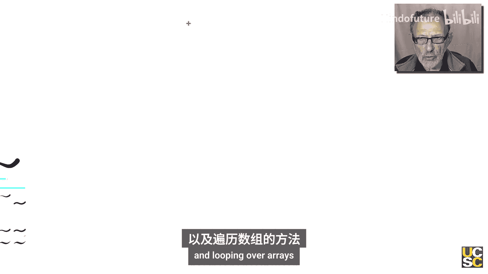
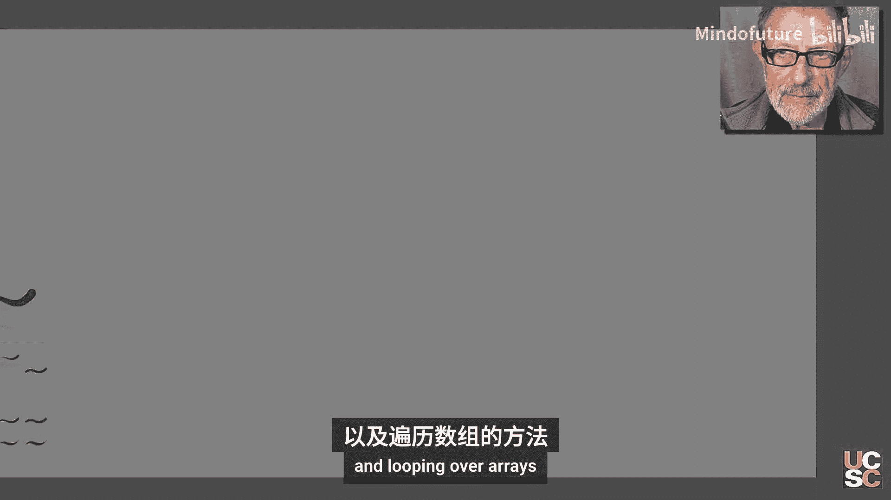

# 044：初始化数组

## 概述
在本节课中，我们将要学习C语言中数组的初始化方法，并重点探讨字符串的概念及其内部表示。字符串在C语言中并非独立的数据类型，而是字符数组，理解其初始化方式对于后续的编程实践至关重要。

## 数组初始化基础
上一节我们介绍了数组的基本概念，本节中我们来看看如何为数组赋予初始值。当我们声明一个简单变量时，可以在声明时使用等号进行初始化。然而，数组是一组通过索引访问的变量集合，其初始化方式有所不同。

以下是数组初始化的几种方法：
*   完整列表初始化：声明数组时，可以使用花括号 `{}` 包含一个逗号分隔的值列表进行初始化。例如 `int data[5] = {1, 2, 3, 4, 5};`，这将使 `data[0]` 为1，`data[1]` 为2，依此类推。
*   部分初始化与自动补零：如果初始化列表中的值少于数组元素个数，剩余的元素会被自动初始化为0。例如 `int data[5] = {1, 2};`，则 `data[0]` 为1，`data[1]` 为2，`data[2]` 到 `data[4]` 均为0。
*   缩写初始化：若希望数组所有元素初始化为同一个值（如0），可以简写为 `int data[5] = {0};`。
*   自动确定数组大小：声明数组时可以省略大小，编译器会根据初始化列表自动确定。例如 `int data[] = {1, 2, 3};` 等价于 `int data[3] = {1, 2, 3};`。

## 深入理解字符串
了解了普通数组的初始化后，我们聚焦于一个特殊的字符数组——字符串。字符串在C语言中是以空字符（`\0`）结尾的字符数组。

字符串的内部表示是一个连续的字符序列，以空字符作为结束标志。例如，字符串常量 `"AB"` 在内存中的实际表示是三个字符：`'A'`、`'B'`、`'\0'`。

这里需要注意字符 `'0'` 和空字符 `'\0'` 的区别：
*   `'0'`：这是一个字符，其ASCII码值为48。
*   `'\0'`：这是一个空字符（null character），其ASCII码值为0，用于标记字符串的结束。它也可以写作 `0`（不带引号）。

## 字符串初始化示例
让我们通过一个具体例子来巩固对字符串初始化的理解。考虑以下声明：
`char str[] = "A B C";`

这个声明等价于以下字符数组初始化：
`char str[6] = {'A', ' ', 'B', ' ', 'C', '\0'};`

以下是该字符串数组 `str` 在内存中的内容：
*   `str[0]`：字符 `'A'`
*   `str[1]`：空格字符（ASCII码32）
*   `str[2]`：字符 `'B'`
*   `str[3]`：空格字符
*   `str[4]`：字符 `'C'`
*   `str[5]`：空字符 `'\0'`（哨兵字符）

这个空字符被称为“哨兵”（sentinel）或“守卫”（guard），因为在对字符串进行循环处理（如计算长度、复制）时，程序通过检测这个字符来判断字符串是否结束。

## 总结
本节课中我们一起学习了C语言数组的初始化方法，包括完整列表、部分初始化及自动确定大小等技巧。我们深入探讨了字符串的本质——以空字符 `\0` 结尾的字符数组，并通过实例分析了字符串常量在内存中的实际存储形式。理解这些概念是后续进行字符串操作和更复杂数组处理的基础。