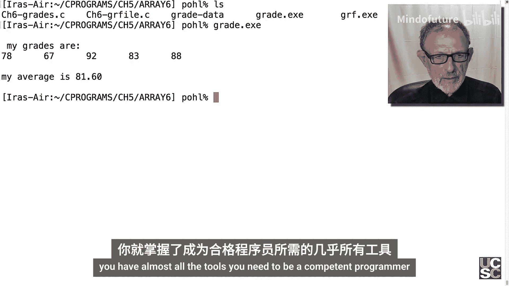

# 045：数组 - 成绩代码示例

在本节课中，我们将学习如何使用一维数组来处理数据。我们将通过一个具体的代码示例来演示如何计算一组学生成绩的平均分。这个示例将展示数组的声明、初始化、遍历以及基本运算。


## 概述

上一节我们介绍了数组的基本概念。本节中，我们来看看如何将数组应用于实际编程任务。我们将分析一段代码，它接收一系列成绩数据，计算其平均值，并输出结果。这段代码的核心思想可以扩展到处理任意大小的数据集合。

## 代码解析与教程

### 1. 定义数组大小与初始化

首先，我们需要确定数组的大小。在C语言中，以这种方式声明的数组会使用栈内存，因此其大小必须是一个常量。

以下是定义数组并初始化的步骤：

*   `const int SIZE = 5;`：定义一个常量`SIZE`来表示数组的大小。
*   `int grades[SIZE] = {78, 67, 92, 83, 88};`：声明一个名为`grades`的整型数组，并用花括号内的值进行初始化。数组索引从`grades[0]`开始，到`grades[SIZE-1]`结束。
*   如果初始化时提供的值少于数组大小（例如只列出3个），则剩余的元素会被自动初始化为0。

### 2. 声明求和变量

为了计算平均值，我们需要一个变量来累加所有成绩的总和。我们希望平均值是浮点数，以避免整数除法导致的截断误差，因此求和变量应声明为`double`类型。

`double sum = 0.0;`

### 3. 使用循环遍历数组

遍历数组是处理集合数据的核心操作。我们使用一个`for`循环来依次访问数组中的每个元素。

以下是循环结构的解析：

*   `for (int i = 0; i < SIZE; ++i)`：这是一个标准的迭代循环。变量`i`通常用作循环索引。
    *   `int i = 0`：从数组的第一个元素（索引0）开始。
    *   `i < SIZE`：循环条件，只要`i`小于数组大小就继续执行。
    *   `++i`：每次循环后，索引`i`自动加1，指向下一个元素。
*   循环体内部可以执行各种操作。在本例中，我们首先打印每个成绩。

`printf(“%d\t”, grades[i]);`

### 4. 计算总和与平均值

在遍历数组的过程中，我们可以同时累加成绩来计算总和。完成遍历后，用总和除以元素个数即可得到平均值。

计算过程的代码如下：

```
// 在循环体内累加成绩
sum += grades[i]; // 等价于 sum = sum + grades[i];

// 循环结束后计算平均值
double average = sum / SIZE;
```

这个程序的核心逻辑（声明、遍历、计算）可以应用于任意大小的数组，只要我们有相应的数据。

### 5. 程序运行与输出

我们已经编译并运行了该程序。对于给定的成绩数据 `{78, 67, 92, 83, 88}`，程序输出各成绩并用制表符分隔，然后输出计算出的平均分。

运行结果示例：
`78 67 92 83 88`
`Average: 81.6`

## 总结



本节课中我们一起学习了如何运用一维数组解决实际问题。我们分析了计算成绩平均分的完整代码，涵盖了数组的常量大小定义、初始化、使用`for`循环遍历、数据累加以及最终的平均值计算。理解并能够修改此类程序，意味着你已经掌握了使用数组处理聚合数据的关键技能，这是成为合格程序员的重要一步。