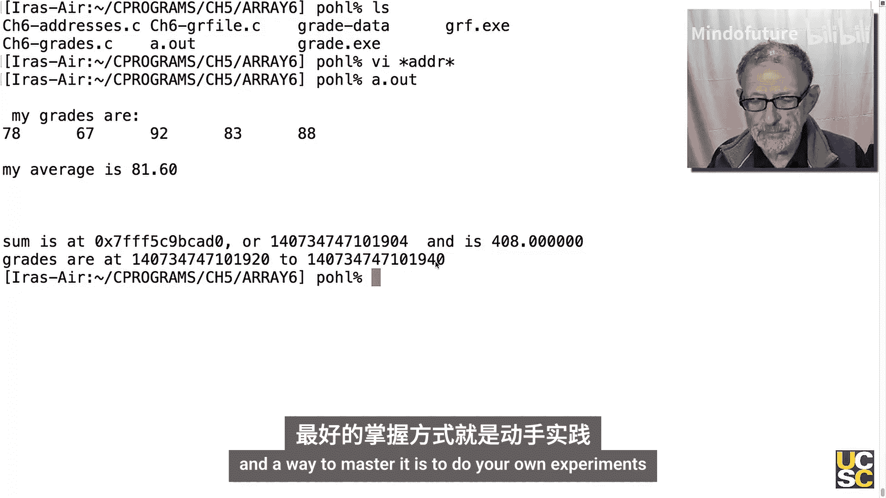

# 047：指针、数组与地址代码示例


在本节课中，我们将通过一个具体的代码示例，深入理解指针、数组和内存地址之间的关系。我们将学习如何声明指针、获取变量的地址、解引用指针，并观察变量在内存中的布局。

上一节我们介绍了指针的基本概念，本节中我们来看看一个结合了数组和指针的实际代码示例。

## 代码示例：计算成绩总和与平均值

以下程序首先计算一个成绩数组的总和与平均值，然后打印出相关变量和数组在内存中的地址信息。

```c
#include <stdio.h>

int main() {
    int grades[] = {78, 67, 92, 83, 88};
    double sum = 0.0;
    double *ptr_to_sum = ∑
    int i;

    printf("成绩为：\n");
    for (i = 0; i < 5; i++) {
        printf("%d\t", grades[i]);
        sum += grades[i];
    }
    printf("\n");
    printf("平均成绩为：%.2f\n\n", sum / 5);

    printf("sum变量的地址是：%p\n", &sum);
    printf("sum变量的地址（长整型无符号数）是：%lu\n", (unsigned long)&sum);
    printf("sum的值是：%f\n", sum);
    printf("\n");

    printf("ptr_to_sum存储的地址是：%p\n", ptr_to_sum);
    printf("ptr_to_sum存储的地址（长整型无符号数）是：%lu\n", (unsigned long)ptr_to_sum);
    printf("ptr_to_sum指向的值是：%f\n\n", *ptr_to_sum);

    printf("grades数组的起始地址是：%lu\n", (unsigned long)grades);
    printf("grades数组第五个元素的地址是：%lu\n", (unsigned long)&grades[4]);
    printf("grades数组占用的内存范围是：%lu 到 %lu\n", (unsigned long)grades, (unsigned long)(grades + 5));

    return 0;
}
```

## 代码解析与核心概念

以下是程序关键部分的详细解释：

### 1. 指针声明与初始化
`double *ptr_to_sum = ∑` 这行代码声明了一个指向 `double` 类型变量的指针，并用 `sum` 变量的地址对其进行了初始化。`&` 是取地址运算符。

### 2. 指针的解引用
`*ptr_to_sum` 表示对指针 `ptr_to_sum` 进行解引用，即获取该指针所指向内存地址中存储的值。在这个例子中，它等同于变量 `sum` 的值。

### 3. 地址的打印格式
*   `%p`：用于以十六进制格式打印指针（内存地址）。
*   `%lu`：用于以长整型无符号十进制数格式打印地址，便于我们直观地比较地址数值。

### 4. 数组的内存布局
程序最后打印了数组的起始地址和最后一个元素的地址。由于每个 `int` 类型通常占用4个字节，一个有5个元素的数组会占用20个连续字节的内存空间。因此，`&grades[4]` 的地址值会比 `grades` 的地址值大20。

## 程序输出与内存分析

运行上述程序，你可能会看到类似以下的输出（具体地址值因系统和编译器而异）：

```
成绩为：
78      67      92      83      88
平均成绩为：81.60

sum变量的地址是：0x7ffee3a5b904
sum变量的地址（长整型无符号数）是：140732796753156
sum的值是：408.000000

ptr_to_sum存储的地址是：0x7ffee3a5b904
ptr_to_sum存储的地址（长整型无符号数）是：140732796753156
ptr_to_sum指向的值是：408.000000

grades数组的起始地址是：140732796753168
grades数组第五个元素的地址是：140732796753188
grades数组占用的内存范围是：140732796753168 到 140732796753188
```

从输出中我们可以观察到：
1.  `ptr_to_sum` 中存储的地址与 `sum` 变量的地址完全相同。
2.  对 `ptr_to_sum` 解引用得到的值（408.0）正是所有成绩的总和，与变量 `sum` 的值一致。
3.  `grades` 数组的起始地址（140732796753168）与 `sum` 的地址（140732796753156）很接近，但不同，说明它们是内存中不同的变量。
4.  数组最后一个元素的地址（140732796753188）比起始地址大20，印证了数组在内存中是连续存储的，每个 `int` 元素占4个字节。

## 总结




本节课中我们一起学习了如何通过代码探索指针、数组和内存地址。我们实践了指针的声明、初始化与解引用操作，并使用 `%p` 和 `%lu` 格式说明符查看了变量的内存地址。通过比较数组元素的地址，我们直观地理解了数组在内存中的连续存储特性。虽然这些底层细节初看起来可能很复杂，但通过亲手编写和修改这样的示例代码，是掌握C语言内存管理概念的有效方法。理解这些原理对于深入学习C语言乃至C++至关重要。