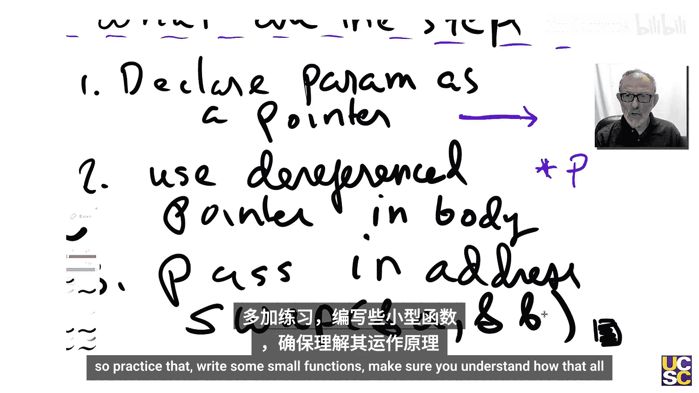
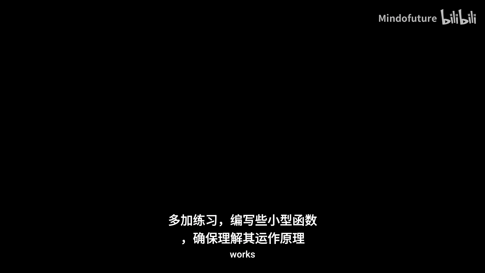

# 048：模拟按引用调用


在本节课中，我们将要学习C语言中一个至关重要的概念：如何模拟“按引用调用”。理解这个概念需要你建立对计算机内存、地址和指针的抽象模型。

## 概述

C语言默认使用“按值调用”来传递函数参数。这意味着传递给函数的只是变量值的副本，函数内部对参数的修改不会影响函数外部的原始变量。然而，许多编程任务需要函数能够直接修改调用者环境中的变量值。C语言通过传递变量的地址（即指针）来模拟“按引用调用”，从而实现这一功能。本节课我们将深入探讨其原理与实现方法。

## 按值调用回顾

上一节我们介绍了按值调用的基本概念。在按值调用中，函数接收的是实际参数值的副本。

*   **过程**：调用函数时，实参的值被复制到形参对应的内存位置。
*   **结果**：函数内部对形参的任何操作都只作用于这个副本。当函数执行完毕，原始的实参变量保持不变。

其核心行为可以概括为：**函数内部操作的是局部副本，不影响外部原始数据。**

## 模拟按引用调用的原理

既然按值调用无法修改外部变量，那么如何实现修改呢？本节中我们来看看C语言的解决方案：传递地址。

C语言允许我们通过传递变量的内存地址来模拟按引用调用。这涉及到两个关键操作符：

1.  **取地址操作符 `&`**：用于获取一个变量的内存地址。
    *   代码示例：`&variable`
2.  **解引用操作符 `*`**：用于访问指针所指向地址中存储的值。
    *   代码示例：`*pointer`

一个常见的应用就是 `scanf` 函数。当我们写 `scanf(“%d”, &size);` 时，就是将变量 `size` 的地址传递给 `scanf`。`scanf` 函数通过这个地址，直接向 `size` 所在的内存位置写入新的整数值，从而改变了调用环境中的 `size` 变量。

**核心机制**：我们传递一个地址（而非值）给函数。函数通过解引用这个地址，直接读写原始变量所在的内存位置。

## 实践：编写交换函数

为了具体理解，让我们尝试编写一个交换两个整数值的函数 `swap`。

### 错误的按值调用实现

首先，我们看看如果使用按值调用会发生什么。

```c
void swap(int i, int j) {
    int temp = i;
    i = j;
    j = temp;
}
```

以下是这个函数内部发生的过程：
*   函数接收 `i` 和 `j` 的**值副本**。
*   在函数内部，`i` 和 `j` 的副本成功地交换了值。
*   但是，当函数结束时，这些局部副本被销毁。调用时使用的原始变量（例如 `a` 和 `b`）完全没有被触及，它们的值保持不变。

因此，这个版本的 `swap` **无法工作**。

### 正确的模拟按引用调用实现

要使 `swap` 函数真正生效，我们需要传递变量的地址，并在函数内部通过指针来操作。

```c
void swap(int *i, int *j) {
    int temp = *i;
    *i = *j;
    *j = temp;
}
```

以下是这个正确版本的分析：
*   **参数声明**：`int *i, int *j` 声明 `i` 和 `j` 为指向整数的指针。
*   **函数内部操作**：
    *   `int temp = *i;`：解引用指针 `i`，获取其指向地址中的值，存入 `temp`。
    *   `*i = *j;`：解引用指针 `j`，获取其值，并赋值给 `i` 所指向的地址。
    *   `*j = temp;`：将 `temp` 的值赋值给 `j` 所指向的地址。
*   **函数调用**：调用时必须传入变量的地址：`swap(&a, &b);`。

这个版本是C语言中实现“按引用调用”功能的典范。如果你理解了这个函数，就掌握了在C语言中编写此类函数的关键。

## 实现步骤总结

本节课中我们一起学习了在C语言中模拟按引用调用的完整流程。让我们总结一下必要的步骤：

1.  **函数声明**：将函数的形参声明为指针类型（例如 `int *ptr`）。
2.  **函数体操作**：在函数内部，使用解引用操作符 `*` 来访问或修改指针所指向的值。
3.  **函数调用**：调用函数时，使用取地址操作符 `&` 传递你想要修改的变量的地址。

遵循以上三步，你就能写出可以改变调用者环境中变量值的函数。

## 总结





本节课我们深入探讨了C语言中“按引用调用”的模拟机制。我们首先回顾了“按值调用”的局限性，然后引入了通过指针和地址操作来模拟“按引用调用”的核心思想。通过分析一个失败的 `swap` 函数和一个成功的 `swap` 函数，我们清晰地对比了两种传递方式的区别。最后，我们总结了实现模拟按引用调用的三个关键步骤。理解并掌握这一机制，对于编写高效、灵活的C程序至关重要。建议你通过编写一些简单的函数来练习，以确保完全理解这个过程。