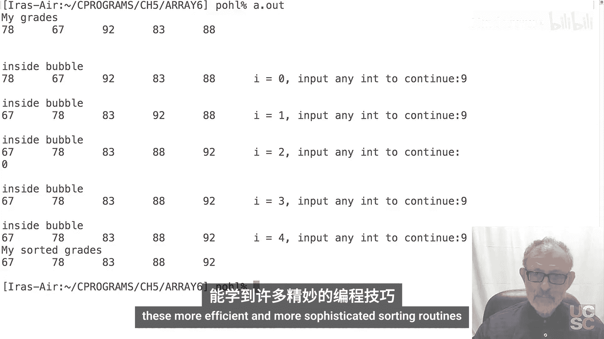

# 050：数组与冒泡排序


## 概述
在本节课中，我们将学习一个非常重要的编程主题：排序算法。我们将重点介绍一种名为“冒泡排序”的简单排序算法。虽然冒泡排序对于小型数组完全适用，但对于大型数组则被认为效率较低。排序是计算机科学中最核心的功能之一，因为大量数据（例如大城市电话簿中的数百万条记录）需要被组织，以便高效地搜索和查找信息。

## 排序的重要性
排序之所以关键，是因为它使数据搜索变得高效。试想一个包含数百万条无序电话号码的列表，要找到特定号码可能需要检查数百万次。然而，如果数据已排序，则可以使用对数时间（例如二分查找）快速定位信息，可能只需十几次查找。因此，排序和搜索是计算机科学中被深入研究的领域，甚至有一本名为《排序与搜索》的专著专门探讨这些技术。

## 核心概念：交换（Swap）
冒泡排序的核心操作是交换两个顺序错误的元素。我们将使用一个 `swap` 函数来实现这一点。该函数利用指针参数来模拟“按引用调用”，从而能够实际交换两个变量的值。

**代码示例：交换函数**
```c
void swap(int *a, int *b) {
    int temp = *a;
    *a = *b;
    *b = temp;
}
```

## 打印数组
在排序过程中，我们需要观察数组的变化。因此，我们编写一个函数来打印数组。该函数接收一个数组指针、数组元素数量以及一个标题字符串作为参数。

**代码示例：打印数组函数**
```c
void printArray(int arr[], int n, char *str) {
    printf("%s", str);
    for (int i = 0; i < n; i++) {
        printf("\t%d", arr[i]);
    }
    printf("\n");
}
```

## 冒泡排序算法详解
上一节我们介绍了交换和打印数组的基础操作，本节中我们来看看冒泡排序算法本身的具体实现。

冒泡排序使用双重循环。外层循环控制排序的“轮次”，每一轮会将当前未排序部分的最大元素“冒泡”到正确位置（数组右侧）。内层循环则负责在每一轮中进行相邻元素的比较和交换。

**代码示例：冒泡排序函数**
```c
void bubbleSort(int arr[], int n) {
    int i, j;
    int go; // 用于控制程序暂停的变量
    for (i = 0; i < n; i++) {
        // 打印每一轮开始前的数组状态
        printArray(arr, n, "Inside bubble: ");
        printf("Enter an integer to continue: ");
        scanf("%d", &go); // 暂停，等待用户输入以继续

        // 内层循环：进行相邻元素比较和交换
        for (j = n-1; j > i; j--) {
            if (arr[j] < arr[j-1]) { // 如果顺序错误
                swap(&arr[j], &arr[j-1]); // 交换它们
            }
        }
    }
}
```

## 算法执行流程与效率分析
让我们通过一个具体例子来观察冒泡排序的执行过程。假设初始数组为 `[78, 67, 92, 83, 88]`。

以下是排序过程中数组状态的变化步骤：

1.  **第一轮（i=0）**：内层循环从右向左扫描。
    *   比较88和83：顺序正确，不交换。
    *   比较83和92：顺序错误，交换。数组变为 `[78, 67, 83, 92, 88]`。
    *   比较83和67：顺序正确，不交换。
    *   比较67和78：顺序错误，交换。数组变为 `[67, 78, 83, 92, 88]`。
    *   本轮结束后，最小值67被“冒泡”到最左端。

2.  **后续轮次**：每一轮都会将剩余未排序部分的最小元素移动到其正确位置。
    *   第二轮将78移动到位置1。
    *   第三轮将83移动到位置2。
    *   第四轮将88移动到位置3。
    *   第五轮后，92自然在位置4。

最终排序结果为 `[67, 78, 83, 88, 92]`。

**冒泡排序的缺点**：即使数组在中间某轮已经完全有序，算法仍然会继续执行完所有的外层循环，因为它无法提前“知道”数组已排序。这导致了不必要的比较。一种改进方法是设置一个标志位（flag），如果某一轮内没有发生任何交换，则提前终止算法，因为这表明数组已经有序。

## 主函数示例
最后，我们来看一个完整的主函数示例，它演示了如何调用上述函数。

**代码示例：主函数**
```c
int main() {
    int grades[] = {78, 67, 92, 83, 88};
    int n = sizeof(grades) / sizeof(grades[0]);

    printf("Original grades:\n");
    printArray(grades, n, "");

    bubbleSort(grades, n);

    printf("\nSorted grades:\n");
    printArray(grades, n, "");

    return 0;
}
```



## 总结
本节课中我们一起学习了冒泡排序算法。我们了解了排序在数据处理中的重要性，掌握了通过 `swap` 函数交换元素、使用 `printArray` 函数观察数组状态的方法，并深入剖析了冒泡排序的双重循环逻辑及其执行过程。虽然冒泡排序易于理解和实现，但其效率对于大型数据集来说较低。建议你尝试用随机数生成更大数组来测试其性能，并思考如何通过添加标志位来优化它。理解基础排序算法是学习更高效、更复杂算法（如快速排序、归并排序）的重要基石。