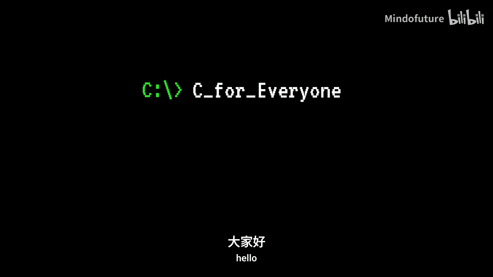
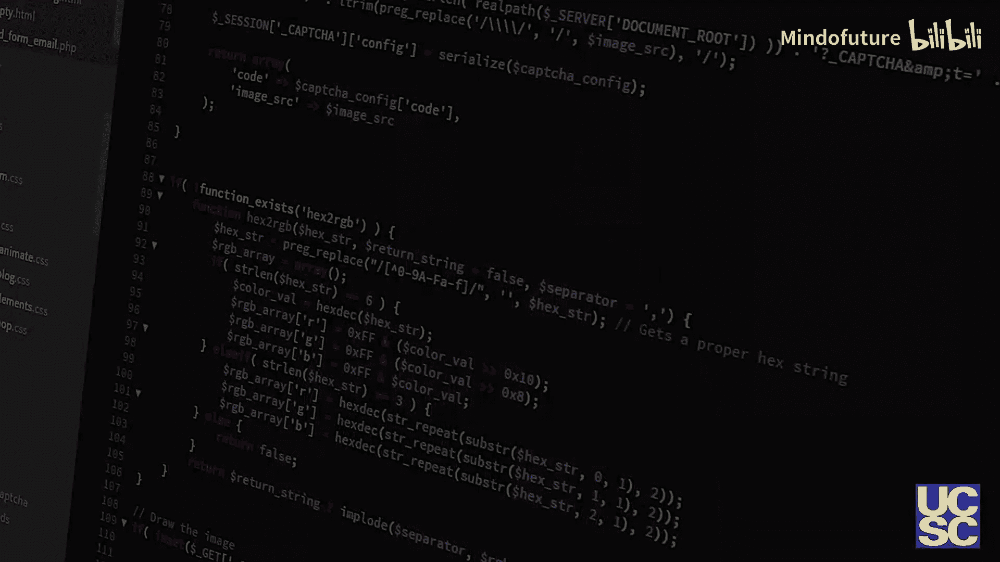

# 【加州大学】C语言编程基础-｜-C-For-Everyone-p01-P01_概述_01_01_01--BV1Fqe7zDEVT_p1-

🎼Yeah。

🎼，🎼The。🎼。Hello， I'm Professor Ia Pole from the Baskin School of Engineering at the University of California。

 Santa Cruz。Something about this course interested you。 and now you're watching the first video。

Let me explain why you should keep going and what you're going to learn。First off， why code？

Coding is now a universal skill。 I think coding should be added to the curriculum。

 Even at the high school level， should go along with reading， writing and arithmetic。

This is the new world， in the new world， we want to understand how to properly express algorithms。

Algorithms that can run on a computer。 And this is absolutely a critical skill you're going to be using in the new world。

Why this course？Well， probably the best reason is I've designed this course for every one。

If you're an aspiring computer scientist， you will benefit。

 You'll get a rigorous introduction to concepts such as syntax and operator precedes。

 and then you'll be able to move on to something like more advanced programming。 Indeed， on Coursera。

 I already have a successful two parts C plus plus for C programmers course。😊，On the other hand。

 if you're another kind of scientist， a biologist or a chemist or an ecologist。

 then you want to be able to code all sorts of functions so that you can model scientific theories。

 again， crucial to pursuing any part of modern science。Finally， if you're a humanist。

 you're going to learn how algorithms work， and you're going to be able to do things like get the computer to write poetry。

😊，So this is for everyone。 everyone will have an opportunity to work on a problem that comes from a domain that motivates them and the essential skills such as understanding how to write a loop will be universally taught。

 but then you'll be able to practice in an environment in which you're comfortable in a problem solving environment appropriate to your background and your interests。

Okay， why the coding language C and not Java or Python or Pascal？There are many。

 many introductory courses for these other languages。 These other languages are in many ways。

 very suitable for teaching， beginning programming。

 There's nothing wrong with starting with another language or coming over from another language。

But even if you've had a start in Python or Java， you'll appreciate learning C。

C was invented by Dennis Ritchie at Bell Alps in 1972。

 and it's a tried and true language used throughout industry。

 It's what's called a systems implementation language， a C。With my approach to C。

 you're going to learn low level details。A lot of these other languages like Javava or Python。

 hide some of these details。Which partly makes it easier。

 But then if you want to move on and learn more or understand at a deeper level what is being done by the computer。

 you need to be able to program or code in a language like C。

 which is near the bare metal near the computer and gives you that level of understanding。Okay。

 then I think you're going to keep going with this course。

You'll have detailed video lectures in which I demonstrate the principles and procedures of C。

 You'll have segments from a book on C， which I wrote with Al Kelly。

 You'll be able to check your understanding with regular quiz questions。

 There are peer reviewed programming assignments where you can demonstrate your new skills and see what your fellow learners are doing。

🎼And I hope you'll be active in the discussion forums。 I'm looking forward to seeing what all of you。

 whether you had a lot of experience or none at all， will learn to do with see。😊。

