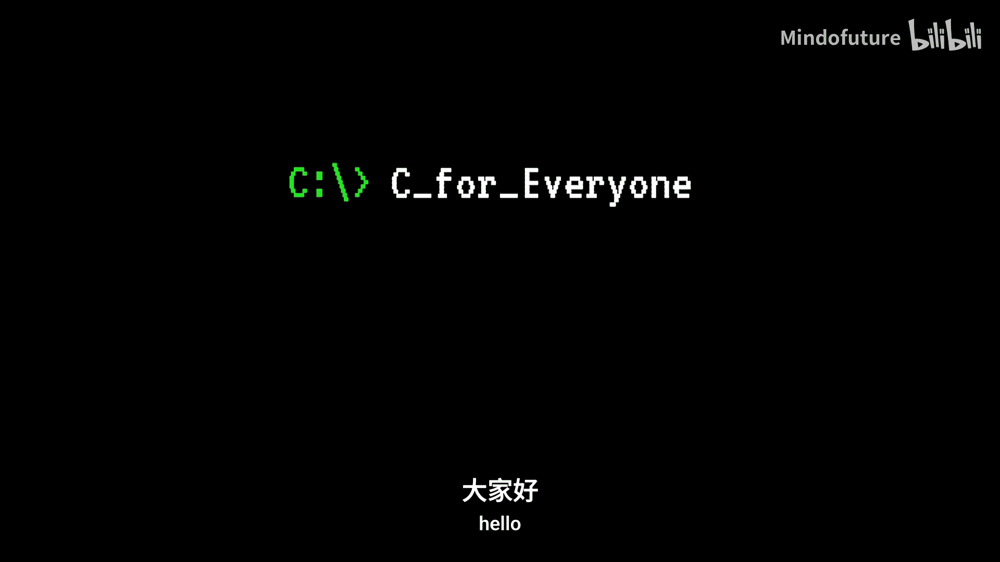
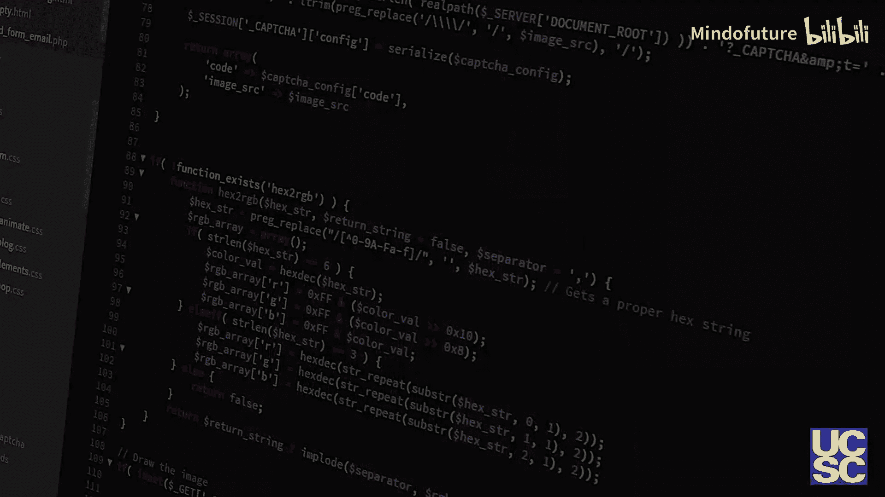

# C语言编程基础：P01：课程概述

## 概述

在本节课中，我们将要学习这门C语言入门课程的核心目标、适用人群以及选择C语言作为教学语言的原因。课程由加州大学圣克鲁兹分校工程学院的伊恩·波尔教授设计，旨在为所有人提供编程基础。

## 为什么学习编程？

编程已成为一项通用技能。编程应被纳入课程体系，与阅读、写作和算术并列。在新世界中，我们需要理解如何正确地表达能在计算机上运行的算法。这是一项至关重要的技能。

## 为什么选择这门课程？

这门课程专为所有人设计。无论你是计算机科学初学者、其他领域的科学家，还是人文学者，都能从中受益。

以下是不同背景学习者的收获：

*   **计算机科学初学者**：将获得关于语法、运算符优先级等概念的严谨介绍，为学习更高级的编程打下基础。
*   **其他领域科学家**：将能够编写各种函数来建模科学理论，这对从事现代科学研究至关重要。
*   **人文学者**：将学习算法的工作原理，并能够完成诸如让计算机创作诗歌等任务。

课程将教授循环编写等核心技能，同时允许学习者在适合其背景和兴趣的问题解决环境中进行实践。

## 为什么选择C语言？

市面上有许多针对Java、Python等语言的入门课程。这些语言在许多方面非常适合教学。从其他语言开始学习或转学过来并无不妥。

然而，即使你已经接触过Python或Java，学习C语言也大有裨益。C语言由丹尼斯·里奇于1972年在贝尔实验室发明，是一种久经考验、广泛应用于工业界的语言，被称为**系统实现语言**。

通过本课程学习C语言，你将了解底层细节。许多其他语言（如Java或Python）隐藏了部分细节，这在一定程度上降低了学习难度。但如果你想深入学习，或更深入地理解计算机的运行机制，就需要掌握像C这样**贴近硬件**的语言，它能提供更深层次的理解。

## 课程内容与形式

如果你决定继续学习这门课程，你将接触到以下内容：

*   **详细的视频讲座**：教授将演示C语言的原理和操作。
*   **教材节选**：来自教授与阿尔·凯利合著的C语言书籍。
*   **定期测验**：用于检验你的理解程度。
*   **同行评审的编程作业**：你可以在此展示新技能，并观摩其他学习者的成果。

此外，教授鼓励大家积极参与讨论论坛，期待看到所有学习者，无论经验丰富与否，都能用C语言创造出精彩内容。

## 总结

本节课我们一起学习了这门C语言课程的设计初衷、广泛适用性以及选择C语言教学的优势。课程旨在通过严谨的教学和丰富的实践，帮助不同背景的学习者掌握编程核心思想与C语言基础，为后续深入学习或应用打下坚实基础。