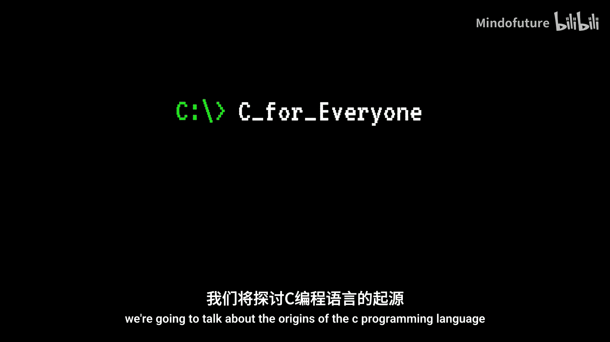

# 【加州大学】C语言编程基础-｜-C-For-Everyone-p02-P02_C语言的历史_01_01_02--BV1Fqe7zDEVT_p2-

🎼TheYeah。

We're going to talk about the origins of the C programming language。Language was invented by。

Dennis Richitchie。Dennis Ritchci invented it。1972。Its purpose was to write an operating system。

 the operating system became so famous。That we're still using it。It's called UniX。

And while it was researched。Which he conducted with Ken Thompson。

Because it was done at Belllaps at that time， it was released as。A free product。

So people who wanted to use an effective at the time。

Small time sharing system or a system that let you。Have multi users on a small computer。

 had many advantages， and it was just the era of the mini computer was just starting。

People who had very large computers， like millions of dollars of big hardware from IBM or buroughs。

This wasn't how they were going to use their computer typically。Instead。

 this was for computers just being developed。By places like Ewlett Packard and then digital equipment。

Later。The system becomes very important because it can also be used on。Small personal computers。

 and indeed， it's the basis of Linux and it's。The under the hood。Mechanism behind。

The Macintosh operating system。Very important， fact， so important of both。Ricitchie and Thompson。

Won the highest award。In。Computer science， which is called the Turing Award。

