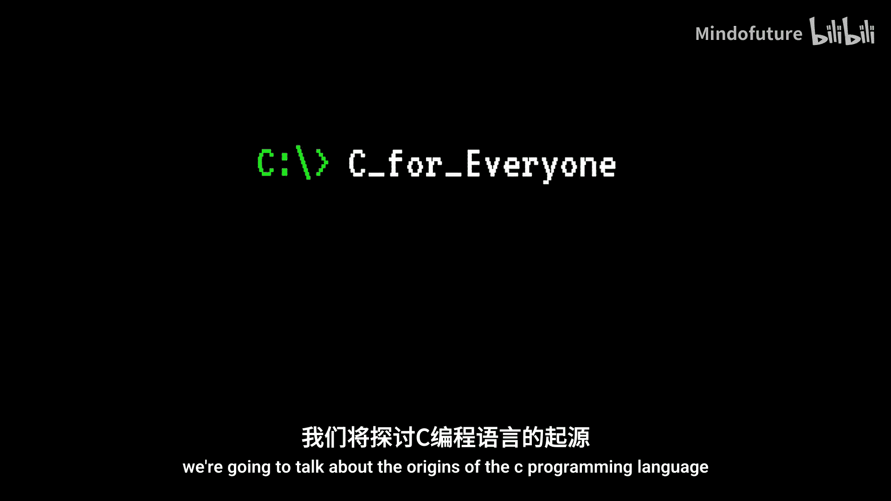

# C语言编程基础：P02：C语言的历史

在本节课中，我们将要学习C编程语言的起源和发展历程，了解它为何能成为现代计算机科学中如此重要的基石。

## C语言的诞生

C语言由**丹尼斯·里奇**发明。他于**1972年**创造了这门语言。

## C语言的目的

发明C语言的主要目的是为了编写一个操作系统。这个操作系统后来变得非常著名，至今我们仍在使用它，它就是**Unix**。

## 开发背景

在丹尼斯·里奇与**肯·汤普森**共同进行的研究中，Unix系统被开发出来。当时，这项研究是在**贝尔实验室**进行的。完成后，它被作为一个**免费产品**发布。

## Unix系统的优势与影响

以下是Unix系统在当时具备的几个关键优势：

*   它允许人们在小型计算机上构建一个高效的**分时系统**。
*   它使得**多用户**能够同时使用一台小型计算机。
*   它拥有许多优点，并且正好赶上了**小型计算机**时代的开端。

对于那些拥有像IBM或Burroughs生产的、价值数百万美元的大型计算机的用户来说，Unix通常不是他们的选择。相反，Unix是为当时正在发展的、由**惠普**和**数字设备公司**等厂商制造的新型计算机而设计的。

## C语言与Unix的深远影响

后来，这个系统变得非常重要，因为它也能在**小型个人计算机**上运行。事实上，它是**Linux**操作系统的基础，并且是**Macintosh**操作系统底层的核心机制。

这是一个非常重要的事实，其重要性体现在丹尼斯·里奇和肯·汤普森都因此获得了计算机科学领域的最高奖项——**图灵奖**。

本节课中，我们一起学习了C语言的发明者、发明时间及其最初目的——为Unix操作系统而生。我们了解了Unix系统的开发背景、其免费发布的特性，以及它在小型计算机和多用户环境中的优势。最后，我们看到了C语言和Unix系统如何深刻地影响了后来的Linux和macOS，并因此获得了计算机界的最高荣誉。理解这段历史，有助于我们认识C语言为何能成为一门强大且持久的编程语言。