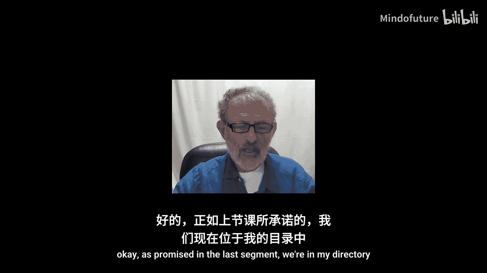
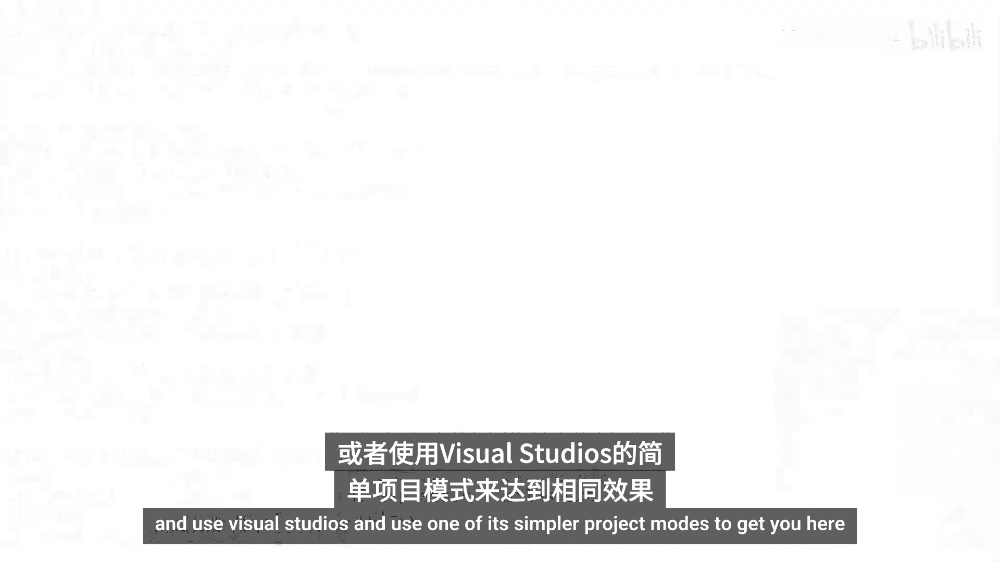

# 【加州大学】C语言编程基础-｜-C-For-Everyone-p04-P04_编译、调试和运行程序-第二部分-包含文件_01_02_02--BV1Fqe7zDEVT_p4-

🎼2。🎼，Okay， as promised in the last segment。

Where're。In my directory。My prompt for my。Computer is Ira's Air。口文。And。

The local directory that I'm running in is called C program slash week1。

So here's where I develop some of the code。That was being used in week one of this class。

So let's look at that directory， the way we can see that directory again。In terminal for a Macintosh。

 the terminal window， which is basically running UniX， so I can use UniX commands。

The Unix Command LS shows me the files in that directory。So we see there's an A dot out file。

 there's something called add2。t EXc， and then there are these dot C files， which are source files。

Which are code and then we can see something like miles Ec， circle Ec， add2 Ec， so all of that。

Or what I previously compiled。As into and executable and I can of course execute them。

 let's look at add2。ex。So in order to execute them， all I have to do is say add2 do EX。

It says input two floats。I do that。And I'm done。4。3 and 6。8 is 11。1。Now。

 if I wanted to develop a program。Let's say I want to change the input to Fs program。

To an input three floats。 Let me try doing that。 So I'm going to。Have。Add3。

 I'm going to call it add 3。c。BI。It three。So this command means create a file called add3。C。Now。

It's going to look very much like add 2。y So basically in frequently the cases I'm going to want to modify a pre existinging file。

 so I'll just read that file in and there these are all VI commands。

 and again in this class I'm not going to go through all of the VI commands or notepad commands。

 you're just going to have to get comfortable with using an editor。

 An editor is a critical tool for almost anything on a computer。

And once you understand a little of it， you can get a tutorial that explains in detail。

The editing commands you need。So。呃。Okay。哎呃。Mititled that file so I couldn't read it。There it is。

 read in two floats。So here's a classic kind of thing， let's change it to three。

So that was a CW that I printed， and that means change word。And I'm going to change the word to。

three。Okay， today is not。The 18th it's。19th， so I'll change that。嗯。Again。

 I might have a sample program of some kind and it is always going to probably have include standard I。

 and so I don't have to always be redoing my program， I have something standard。Now， indeed。

 if you go to an environment。And Windows with something like an IdeE， more elaborate IdeE。

 like visual studios， it'll probably give you a basic template for starting such program。

 So an integrated development environment like visual studios， once you get the hang of it， though。

 the。It's got so much stuff in it。That that。Can be intimidating。

 does give you a leg up on doing programs， gives you a lot of additional assistance。

So instead of float A B， we need a third， I'm going to just do an addition here。

So I'm going to also have a C。Comma。Okay。え。So。Little A says add at this place。

 it's a way to do an insert。And here I'm going to say input three floats。

And I'm going to make an error here because I want to show you the all cycles。

 so let's make an error。Instead of I'll hit the wrong court sign。So。Many places in a C program。

 we have to have matching braces， parentheses。啊。All sorts of things have to match。Here I'm going to。

Get third float。I'm going to print a third float。I'm going to do an insert。

 that's another way to add immediately， so that'll be C。Equals。Percent F。

Oh and here I'm going to also make a mistake， I'm not going to put C in。

 so it's expecting three values， but it's only going to display two values， what's going to happen？

Again， we're going to see。How。The compile edit cycle works。All right。

 so I'm done now and I'm done and I can exit and I can do a colon。Right？I can do a colon quit。

And I can try to compile now， so I'm ready for the next phase， which is to call the compiler。

I'm going to。Use the stock0 to say that I want that to be add3。 if it works。And。Add 3。c。

I might file to compile。Whoops warning， missing terminal invalid。

And it even shows it this is not being matched， so that's pretty good。And then it says。

Erra makes a number of other errorss because there's confusion about matching。So let me reenter that。

Editor。I used the shortcut， I just said。啊。Exclamation mark V， which means。

Use the previous editor command。Let's go and correct this， Sarah。

I pointed it and even told me what liner was on。So I'm going to try and redo this。

 and I'm going to go ahead and also。呃。Okay， one warning and two errors generated。It said a warning。

There was more conversions than arguments。That's not a syntax or in a say。

 it's something where the compilers intelligent enough。To show that something was not。

Did not make sense， but the warning didn't allow me， I believed， to still go ahead。

And build an executable and this says input three flows3。4。5，6。6。And look what happened here。

 I got 3，4。5， but C was shown as 0， but the right result happened，6。6。

 And we ended up with a sum of 14。1。So if we had it。Fix the program based on that warning。

 and I'm going to go back and do that。We wouldn't have get that funky C equals 0 because C equals 0 was the initialized value of this float。

But it wasn't。Change by the scan F。Because it was changed by the scan F， but it didn't show up。

In the printf。Because here， it said percent F。 and it was nothing to read out of。

 So here we're going to now correct that。Okay。I think I corrected it， let may recompile。Okay。

 no warnings， no errors。 everything looks okay。Let's try the add3 again。And put three floats。1。1。2。2。

 3。3。That should be what 6。6， I hope。Sure enough。Gun。So we've seen how we get syntax errors。

 how the compile。啊。Cycle works how。We run， recompile， make our fixes。And。Finally， get。Working。

Executable。And indeed， if we go and look in the directory。There is adsfree。exc。And our program。Okay。

So， this is my working environment。It may not be yours， you might have a different kind of eunuch。

 this is under the Macintosh。But mostly UniX environments will look like this。

 where you might have a totally different environment for Windows and you'll have to use a different editor。

And probably a different compiler， or you can import a new compiler within Windows and use a Windows。

嗯。Terminal box as well。If you want to approximate this environment。

Or you can again go and use visual Studios and use。One of its simpler project modes to get you here。

🎼。