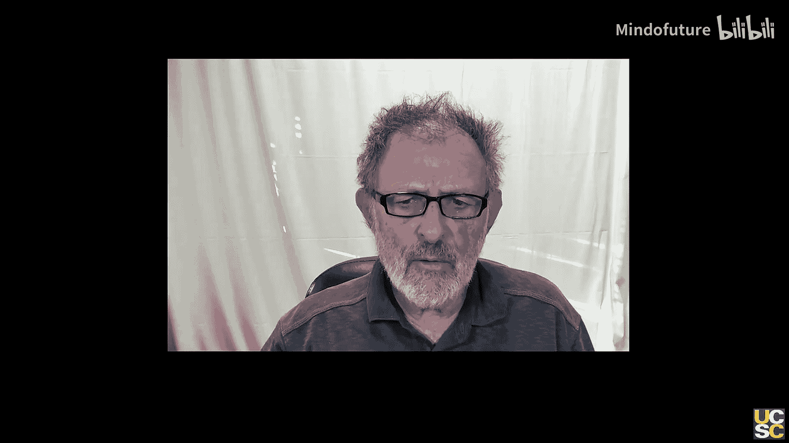
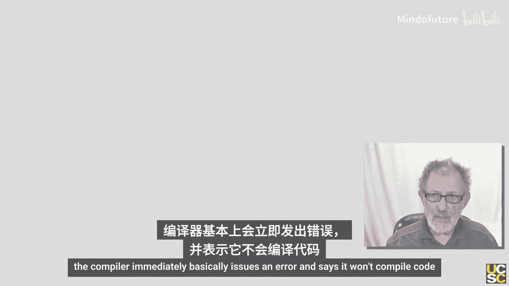
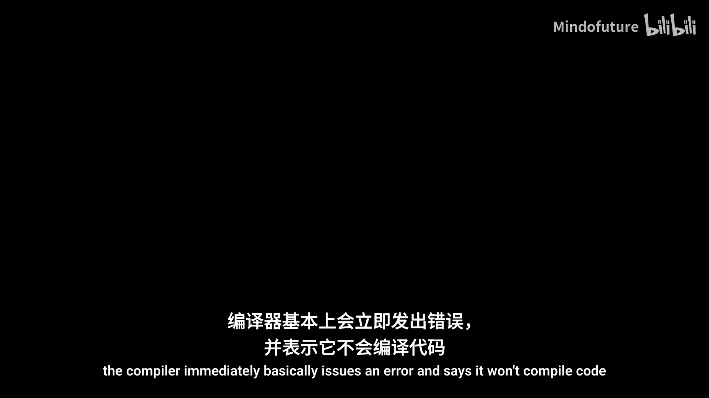

# 【加州大学】C语言编程基础-｜-C-For-Everyone-p05-P05_第一个程序_01_02_03--BV1Fqe7zDEVT_p5-

🎼Yeah。🎼The。Okay， so we just talked some about Dennis Rie， let me put up。His。啊。

Webage from the Wikipedia。あ。对。We can see Dennis， he was born in 1941， died 2011。

I listed an American computer Sc， he created the C programming Lan and with a colleague Ken Thompson EX' operating System。

And that's his picture。呃。Towards the end of his life。And as I mentioned before。

 he was awarded the Turing Award。83， which is computer sciences equivalent。To the Nobel Prize。

 and he also got a hamming medaled and a national Medal of Technology。

And then another critical thing was he was the R。And Carnegan and Richie， the C programming language。

 which was。The original Bible。For the language So C was created by Dennis Ritchie。

 he was working with Ken Thompson at Belllas。And this was 1972。

And some of the characteristics of the language that make it useful and powerful was it was small。

As we'll see。The number of concepts you need to understand to fully learn。C is much smaller than。

Current languages。C plus plus is。At least。Three times。

The size of this language when you use a metric like keywords。

Keywords are critical to understanding language， their reserve for special meetings。

 will talk explicitly about them shortly。It was low level。

Low level is used when you need a great deal of efficiency and access to all the machine resources。

 so its job was to build an operating system， namely the UniX operating system。

that was the joint project of Thompson and Richie where they were touring。

And then the other thing it was was highly efficient。It was easy to translate from C。

 sometimes C is called a portable asmbler into the actual machine code regardless of what machine you were running on。

See is sometimes referred to as a systems implementation language。Later。

 it got to be used as a general purpose language。It was originally used。To replace languages like B。

 its predecessor and BPL， which was B's predecessor， which were also being used。To implement。

small operating systems， and they were also critically reliant on the design of Algal 60 Algal 60 was a language codified by an international group of computer scientists in 1960 right at the beginning of where there is computer science and if you're interested in majoring in computer science or our computer scientists。

 I highly recommend for the majors that you go back and look at Algal 60。

 many of the concepts that we still，Are heavily using。Started with Algal 60。So when we examine C。

 we're going to see a first program， it was made famous by the Carnegie and Richitchie C programming language。

 the Bible， and indeed it's one of the books I recommend， especially if you're a computer scientist。

 because it's somewhat sophisticated。And while my book， a book on C is more didactic， more tutorial。

 this is a very thin book for people who already understood programming。

So it was written for people who knew other programming languages just to expose them to the C language。

And it was written beautifully， largely influenced by the first author who was an excellent writer。

Brian Carnegan。And in that language， in that first program， we see include standardIo。h。

 which is a library for input output， then we see。One of these keywords and includes a keyword now includes a preprocessor keyword。

Int main， main is always a function that we use， it's where the program begins and then these。

Brace pairars。Well those are parentheses， then this is a curly brace。

We sometimes indicate that that's the beginning of a piece of code。

 and then we have this function out of the standard library。

For I owe word prints to the green print F， quote this string hello world。

 And we have this funny little backslash N， and that's a silent character backslash N means。

Instead of printing something advanced to a new line。And then we also have return zero。

 which says we're going to finish the program and a special value zero is going to be indicated to the operating system。

 meaning everything as。Completed correctly and then we have the closing brace so one of the things you're going to be exposed to in programming is making sure you have matching braces。

 making sure you keep to your punctuation， there's matching parentheses， there's matching quotes。

 there's special。The semicolon is heavily used because the semicolon always indicates the end of a statement。

So we'll have in our grammar the syntax for the language， things like punctuation。

Which are very important， special characters and punctuation， semicolon being most important。

Brace is being incredibly important。And parentheses。 And if we mismatch these。

 it's not like writing an essay， the compiler immediately。Basically。

 issues an error and says it won't compile code。

🎼。