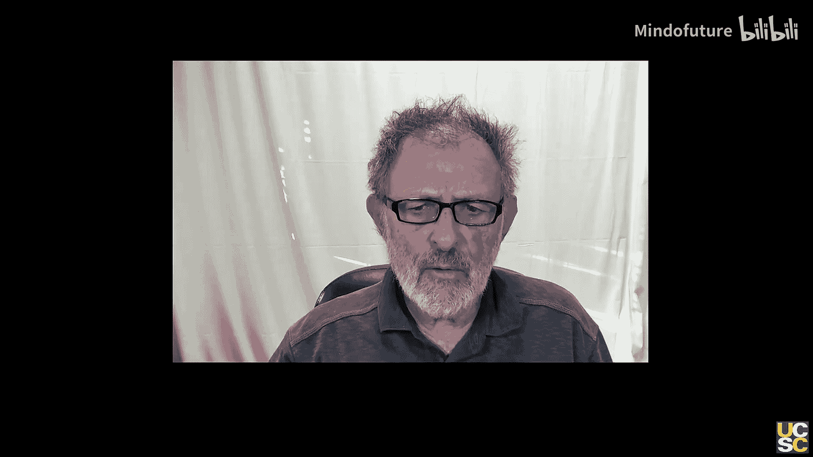
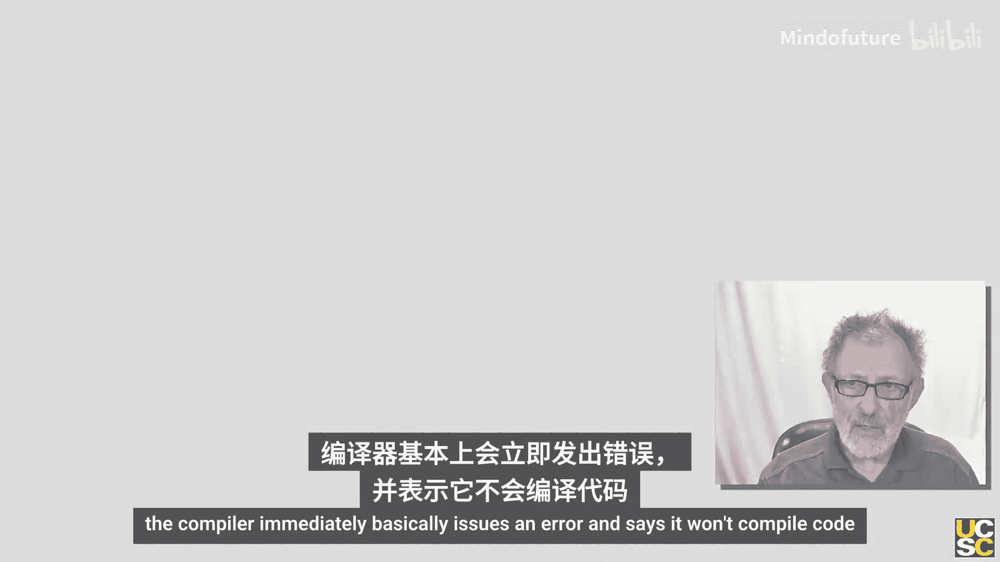
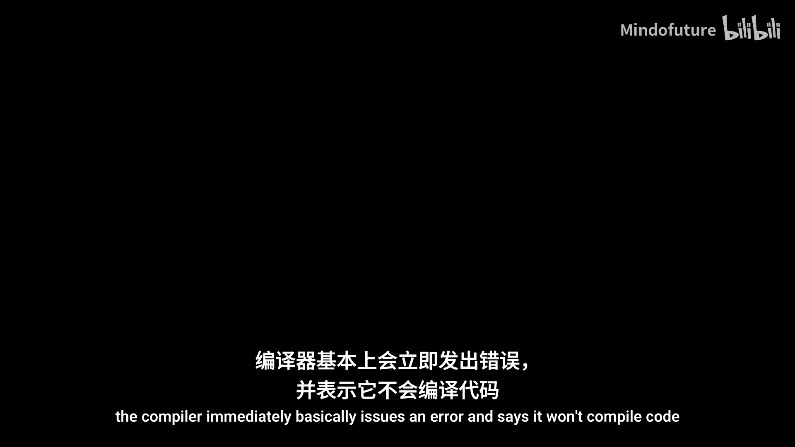

# C语言编程基础：P05：第一个程序



在本节课中，我们将学习C语言的起源、特点，并通过分析经典的“Hello, World!”程序来了解C程序的基本结构。

## 丹尼斯·里奇与C语言的诞生

上一节我们了解了编程语言的基本概念，本节中我们来看看C语言的创造者及其背景。

丹尼斯·里奇出生于1941年，于2011年去世。他是一位美国计算机科学家，与同事肯·汤普森共同创造了C编程语言和Unix操作系统。

他一生获得了多项荣誉，包括：
*   1983年的图灵奖（计算机科学领域的诺贝尔奖）。
*   汉明奖章。
*   国家技术奖章。

此外，他与布莱恩·克尼汉合著的《C程序设计语言》一书，被广泛认为是C语言的权威指南。

## C语言的特点

了解了创造者后，我们来看看C语言本身有哪些关键特性。

C语言由丹尼斯·里奇于1972年在贝尔实验室创造。它具有以下使其强大且实用的特点：
*   **小巧**：与许多现代语言相比，C语言需要理解的核心概念和关键字数量更少。例如，C++的关键字数量至少是C的三倍。
*   **低级**：C语言提供了高效率和对机器资源的直接访问能力，这使得它非常适合用于构建操作系统（如Unix）。
*   **高效**：C语言代码可以高效地翻译成各种机器的机器码，因此有时被称为“可移植的汇编语言”。
*   **起源**：C语言最初被设计为一种“系统实现语言”，用于替代其前身B语言和BCPL语言，以构建小型操作系统。它的设计深受Algol 60语言的影响，许多现代编程概念都起源于Algol 60。

## 第一个C程序：“Hello, World!”

现在，让我们通过C语言中最著名的入门程序来具体认识其结构。这个程序源自《C程序设计语言》一书。

以下是经典的“Hello, World!”程序代码：

```c
#include <stdio.h>

int main() {
    printf("Hello, World!\n");
    return 0;
}
```

接下来，我们将逐部分解析这段代码的含义。

以下是该程序中各组成部分的详细说明：
*   `#include <stdio.h>`：这是一个**预处理指令**。它告诉编译器包含标准输入输出库的头文件，这样我们才能使用如`printf`这样的输入输出函数。
*   `int main()`：这是程序的**主函数**。每个C程序都从这里开始执行。`int`表示这个函数会返回一个整数值。
*   `{` 和 `}`：这对**花括号**定义了`main`函数的代码块范围，即函数体的开始与结束。
*   `printf("Hello, World!\n");`：这是一个函数调用语句。`printf`是标准库中用于打印输出的函数。它打印引号内的字符串`Hello, World!`。字符串中的`\n`是一个**转义字符**，代表换行。语句末尾的**分号**表示该语句结束。
*   `return 0;`：此语句结束`main`函数，并向操作系统返回值`0`。按照惯例，返回`0`通常表示程序成功执行完毕。
*   `}`：这个花括号标志着`main`函数体的结束。

## 语法与标点的重要性

在编写程序时，语法的准确性至关重要，这与写文章不同。

C语言编译器对语法要求极其严格。**标点符号**的正确使用是语法的关键部分，包括：
*   **分号**：用于标记语句的结束。
*   **花括号**：用于定义代码块的范围，必须成对出现。
*   **圆括号**：用于函数调用和表达式，也必须匹配。
*   **引号**：用于定义字符串。

如果这些符号不匹配或缺失，编译器将报错并拒绝编译代码。因此，在初学阶段，养成仔细检查标点符号的习惯非常重要。

---





本节课中我们一起学习了C语言的创造者丹尼斯·里奇、C语言小巧、高效、低级的核心特点，并通过剖析“Hello, World!”程序掌握了C程序的基本结构，包括头文件包含、主函数、输入输出语句以及标点符号的关键作用。