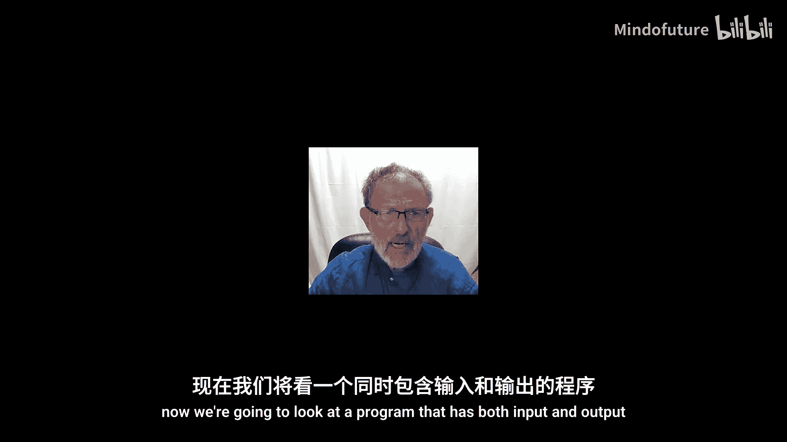
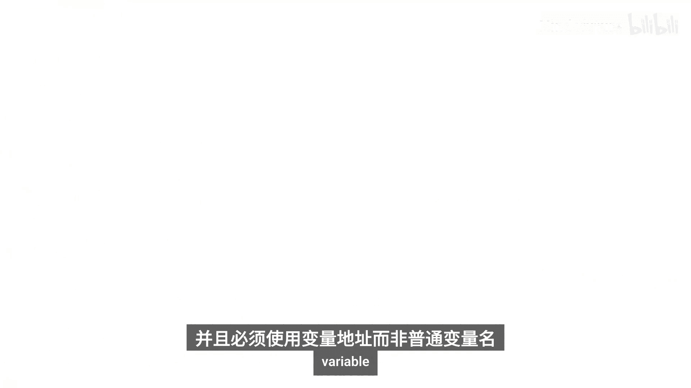

# 【加州大学】C语言编程基础-｜-C-For-Everyone-p06-P06_示例-圆代码_01_02_04--BV1Fqe7zDEVT_p6-

🎼2。🎼，Now we're going to look at a program that has both input and output。

So again， very critical。あ。We frequently as a user， we're used to it。

 let's say in an app we're always entering information and somehow our program or app has to capture that information and then it makes use of it in delivering a response or computation and it's going to be a very simple one that we all know about。

 which is。How to compute the area of a circle。We're going to do that in terms of meters。So。

Let's look at this code again， we're just getting used to how to write。A simple see program。

 some of the elements of it， and later we're going to go into detail again about what each thing is and how it's constructed。

So as before。There's。Our standard。Program。Comment。And it's really for readability and in this case。

 it's telling us this program is to be used for computing。area of a circle。Standard IO。

The preproces command brings in both printf and now Scf and Scf is a basic routine for doing input。

By default， in most cases， we will come from our keyboard in the very old days。

 this could have come from a car deck or。A paper tape。So。啊。

It depends what you default and in our case， standard input is defaulted to the。啊。Computer keyboard。

Here we see another directive。 It's called a defined directive。

 The defined directive does an interesting thing。We have。And this is by convention。A preprocessor。

Token。In this case， we'll call it pi。For obvious reasons。Again， we want this to be documentation。

 we want to make the program readable， and we will define pi to six significant figures because that's what we get to store in a normal double。

 so it's 3。14159。Again， we introduce the program， which is Maine begin。

With what's called the open brace for a compound statement。In the first。啊。

Statement is a declaration statement in which we define area and radius。

 areaan radius are two identifiers。Identifier as I can be。系啊。Ordinary words。

 unless there are keywords like double， so unless there are keyword。

 you can make use of whatever you want to think about。And we initialize area to 0 and radius to 0。

 and we use 0。0 because that's a clear indicator that we're doing constants which are double。

 we could use0 that would be allowed。We then ask the user。Please enter a radius Otherwise。

 if we just didn't do anything and we had omitted this and try omitting it， you'll see that。

Your screen stops and you won't know what to do， so this is what we call a prompt。

So it prompts the user to enter radius。And this says enter the radius。As a double long float。

And we need the special operator Ampersand here， and we'll explain that later， but for the moment。

 trust me， just use ampersand of whatever that variable is。

We're going to explain that much later in detail in the course because that's really a。

That's really a parameter that's the address of radius and we'll have to understand things like address。

 memory pointer to really understand what's going on。And here's our area calculation。

 everybody should remember that from grade school or high school， pi times radius times radius。

We don't have a simple way to say square。So there isn't a notation。Like star star 2。

So we use repeated multiplication and then we print our answer。Return with zero。

So let's make sure we can use that program， I've already compiled it， now I'm going to execute it。

So I compiled it into code。Circle that EXc， a， it says enteradius。Let's try the radius 1。0。Oh yes， 3。

1459， well that makes sense。That's a simple test when we go to the bug programs。

 we want data for which we know the answer and we want simple cases first and we can ask for a more complicated case。

 let's repeat that。So it's saying enter the radius again， why don't we do 2。5？In this case， it's 19。

634937。And that's correct as well Okay， so that shows you how not only to do simple output。

 which we've studied in a few cases， but also simple input and the little secret there is。

Outside of using a format string where you want the input you have a percent with the appropriate format in this case。

 double so it's LF， if it was an integer， it would be percent D。

 and then we have to instead of using the ordinary variable name。

 we have to use the address of that variable。🎼。

