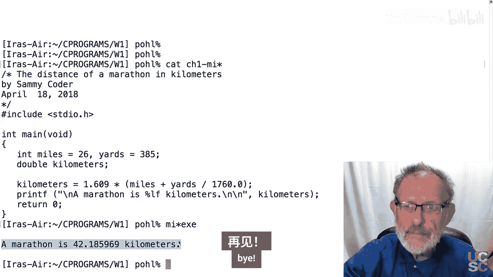

# 【加州大学】C语言编程基础-｜-C-For-Everyone-p07-P07_示例-马拉松_01_02_05--BV1Fqe7zDEVT_p7-

🎼2。🎼，Okay， so we need more practice with output， output is very important。

A componentonent of programming。啊。AndThey know the famous expression garbage in， garbage out。

It wouldn't be useful in most cases to have programs that don't produce answers。

 so output is critical。So let's look at a program that's going to convert。

A marathon distance from miles and yards to kilometers。Here's our program。The distance。Marathon。

And kilometers。Now again， that first part that I've just highlighted is a comment。

A comment is just something that gets thrownn away。

 so why do we have comments if it gets thrownn away？Well。

 we need to make our code readable for a variety of reasons， first off。

 somebody needs to maintain the program。They have to understand what the program is being used for。

 what's the history of how the program got developed？

So we typically like to put in when the program was last updated or coded and by who。

And some overall comment as to the use of the program。Now。

The first thing that actually shows up in the C code is what's called a preprocesor command。

That's the sharp include。And inside the angle brackets， we see STDIo。

h and the doth is an extension that intent that means a header file and that means that in this file。

 which will be included automatically with our program。

 so it tells it's called preprocessor because it happens before the C code is compiled。

 so extra code gets added in that code is the code that we're going to need for doing print F。

Without it， the printf would be undeclared。Then we start the actual code。

And that's with the keyword int， which means that the function called main。

 and almost always fact in our beginning course， everything will always have a main main will be where the program executes from。

That's。Understood by the sea system。Void is another keyword， meaning no arguments。

So in is a keyword meaning。That the program returns an integer。Vod is a keyword that would。

 if it's used as a data type means it's an undefined data type， or in this case。

 it means that the argument list is empty。The next thing we see。Is this brace an open brace means。

Begin the code it。In programming languages， there are a lot of matching braces。

We've already seen matching， we've seen the star asterisk match， we've seen the angle brackets match。

 we've seen the parentheses match。Very critical to getting syntax right is to make sure you don't improperly match braces。

So。普洱。This brace， there's a closing brace， and this is called a compound statement。

 it's a series of statements that is the executable code here。

We have two simple variables that are integer type。And this called a declaration。

And it's a declaration with initialization， so Miles is initialized to 26。

 yards is initialized to 385。And a good programmer chooses identifier names。

 miles and yards or identifiers。Why choose something like that rather than M and Y？

And then why might be okay？But。It adds documentation at no cost， so the fact that we use。

An actual word like Miles or yards gives the program more literacy， makes the program more literate。

And then the result is going to be again。A literate identifier， but this time of type double。

 then it's going to be kilometers。And then the formula is kilometers is assigned， 1。

609 times miles plus yards divided by 1760。0。I'm going to mention this because it's important。

Will be reemphasized later on。The reason that we didn't choose to use 1760 is that yards is an integer。

 this would be an integer and if we did this。Without making this in effect， a double constant。

Then this would have given rise to zero， we would have gotten。啊。The integer。呃。

The vision of Y with 1760 and 385 over 1760 when they both are inteature is zero。So。

We could do this later， we'll learn that we can also use a cast。

Another trick would have been to say 1。0 times yards。Divide by 1760。

 and what happens is there's an explicit conversion。

Which takes the more extensive type and makes the whole expression be of that type。

And then we have the print statement。And in the print statement。

 we first have the controlling format expression， which is a string， so again。

 you see matching quotes。At an earlier time I left out one of these quotes and you get a syntax married。

 so you should see what happens if you leave out one of the matches， you'll see you get very。

Different kind and sometimes obscure syntax errors。But this says print a new line。

 which means advance on the screen， a marathon is， this says use a long float or double。Foract。

Print kilometers period and then two new lines， and then kilometers is in fact interpreted and printed as a long float and then return zero because we told you that。

Int as a integer value and so that returns zero and mysteriously that returns zero to the operating system。

 zero being a code that the program ended correctly。So let's execute this。And， indeed。

We get a correct result that a marathon is 42。185969 kilometers， okay。

So study this program it a little more complicated than the previous program。

 but it gives you a lot of critical ideas and we'll go into the various things that were talked about。

In later lectures in more detail。🎼。

🎼我。