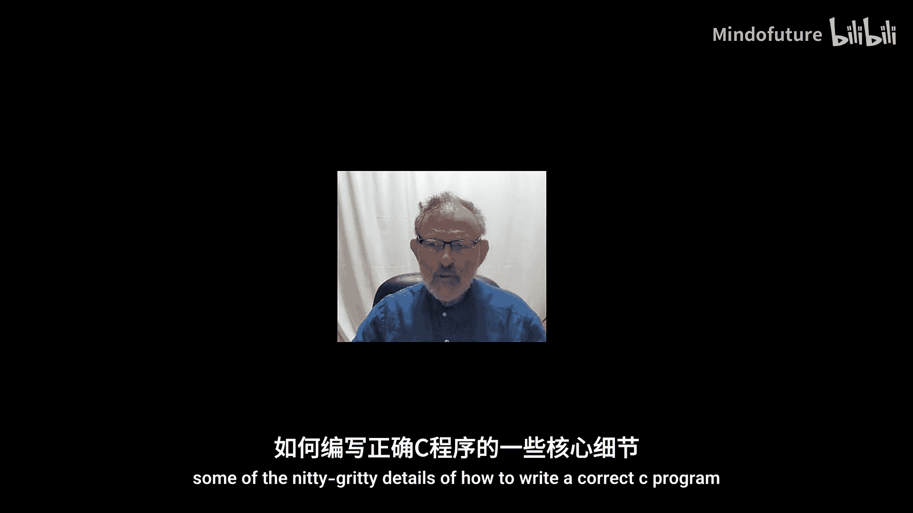
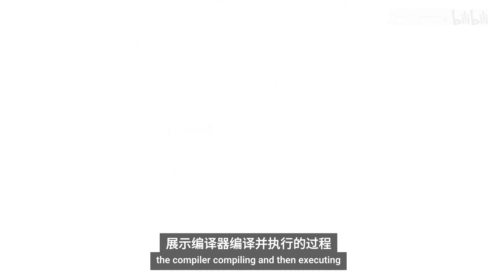

# 【加州大学】C语言编程基础-｜-C-For-Everyone-p10-P10_字符集和标记_02_01_01--BV1Fqe7zDEVT_p10-

🎼2。🎼，Now we're going to turn our attention to some of the nitty greetd details of how to write a correct C program。

And we're going to look at a very simple program。I'm going to show it in。It's execution window。

 But first， I want to discuss what we're going to look at。 So this program is going to。

Print to sum of two floating point numbers and it's going to use simple IO。

It's going to use the scanf to read in the values and then print F。To show the results。Now。

 the elements of a C program are made up of characters， so it's just like an essay in English。

Except an essay in English could be understood。Even if you have misspellings and punctuation errors。

In case of a C program。Spellings， punctuation， errors。

 stakes of that kind get caught by the compiler， and the compiler won't let you run the program。

 even though you think you understood。And。It should have understood these simple mistakes now。

 hopefully a good C compiler will give you informed messages that make it clear what it thinks is wrong。

So first off， a program in C assembles a bunch of characters into what we call tokens。

 And let's look at a little of what a token is。 So these tokens orxical elements might be comments。

 for example， and comment is something that starts。With slash asterisk。

 and then can be any set of characters。 So those set of characters get ignored until you see an asteriskster slash。

What if you you forget the second part or？Write this incorrectly。

 Then this is going to go on forever， and you'll get some。Or a message。

 hopefully that'll say you didn't complete your comment。

A second thing you'd see that we've seen already in C programs are preprocessor directives。

And the biggie is sharp。Include。So prepro directive starts by putting a sharp。

 typically by convention， the sharp should be at the beginning of a line and then we have。

A number of possible。Special words and include is one that says to the compiler。

The following library should be included。And we are， of course， already made use of standard IO。

But there are other important libraries like the math library， like the character processing library。

Like the library that includes timing operations。Time。

 H there are multiple very important standard libraries that you're going to have to get familiar with。

Another big part of having a program be correct are things like identifiers。

 and these are possibly multi letter， but they can be as much as single letter。呃。Tokens。

 so A and B can be an identifier and we'll see that in the next program。

And Maine is a typical identifier because it indicates its special in that sense that it indicates where the program is going to start executing。

We also have tokens that are operators， so plus is a token for binary operator or in context。

 it could be a unary plus。Ampersand is an operator meaning address of。But again。

 you've got to have context， so sometimes you could see two ans and two ans are the operator for the logical end。

N' punctuation， also highly important。So we've already seen punctuaators like the open brace and the closed brace in the semi cold。

 and each has an important use in the language。 and you must get them to correct。

 or else you'll make fundamental syntax errorss。So a program must end up being syntch correct。

 so we write a program， we get our ideas down， and then we have the compiler check that it's syntch。

So here's it。APo syntax error message will have int main Par Paren。

And then rather than a curly bracket。We might mistype and have。

An open parenthesis and that would be wrong， so the compiler will issue you some message。

 hopefully it'll be informed。It almost always points you at where it sees the beginning of the era。

 and then hopefully it gives you an English language message that is helpful。

But you have to make sure you understand where the error occurs and how to correct it。

Then harder than that is to get the program to work right， semantically correct， it works。

And here is where we。Possibly repeatedly run， modify and retest the program until we get it。Okay。

The next segment will go on to the actual code for the program in which we've seen these tokens parsed by the compiler。

 the compiler compiling， and then executing。🎼。

あ。