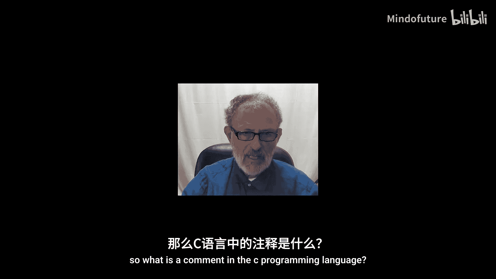
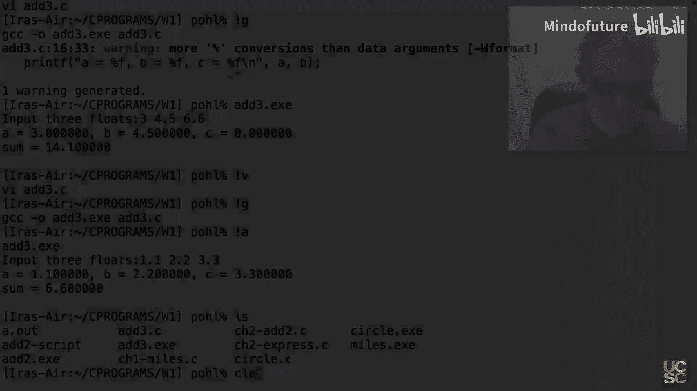
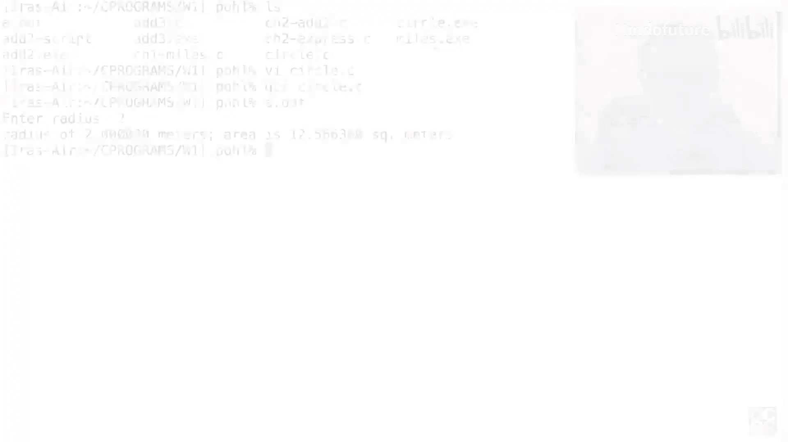

# 【加州大学】C语言编程基础-｜-C-For-Everyone-p11-P11_注释_02_01_02--BV1Fqe7zDEVT_p11-

🎼2。🎼，Okay。This topic will be a very simple one， it's going but a super important one。

You just have to。Work as long as I had at programming to understand how valuable it is to properly comment your program。

 so what is a comment in the C programming language？

We're in my terminal environment on my Macintosh or Unix environment。

And let's look at a particular program that we've already。啊。May have seen。Let's look at circle。c。

And here we have our comment and we're used to now writing code in which we start with a back slash star。

And a star， an end in a star backslash， and then we can write whatever we want here。

All of this gets discarded， so if we recall how the C compiler works。First off。

 there's a pre processorcessor， the preprocessor puts in whatever code is necessary is what's called a tokenizer。

 and the tokenizer goes and looks through things and discards this。So this， in effect。

 becomes empty space。So why is it so important， It's important for documentation and readability。

In order to be able to maintain or modify the program and understand its use。

 we want the program to be literate。So we could， let's say， add some more comments if we want。

Let me add some other comments here。Area in。Km。So there's a comment。

Now I'm going to show you a different common style。呃。In original C Nancy for a long time。

 the only kind of comment was。Back slash， star， whatever you want， star backslash。

And this could be multiline。But it turns out that's inconvenient。

 And sometimes it makes for mistakes， if you。Mipell this。But let's put in a rest of line comment。

Notice in this case， we use two backslashes。But we don't have sue。Do anything further。

 and only the rest of this line is considered a common。Most compilers。

 unless you're using something that's。Probably pre 1988 will allow for this rest of line comment。

Let's see if my compiler will allow it。We're going to call in the compile command。No problem。

Now if we want， we can execute。Enter radius。2。That would be the area， two meters。

 we get an area of 12。566 square meters。So comments are critical。

We can do them with the classic multi line comment。Or we can use the rest of line comet。

 the more modern come。啊。That tends to be less error prone。🎼And， of course， fewer characters right。

🎼。🎼。