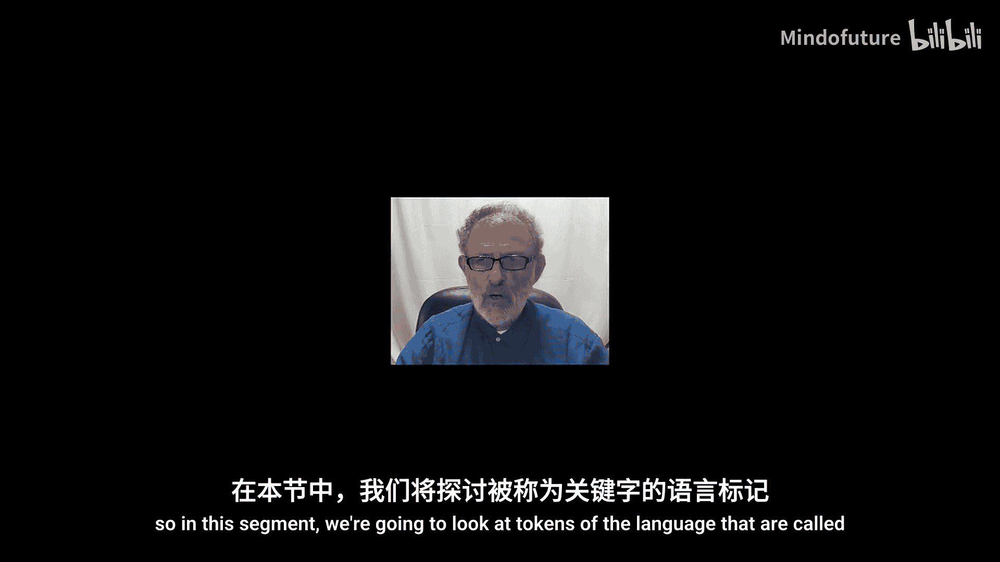
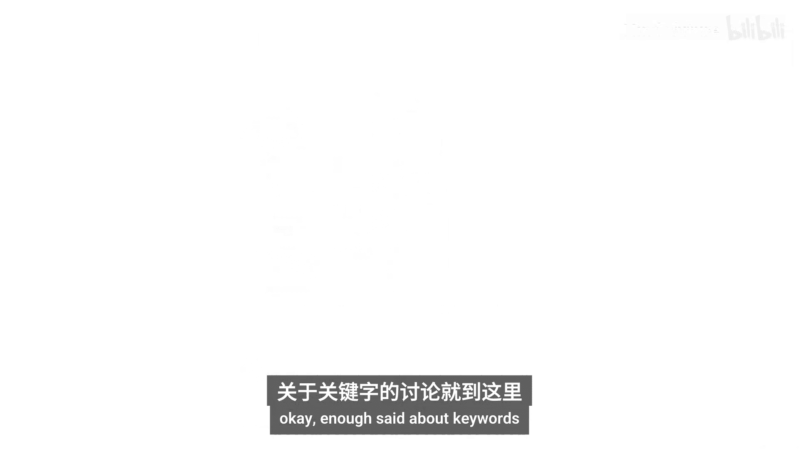

# 【加州大学】C语言编程基础-｜-C-For-Everyone-p12-P12_关键词_02_01_03--BV1Fqe7zDEVT_p12-

🎼2。🎼，So in this segment， we're going to look at。Tokens of the language。That are called keywords。

 also in other programming languages they were sometimes referred to。

As reserve words， and I'm going to。Use my browser to look at， you can get many tables for this。

 but it makes it a little easier。So this is the standard NCC recognizes the following keywords。

And there are some additional ones， but I'm going to start by grouping them。

 and it means that they can't be used for other purposes， so you can't use them。

As ordinary identifiers。Now， keep in mind， certain things that look like keywords aren't keywords。

 so typically on an exam， a simple mistake is to think that main MAI N is a keyword because you're seeing it all the time as。

An identifier that。By default， introduces the。Execution of the main C program。

But main is just a keyword。呃。Another thing that might be thought of as a keyword is actually a special word for the preprocessor。

 which is something like include。And words that get introduced by the sharp sign。

 like sharp include or sharp define， while they have special purpose in the language。

In the C compiler system， they are not these reserved words or keywords。

Now a number of the keywords like double。Float。En long。CR， those get used to declare data types。

Those are used for the。Built in or what we call the native data types of this language。

 another one of those is aumome。So they're one category， so let's look at chaR。

We'll get a further definition by clicking on it。Ent and char basic data types for integer and character variables of type endt are one machine word in length。

And that's typically on most machines for bytes now。あ。They can also be modified by signed， unsigned。

 short and long， but that's for a later time。 So character types are very important。

 They are the basic types that you're going to work with in the language。 The in type。

 which is one of our most basic here， is a range event typically represented between roughly 2 billion-2 billion and plus 2 billion in the sign type and in the unsigned type Its 0 to 4294967295。

呃。Break。Continue。Go to for if。These are all keywords else。

That affects the flow of control of the language。Later。

 we're going to go and show you what an if L statement is。 We're going to avoid go to。

 So consider go to obsolete go to as a way of jumping anywhere in the program code。

And that's considered a no， no。And in fact， some languages now no longer allow go to。嗯。

Return we've seen on a lot of our simple programs and that' just means。

Finish the execution of the current function and if it's return of an expression。

 it returns the expression value。To that function from where it was called。Later。

 we're going to see fancy things like type de。They're a way of giving new names to。

Types are frequently compound types。There's some specialized types like union and struck。

 struck will be heavily used， but in part B of this course， and union， not so much。哦。Generally。

 a union can be avoided。Now， among these keywords。Auto is obsolete again， auto is just rarely used。

 unneeded。呃。It's what's called a storage classification。And among the storage classifications。

 you have auto and you have register。 again， register is unneeded。 register says。

Place whatever this is into high speed storage well。

It turns out the compiler can do a better job than you can do。 And indeed。

 modern sea systems are running on things that don't need this kind of。

Programr directed optimization， so you're not going to see auto， you're not going to see register。

You are going to see static， but it has a very special set of uses， those are storage classified。So。

Get used to this， this keyword list， I think there's about 30 in this keyword list。

Most of are critical concepts。 But the nice thing about a language like C。

 it has a relatively small number of these in currency plus plus the number of key wordss exceeds。

 I believe。呃。I'm not exactly sure。Why don't we look it up？So。Letm going use my compiler and see。四。

Plus， plus keyword table。And you can see this is a very much bigger set includes as a subset things。

呃。That we saw in the other case， and indeed， C will let you migrate to C++。

But we're not starting with C++ because look at this table what。It's what one， two， three， four。

 five， six， seven， eight， nine，1 11， 12。It's about 96 from counting right and indeed there are some other things that are special context。

 so roughly speaking C+ plus。Modern C++ has three times the keywords。

 and you can imagine that in many ways it's three times more complicated， though。

 of course you don't have to use the full language。Okay。Enough said about cures。

