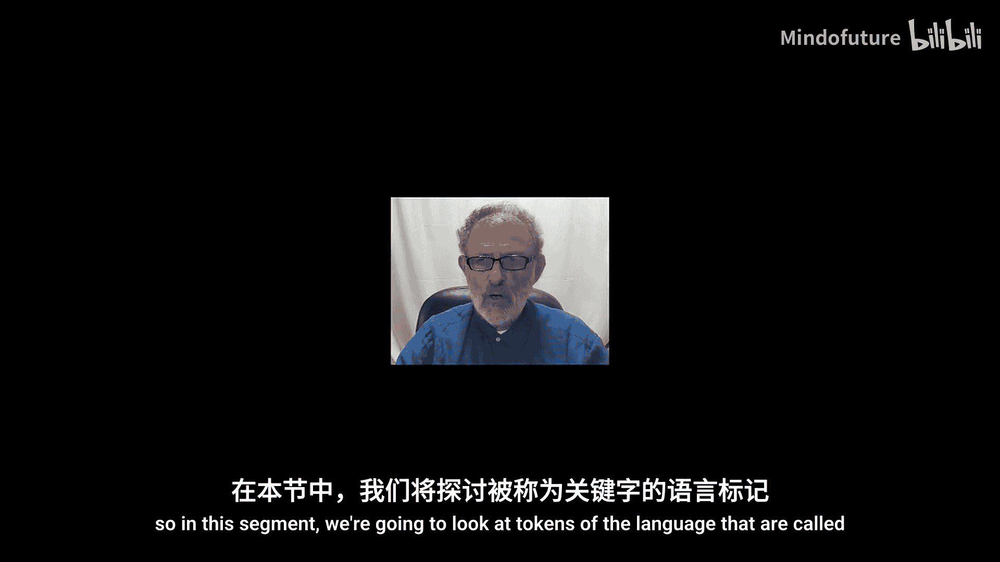
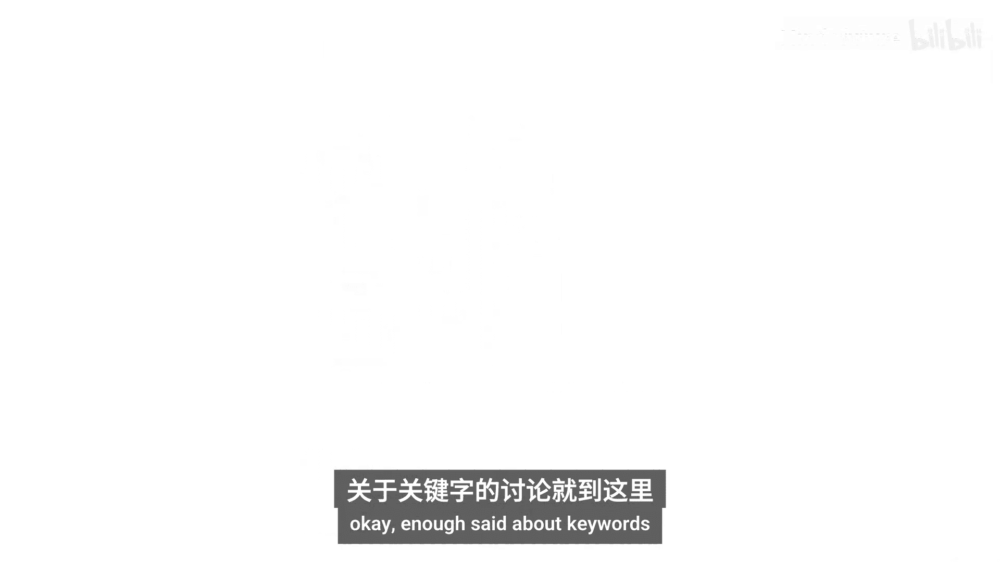

# C语言编程基础：P12：C语言关键词

## 概述
在本节课程中，我们将学习C语言中的“关键词”。关键词是语言中具有特殊含义的保留字，不能用作普通的标识符（如变量名或函数名）。理解这些关键词是掌握C语言语法的基础。

## 关键词的定义与作用
在C语言中，关键词有时也被称为“保留字”。它们由语言标准定义，具有特定的功能，因此程序员不能将它们用于其他目的，例如作为变量名。

需要注意的是，有些看起来像关键词的标识符实际上并不是关键词。一个常见的误解是认为 `main` 是一个关键词，因为它频繁出现，作为C程序执行的入口点。然而，`main` 只是一个普通的函数标识符。同样，由 `#` 符号引入的预处理器指令，如 `#include` 或 `#define`，虽然在编译系统中具有特殊用途，但它们也不属于这里讨论的保留关键词范畴。

## 关键词的主要类别
以下是C语言关键词的一些主要类别及其简要说明。

### 数据类型关键词
这类关键词用于声明C语言内置的（或称“原生”）数据类型。

*   **`int`**: 用于声明整数类型变量。`int` 类型的长度通常是一个机器字长，在现代大多数机器上是4字节。它可以被 `signed`、`unsigned`、`short`、`long` 等修饰符修饰。
*   **`char`**: 用于声明字符类型变量。字符类型是语言中非常重要的基本类型。
*   **`double`**、**`float`**: 用于声明浮点数（小数）类型。
*   **`long`**: 通常用作修饰符，与 `int`、`double` 等结合使用，表示更长的数据类型。
*   **`enum`**: 用于定义枚举类型。

关于 `int` 类型，其取值范围在典型的有符号类型中大约是 -20亿到 +20亿；在无符号类型中，范围是 0 到 4294967295。

### 流程控制关键词
这类关键词用于控制程序的执行流程。

*   **`break`**: 跳出当前循环或 `switch` 语句。
*   **`continue`**: 跳过当前循环的剩余部分，直接开始下一次循环。
*   **`for`**、**`while`**、**`do`**: 用于构建循环结构。
*   **`if`**、**`else`**: 用于构建条件判断语句。
*   **`goto`**: 用于无条件跳转到程序中的指定标签。**注意**：`goto` 语句被认为是一种不良的编程实践，因为它会破坏代码的结构，使程序难以理解和维护。事实上，许多现代语言已不再支持 `goto`。在本课程中，我们将避免使用它。
*   **`return`**: 用于结束当前函数的执行。如果后面跟有表达式，则将该表达式的值返回给函数的调用者。我们在之前的简单程序中已经多次见过它。

### 类型定义与复合类型关键词
这类关键词用于创建新的类型名称或定义复杂的数据结构。

*   **`typedef`**: 用于为现有类型（特别是复合类型）定义新的别名。
*   **`struct`**: 用于定义结构体，这是一种将多个不同类型变量组合成一个单一类型的方式。**结构体**在本课程的后续部分（B部分）将被大量使用。
*   **`union`**: 用于定义联合体，它允许在相同的内存位置存储不同的数据类型。**联合体**的使用频率较低，通常可以找到替代方案来避免使用它。

### 存储类别说明符关键词
这类关键词用于指定变量的存储方式和生命周期。

*   **`auto`**: 用于声明自动变量（在函数内部默认的变量类型）。**注意**：`auto` 在现代C语言中已基本废弃，很少使用，因为函数内局部变量默认就是 `auto`。
*   **`register`**: 建议编译器将变量存储在CPU寄存器中，以期提高访问速度。**注意**：现代编译器在优化方面通常比程序员做得更好，因此 `register` 关键字已不再需要，也不建议使用。
*   **`static`**: 用于声明静态变量或函数，它具有特殊的用途（如保持变量的值在函数调用之间不变，或限制函数/变量的作用域）。**静态变量**是你会遇到的重要概念。

## C与C++关键词数量的对比
C语言的关键词列表相对较小，大约包含30个，其中大部分是核心概念。相比之下，C++语言的关键词数量要多得多。

如果我们查看C++的关键词表，会发现它包含了C的关键词作为一个子集，但总数远超C。粗略计算，现代C++拥有大约三倍于C的关键词数量。这在一定程度上也反映了C++语言比C更为复杂。当然，编写C++程序并不要求使用全部语言特性。我们之所以从C语言开始学习，正是因为它的核心相对简洁明了。

## 总结
本节课我们一起学习了C语言中的**关键词**。我们了解到关键词是语言保留的、具有特定功能的单词，不能用作普通标识符。我们将其分为几个主要类别进行了介绍：**数据类型关键词**（如 `int`, `char`）、**流程控制关键词**（如 `if`, `for`, `return`）、**类型定义关键词**（如 `typedef`, `struct`）以及**存储类别说明符**（如 `static`）。同时，我们也指出了 `goto`、`auto`、`register` 等关键词在现代编程中的局限性或废弃状态。最后，通过对比C和C++的关键词数量，我们理解了C语言语法核心的相对简洁性。熟悉这些关键词是编写正确C程序的第一步。