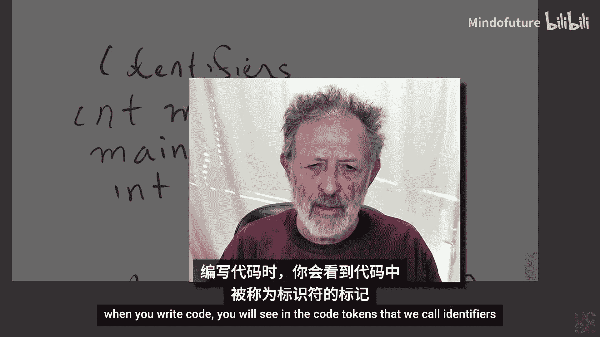
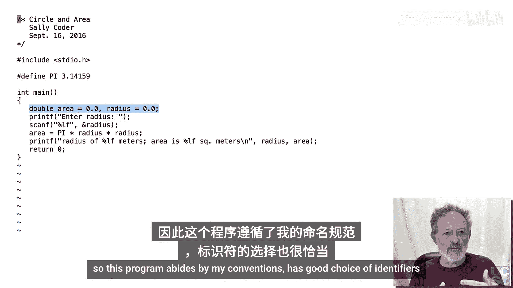

# 【加州大学】C语言编程基础-｜-C-For-Everyone-p13-P13_标识符_02_01_04--BV1Fqe7zDEVT_p13-

🎼TheYeah。In this lecture I'm going to talk more about identifiers when you write code。

 you will see in the code。

Tokens that we call identifiers， so we've already written code where we see int main Paren Par。

The int is not。An identifier， it's a key word， mainine is an identifier， it's the name of the。

Function in which execution starts and the parentheses are not part of the identifier。

Prenheses get used for。A function call。Now。One of the key parts in writing good documentation。In。

Any programming language is proper choice of an identifier and we have to know the rules for how to choose an identifier and here's a shorthand for the rules I'm not going to do much of this。

But it's， and I'm going to explain it。This is what is called a syntax equation。

Identifier sitting on the left side， and identifier in C is made up of。

A letter underscored character。In which you have at least one。Letter or underscore this。

Straight line means or letter or underscore and when I subscript by one。

 it means I have to have at least one of these and then following it。

 I have a letter or underscore or digit and I can have that zero or more times the plus sign means as many times as I want so identifiers can be arbitrarily long。

Generally speaking， you're not going to see identifiers that are more than。呃。10 or 12 characters。

 that would be as big an identifier as you're likely to see。And see what conforms to this。Well。

 the simple one letter identifier K frequently used for。あ。Integers that are auxiliary integers。

In writing your code。Underbar print F， and that could be an identifier and in fact that's probably the identifier that the systems programmers is used when they design the print F function。

Here is a common thing you see。Two words。When you have the two words。You have two underbar words。

 the underscorebar or the underscore character should say。

 the underscore character is used to separate distinct words so when you want。An identifier。

 but in English you want to have more than one word in your description。

 one convention is to use underscore Another convention is to tie the two words together with a capital。

 so two capitalize W the beginning of the second word。

 and that would also be another standard convention， what you shouldn't be doing is mixing them。

And then here's another。Standard identifier， my underscore DNA 23。

 and remember once we're past the first digit。We can use digits as well。

What won't work as an identifier？Sharp character， so sharp me， it not an identifier。

Sharp is not allowed anywhere， so or me sharpp would not be an identifier。Here。

 rather than underscore， I'm using minus。And that would be the expression， unary minus x。

X could be an identifier， but minus x is an expression。

And 23 my DNA is not identifier because the first。Character of that sequence is a digit。

So that's not allowed。So ditchches are allowed anywhere but in the first character。

 underscores an alphabet or allowed anywhere， including the first characters。Now。

 good choice of identifiers in your program help you document the program and make the program readable。

Main print F square root S Q RRT， those are actually things you'll see very commonly print F and square root come from。

Standard library。And Superman， if somehow you're writing some。Code。Exhibit something to do with。

The character Superman， maybe you'd call that。呃。You've used as an identifier that gives you a clear image as does radius。

And I as well， you have， it's a convention in the community in both the programming community and mathematics community when you want something that's。

For counting， you can use I J and K also you frequently can use。And as another understood。啊。Integer。

 those will all be good choices。 Of course， you have to use them for the right purpose。

Here are some things that might be bad choices， GR X33 underbar PP underbar 25。

I underbar am underbar four words。Well， Gx 33 and this underbar PP stuff。

We have no concept of what they might be。So they're not going to be readable and not going to provide some kind of documentation。

 I am for words makes sense， but we've mixed two conventions so that。Sort of what。啊。In a way。

 take away from the goodness of I am four words。Other things we aren't going to necessarily know if they're good or bad。

 let me put some up。They're going to have to have the right context。

So data may or may not be good and may not be adequately descriptive， maybe you need。

Height data or weight data or something else。あ。Mix a pallic， I'm not sure I'm pronouncing that right？

Maybe that's an okay。Identifier。Maybe not， let me exit this。Oh。

If we look in our browser and we look up DC cartoons， here's Mr。

 Miix of Plys is a typical foe of Superman， Superman always has to get him to say his name backwards。

Which， again， is very hard to pronounce。 I'm not sure if it's getto zimmaic。Whatever。啊。And again。

 if you were writing some movie with Superman and Mi of pickcaliix。

 it might be an appropriate identifier。X might be inapp。Identifier。

 especially if it's something like a coordinate in the XY plane。

Then it would make perfect sense again， we said if we use J for integers， fine。Q may be good or bad。

 maybe it's obscure， maybe we're doing something like logic programming。

 and in the logic community P and Q are typically chosen to mean。Bolean variables。

 so if we were doing logical evaluation， P and Q might be quite appropriate again that's contextual。

 so they might be either good or bad。Let me finish by looking at。

A very simple program that hopefully follows these constructs。Here's a piece of code。

It's for computing the area of a circle。Notice we have main， that's an identifier。

The capitalized pi pi would be an identifier in C， but that's。Preprocessor command and in the syntax。

This must be an identifier。And then it's associated with this constant value。

 and it's typical another convention is when you have such a constant， you capitalize it， again。

 there are community conventions。That should be understood to make your program readable。

 you want an ExpE programmer to say， aha I can read that understand it clearly。So here we have。

Two identifiers area and radius， and we understand their meaning。

 that's how we're going to use them in the program， double of course is a key word。

Then we have print F， scanf， they're both standard identifiers found in。

The IO library and standardIo。h。There's area equals pi times radius squared。And so on。

So this program is abides by my conventions， has good choice of identifiers。

