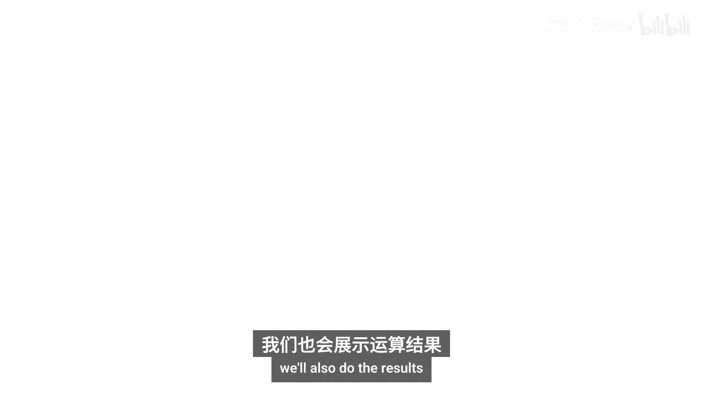

# 【加州大学】C语言编程基础-｜-C-For-Everyone-p14-P14_运算符_02_01_05--BV1Fqe7zDEVT_p14-

🎼2。🎼，We've already talked about。Operators and operator press lens。

 which very important to figure out。How expressions will be evaluated and there's quite a few levels of operator press lens we've already seen。

For or five of these。呃。I want to go into a little more detail。On this。And so。I'm going to。Put up。

The complete operator precedence table for the C language。And we see it here。呃。Found it on the web。

 it's a nice version， there are many this copyright William Swanson。

And notice what he says about the table。Operator precede describes。

The order in which she reads expressions。For example。Expression， A4 plus B times 2。

Contains two arithmetic operators， actually， technically， there's the assignment operators well。

In addition and in multiplication， there's actually three with assignment。Which comes first。

 while the 4 plus B does not get evaluated first， that would be a left to right order。

 which isn't the case。Times has the highest precede。So first。

 whatever B's value would be would be multiplied by 2， and then4 would be added to the result。Now。

 there's also a notion of associivity， whether things associate left to right， which is。啊。

What some operators do and others go right to left。So let's look at the different levels。

 there are something called primary expression operators。

Those include postscript plus plus postscript， minus minus。

The auto increment and auto decrement operators。 It also includes something we will use later。

 which is indexing。And also includes function call， which weve already seen when we call main。

Then there are a bunch of urary operators and they have the next highest prevalence and among them。

Is star， which in this case means dereferencing， and we won't see that。

Until much later in this course or the next course。Also address of which we've seen with scananf。

They。unary plus the unary minus。So you see plus and minus here and those are binary。

So unary minus and unary plus。Bine more tightly。 Have higher precedents。Thenhan the binary operators。

 So you could say plus B plus。A。And the plus B， while in affect it's a no op。Is。First。

Do this unary plus operation。Which doesn't have much value。Then there's a logical negation， negation。

Very important， especially in logical and relational expressions。呃。

Then there's the prefix auto increments。And。Ato decrements。

And we'll see later that we need type casting， and we also will have a special operation called size of。

 which gets us。The size of some expression， how it's stored。 How many bites。嗯。

Here we have operators we've already used a fair amount。 We've had times divide。

 the is actually two operators。 It could be integer divide or floating point divide and modulo。

Here are the binary plus and minus and then below it。Are some bitch shift operators。

And then relation operators less than greater than， greater than equal， less than equal。

And then equality and inequality， the logical is a equal to B or is a not equal to B。

Thenhan the Biwise operator， Ampersand。Which is different than the use up here。

 So one thing that's confusing about sea。Is the overuse of symbols。

 So you have to understand a symbol in the context。 So this is a bit wise， And this is an。

Address of Anne。And we'll see later， Ampersand Ampersand is a logical end。

 just as these two side arrows。A。Logical or， whereas this is a bit shift。

And this is also a bit wise operation。We won't get to use a lot of these operations。

 especially the bitwise operations。 They're rather advanced。 You should know about them。

 as is a fancy ternary operator。 It's ternary because of that three arguments。We'll get to see it。

Shortly， but again， it's a bit esoteric。Finally， we have these assignment operators， the normal one。

Just assign sign。Then plus assignment， minus assignment， times assignment， et cea。And finally。

 we have the lowest precedence operator， which is a common operator， which。

Is associating left to right。And the comma operator is quite interesting， though， again。

 it shouldn't be used because of too often because it's fairly subtle。

 And it means first evaluate in a left or right order， the first expression。

And then go to the next expression， and then go to the next expression。 So also。

 the comma operator forces a sequence of evaluation， which is sometimes useful。

To make sure you understand how these things work， at least。And things you've already used up to now。

You should be able to do what's three times5。 All right， That's pretty easy。 I'll tell you， it's 15。

Now， what's three times5 plus2。 here you have to know that the plus2 is added on later。Right。

 times goes first。Now， you can override precedence with parentitization。

So three times5 plus2 is different than three times 5 plus2。However。

 you could also have had paren three times。Pranify。Plus2。And that would have just reinforced。

The implicit ordering。So， again， you can work through a bunch of these。

 Just make sure you understand how they work， how to do the order of evaluation。 Here's that funky 8。

Is it equal to plus8？Remember， this plus is。Uary plus。

And then here we get into the difference between integer divide 3 integer divide 5 versus 3。0。

 which is a literal double， a constant that's taken from the doubles divide 5。

And you should understand why these give different results。Okay。We also doquis。

