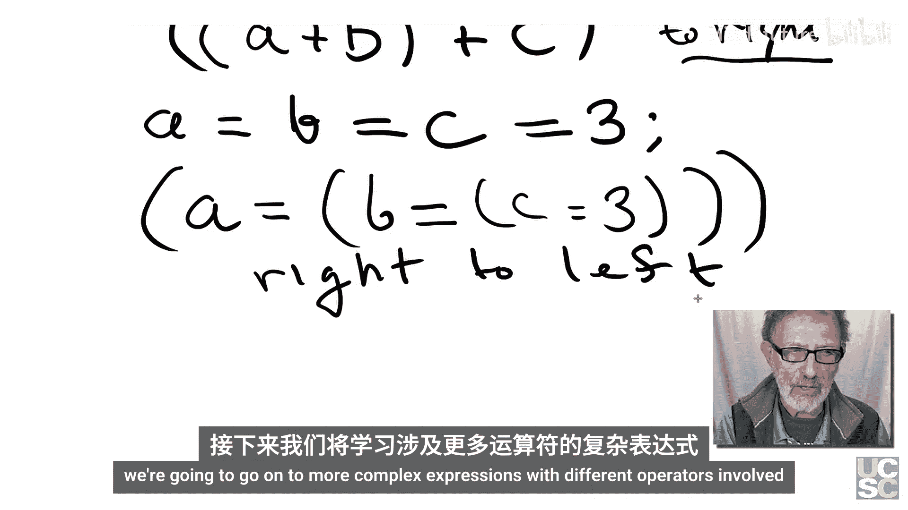
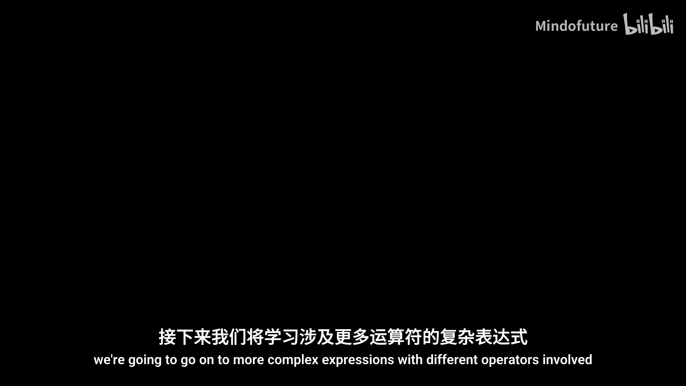

# 【加州大学】C语言编程基础-｜-C-For-Everyone-p15-P15_表达式和优先级-包含文件_02_01_06--BV1Fqe7zDEVT_p15-

🎼TheYeah。In this segment we're going to talk about expression evaluation。

C is a language rich with operators。And it's very important to know how。The operators allow。

Combination in what order they're applied。I'm going to show you some very simple cases so you can get。

They啊。Central idea and the central idea is going to be。Know how the operator works。

 know its precedence， and know its associivity。So we're going to start with three very simple variables。

As we declare them NC， we would sayentt A is initialized to one。Es弦 n。

Deeclaration is the initializer symbol。And B is initialized to two and in C。Is left uninitialized。

 normally most systems would make that zero。So we have three variables to work with in our code。

Here's a very simple expression using those。C is this equals means asi。So in this case。

 we are seeing an assignment statement。Read that as C is assigned。The expression， A plus B。

Semicolon is a。End of。The operation。So it's signaling a sequence， what's called a sequence point。

In the computation， everything that happens happens on that line。

 and then you're finished and then you go on to the next line。Now， as we know， a was。Initialized to1。

 B was initialized to two， so we would expect C to become three。

So this is a assignment expression inside it is。A binary。Plus， operator。

And thats says C has assigned a value of。And here we use parentheses， A+ B。

And parentheses are critical in the C language。When you're evaluating expressions。

 because they always override any other part of the expressions precede。

So they clearly show if youre confused otherwise， or it's a very complicated expression。That。

This is how you want the order of evaluation to occur。So as we just said， C becomes three。

 that should be straightforward。Let's go on。Precidence when we have。

Something like 16 levels of precedence in sea operators。Things that are very low precedence。

 for example。Tend to happen。Later or last， so assignment itself as an operator has very low precedence。

However。啊。Certain operations like cuary operations， like the operationeration negation， which is。

foound when you're doing some logical expressions and where you use the exclamation point is a very high precedence operator。

 as is something like auto increment or auto decrement。

 which are operators that use the symbol plus plus and minus minus。

And then somewhere in the middle are alphametic operators and in the alphametic operators。

 you have multiply， for example。Which， in this case is。Featured with this。Sar。

And that has a higher precedence than simpler Athmetic operations plus in binary minus。By the way。

 note that you can also have unary minus and unary plus。

And the only reason you would know the difference is context。Or app parentheization。

And a unary operator like these are higher than the corresponding binary plus and minus。

So binary plus or minus state two arguments， unary takes one argument。And then times and indeed。

 things like multiply。啊。And multiply and。And divideivide。Our higher precedents again。

And there's also on that level， the remainder operator percent， which again。

 or sometimes called the modular operator remainder operator。Which is also a higher precedence。

Equivalent to a multiplier or a divide。The addition operator or distractionion operator。

Why is that important because these get mixed up in an expression， you have to know which goes first？

The other thing you need to know about is associivity。How do the operators associate？

So when you have an operator， A plus B plus C， this's just got two operators。Which goes first。

 do you apply B plus C first and then do A？Or do you do a plus B first and then C。And。

It turns out that these operators occur left。To right。

And the overwhelming number of operators are left to right。

And we show the equivalent parentheization here。So we would get a plus B parentheses plus C parentheses if we wanted to fully parenthesize this expression to make it clear what the。

Implicit order of evaluation based on sosociivity。Now， looking at this other expression。A。

 assigned B， assign C assign3， we get right to left。

 that means the C assigned3 occurs first then the B。Its a that expression value。

 then the a is assigned sign， and what you'd all end up with is everything would end up being three。

All right。Try to absorb that， make sure you can write code of this kind and know how to evaluate it and we're going to go on to more complex expressions with different operators involved。

