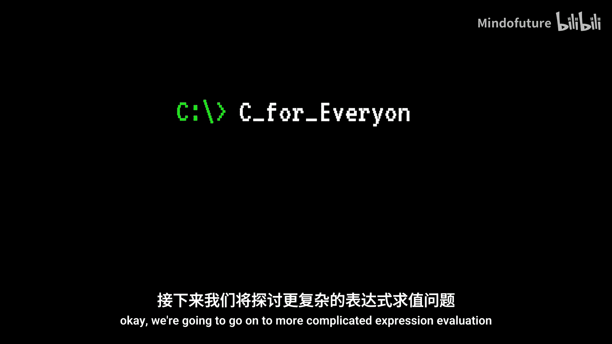
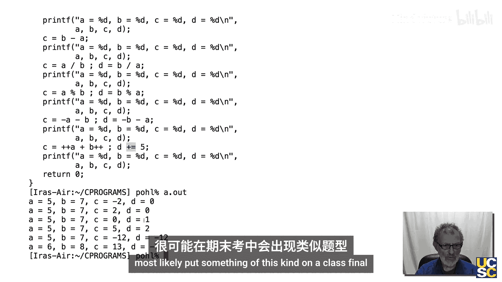

# 【加州大学】C语言编程基础-｜-C-For-Everyone-p16-P16_表达式和求值_02_01_07--BV1Fqe7zDEVT_p16-

🎼Yeah。

🎼，🎼The。Okay， we're going to go on to more complicated expression evaluation。

We're going to look at some more involved cases。One of the things that gives a lot of people trouble at first。

Is to remember that tokens like the slash token have different meanings in different contexts。

So besides the fact that a slash token can be used。To be part of a comment。

A single slash is generally a divide in an expression。

But that divide could be either the integer divide operator or the floating point divide operator。

 and that gets determined contextually。Similarly， people have trouble with the remainder or modular operator。

 modulus operator。Somehow they don't use that as much in daily practice。

 so it's hard for them to remember how that works。Then there are operators that are unique to the C language。

 and they include。啊。Auto increment and auto decrement。 and their。Plus， plus and minus minus。

And then there are operators that are based on assignments， so they are ordinary assignment。

 but also an operator like plus。A sign， so you might see plus equals or minus equals。

 but when you see equals equals。That itself is a logical operator， so context means a lot。

I shouldn't say these things are unique because while C pioneered much of this stuff。

 they do get used in typically languages derived from C or with some inspiration for C。

 so you'll see such operators in Java and C++ as well。

Now if stuff gets too confusing and expressions。Then。

To unconfuse yourself and people reading the code and maintaining the code use parentheses。

 And keep in mind parentheses override the built in。Precience and associivity of the operators。

 so a times B， which is high precedence than plus。啊。If you had A times B plus C without parentheses。

 it would mean that first thing would mean first to a times B because of its higher precedence。

 then add and C。But if you wanted a times。B parenthesize C。

Then you'd have to use parenticide because that would override the precedence and associivity of those。

The built in ones for those operators。There are also gotchas that you have to keep in mind and a typical one is the use。

Of divide， when it's an integer divide， you don't have this problem with multiply。

 but3 divide 7 is going to be 0， whereas 7 divide 3 is going to be。A2。And in those cases。

 there would be a remainder， and the remainder just gets thrown away， but five divide 2。0 because 2。

0 is a floating point constant。Is indeed 2。5， which itself is a floating expression。Finally。

 the modo operators， as I say you have to familiarize yourself with it。

 If you haven't used the idea of modulus for a while。

 that's just what a remainder is in an in divide。 So three modo7， a remainder would be 3 or 7 mod 3。

 the remainder would be one。Here's the use of pre and post increment。

These are specialized but very useful because they abbreviate what would be。

LetLet take some more writing。So the pre increment in Aly plus plus B。

What it means is b is assigned b plus1， so b plus 1， the increment gets done first。

Then the assignment a。It's assigned the resulting value。A be。After the increment in the post case。

 which has higher precedentnce， by the way。A assigned B plus plus。

It's the equivalent as A is first assigned B， so if b was5， a would be5， but then B would become6。

All right， so I hope you'll experiment and I'm going to show you an experiment right now。

I'm going to switch over to my runtime window。So here's some code I wrote earlier to experiment and this is code that you should try to either copy。

Or write your own code of this kind and just try to。Check your understanding of evaluation。

 make sure what gets done on the machine is what you expected。So in the first case。

 we have equals sine meaning initialized， so a is initialized to five， D is initialized to zero。

Then we have an expression where C is assigned a minus B。

WellA is 5 and b is 7 so we'd expect 5 minus7 to be minus2， so if we use that print statement。

 we should see a is equal to 5， B is equal to 7， C is equal to minus2 and D is equal to zero。Now。

In this part of the code。We're seeing how integer divide would happen， so5 integer divide 7。

 that's going to be zero。D will be equal to7 divide5， so that will be1。

If this had been all in floating point environment， if everything had been set up as floating point。

Instead， you'd have。The equivalent of five7s in floating point or。7 fifths or 1。4 for D。

 but that won't happen， you're going to get zero and one。Also， further on here。

I won't look at the module let you work that out， but here's an interesting one。

Here we see the difference between。Uary minus。And binary minus。

 and urary minus has higher precedence， so that occurs first， so5 becomes minus5。

 and then we have a binary minus where we sub track 7。Positive value 7， and the result should be。

Here we're seeing。The difference between。Prefix。A increment。So a will move from 5 to 6。

 but this is postfix auto increment。 So B remains 7。 So 7 plus 6， C will become 13。

 But then when the whole thing is executed after assignment， then B will become 8。

And here we see the plus。Assignment operator。 So this means whatever deed's value was。

 where in the earlier case D would be-12， we would add in 5 so we'd end up with a -7。So again。

 try to understand all this。And then here's actual。

The actual running of the program results in these values。And I will write a quiz for you。

Most likely puts something of this kind。On a class final。

