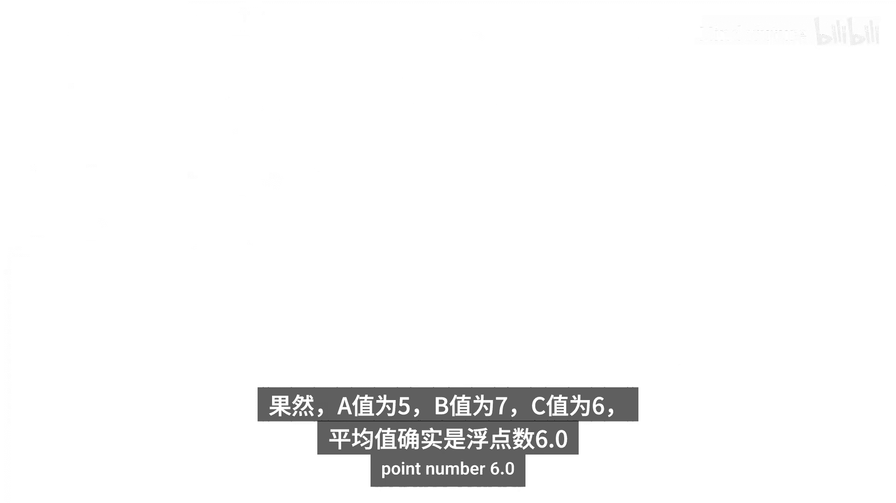

# 【加州大学】C语言编程基础-｜-C-For-Everyone-p17-P17_声明_02_01_08--BV1Fqe7zDEVT_p17-

🎼TheYeah。In this segment， we'll talk about the structure of the program that includes declarations and an especially important operator。

Assignment and how it relates to expressions as well。And all of this is wrapped up with types。

 so we're going to talk in detail in the next few segments。

About the type logic of the C programming language。Now types。呃。

Some of the types we've seen already are int and double， there will be other types。

 there will be other simple types like char， float， unsigned。

 and then there'll be more complicated types later on。That involve strs。For the moment。

 we'll concentrate on these two distinct types int， which is in effect， a integer type。

supposedposed to represent precisely the whole numbers and double， which is a floating point type。

 which is supposed to。Represent scientific numbers。With a very large range。Now。

A declaration a simple declaration is going to look like。A type followed by an identifier。

With the semicolon。So here we see。A。Simple example on this side。

Then a more complex example is a type identifier， followed by the。Equal sign， the equal character。

And an initializer， this is not assignment。 This is initialization。 It declare in the declarations。

Deeclarations， by the way， occur at the head。Of。A body of code。Or at the head of the program。

And here， we have。Again， a very simple example， int。The variable A assigned 2。

So there we mean that we're going to in that piece of code。

Treat a as something that can get different values as long as their integer。

 as long as they fit within the type。Ent， and we'll explain more about what it means to fit in the type int。

And 2。Finally， we can have a more complicated type decoration in which we have a list。

So here's one of those。A assigned or initialize three comma。 So it's a comma separated list。

 It can be arbitrarily long， and this has two。Variables。

 one initialized to three and one initialized to five。Okay， let's restart。

Here we have a piece of code that are already typed in。

It's supposed to show you an example of the use of elementary declarations and assignments。

In this piece of code。呃。Again， at the head of what's called the block， the block starts with at。

Open brace。We have。A declaration list with initializers。 So A is of the type int。

 B is of the type int。 C is of the type int。 And if we think about what's stored in their memory location。

 A is 5。 V is 7。 C is 6。And then we're going to use， we're going to do a simple averaging。

 and we're going to use a variable average， and that average is going to be initialized to 0。0。

 though that may be unnecessary。Because it's just good practice to initialize variables。

 because sometimes when you forget to do that can lead to errors if you allow the system to do the initialization for you。

Here's a print f that'll show us that we assigned what we've assigned。

 and then we're going to do an average， and in this average we see A plus B plus C。

 normally that's integer expression。We divide by 3。0 y because we divide by 3。This will be purely。

And enter your division。And we may have a rounding error。But we want it to be done。In double。

 we're going to talk more about why this occurs as a double。 This expression will occur as a double。

 So this is overall an assignment expression。But。Conversion。Would have been if there was a three。

 we would make this integer expression and then assign it to a double。 In this case。

 this is a double expression assigned to a double。 So there's no conversion。 Again， as I say。

 difficult topic。 very tricky。 We'll talk a lot more about conversion。 And here we just print it。

 So it's a very naive program。啊。Let me escape。And I compiled it already and let me run it。

And sure enough， A is5， B is7， C is6， and the average is indeed the floating point number。

Six point Si。

