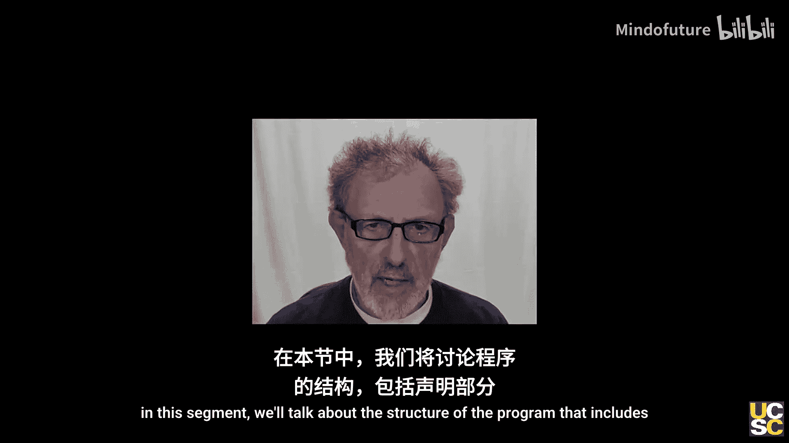
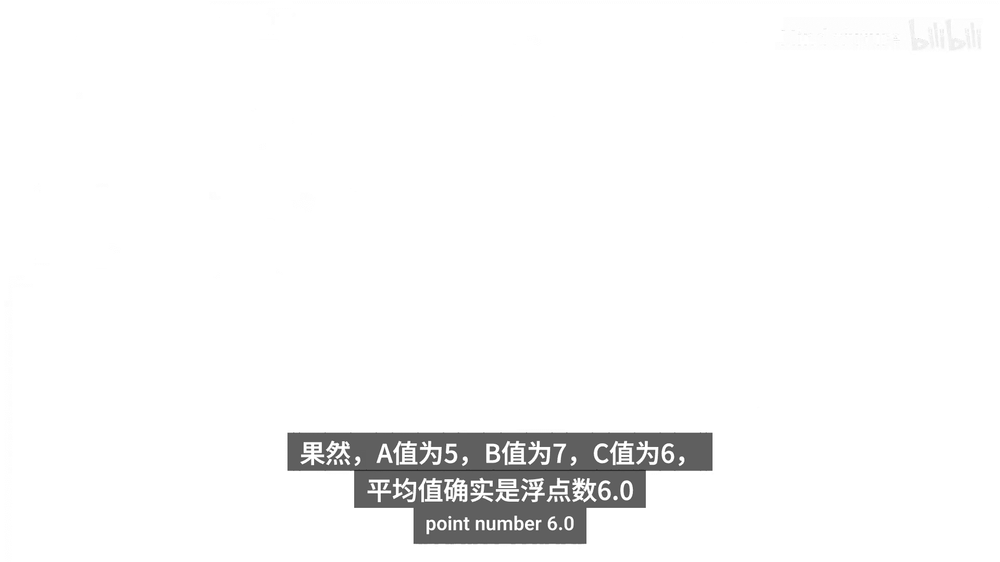

# C语言编程基础：P17：声明与赋值



## 概述
在本节课中，我们将学习C语言程序的结构，重点探讨声明、赋值运算符以及它们与表达式的关系。所有这些概念都与**类型**紧密相连，因此我们将在接下来的几个小节中详细讨论C语言的类型系统。

## 程序结构与声明
上一节我们介绍了程序的基本结构，本节中我们来看看**声明**的具体形式。声明通常出现在代码块或程序的头部。

一个简单的声明格式如下：**类型** 后跟一个 **标识符**，并以分号结束。
```c
int a;
```

更复杂的形式是声明并同时进行**初始化**（注意，这不是赋值）：
```c
int a = 2;
```
这意味着变量 `a` 被声明为 `int` 类型，并初始化为整数值 `2`。变量 `a` 后续可以被赋予不同的值，只要这些值符合 `int` 类型的范围。

我们还可以在一个声明语句中初始化多个变量，这是一个用逗号分隔的列表：
```c
int a = 3, b = 5;
```

## 类型系统简介
C语言有多种类型。我们已经见过的有 `int`（整数类型）和 `double`（双精度浮点类型）。后续还会遇到其他简单类型，如 `char`、`float`、`unsigned`，以及更复杂的类型（例如涉及字符串的类型）。目前，我们专注于 `int` 和 `double` 这两种基本类型：
*   `int` 用于精确表示整数。
*   `double` 是浮点类型，用于表示具有很大范围的科学计数法数字。

## 声明与赋值实例分析
理解了声明的基本形式后，让我们通过一个具体的代码示例来观察声明和赋值是如何协同工作的。

以下是一段已经编写好的代码，它展示了基本声明和赋值的用法：
```c
#include <stdio.h>

int main() {
    // 声明并初始化三个整型变量
    int a = 5, b = 7, c = 6;
    // 声明并初始化一个双精度浮点型变量
    double average = 0.0;

    printf("a = %d, b = %d, c = %d\n", a, b, c);

    // 计算平均值并赋值给 average
    average = (a + b + c) / 3.0;
    printf("average = %f\n", average);

    return 0;
}
```
在这段代码中：
1.  在 `main` 函数代码块的开头，我们声明并初始化了三个 `int` 类型变量：`a`, `b`, `c`。
2.  同时，我们声明并初始化了一个 `double` 类型变量 `average`。将其初始化为 `0.0` 是一个良好的编程习惯，可以避免因系统未初始化变量而可能导致的错误。
3.  第一个 `printf` 语句用于输出已赋值的变量。
4.  关键部分在于计算平均值的表达式：`average = (a + b + c) / 3.0;`。
    *   `(a + b + c)` 本身是一个整数表达式。
    *   除数我们使用了 `3.0`（一个双精度浮点数），而不是 `3`（一个整数）。这是因为在C语言中，两个整数相除会进行**整数除法**，结果会被截断为整数，可能导致精度丢失。而使用 `3.0` 会使整个表达式 `(a + b + c) / 3.0` 按照双精度浮点数规则进行计算。
    *   因此，整个 `(a + b + c) / 3.0` 是一个双精度浮点表达式，其结果被赋值给同样是 `double` 类型的变量 `average`。这里不需要进行类型转换。
5.  最后，程序输出计算得到的平均值。

程序运行后，输出结果为：
```
a = 5, b = 7, c = 6
average = 6.000000
```
正如预期，我们得到了浮点数结果 `6.000000`。

> **关于类型转换的说明**：表达式 `(a + b + c) / 3` 与 `(a + b + c) / 3.0` 的结果有本质区别。前者是整数除法，后者是浮点数除法。类型转换是一个重要且微妙的话题，我们将在后续课程中深入探讨。



## 总结
本节课中我们一起学习了C语言程序结构中的核心元素：**声明**与**赋值**。
*   我们了解了简单声明和带初始化的声明的语法。
*   我们认识了 `int` 和 `double` 这两种基本数据类型。
*   我们通过一个计算平均值的实例，看到了声明、初始化、赋值以及表达式求值是如何在程序中结合使用的，并初步接触了整数除法与浮点数除法的区别。
*   我们强调了初始化变量的良好习惯，并预告了类型转换这一重要主题。