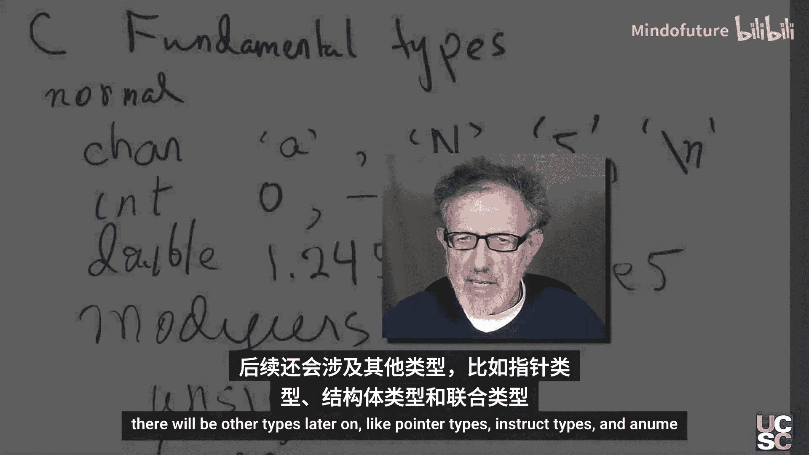
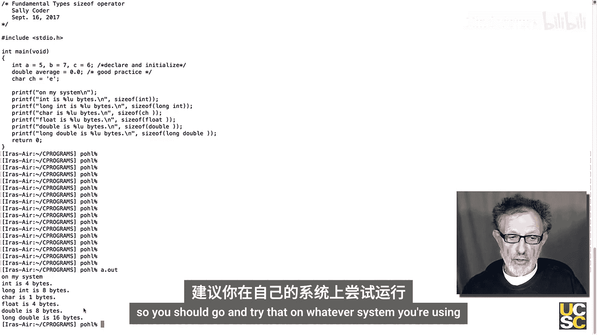
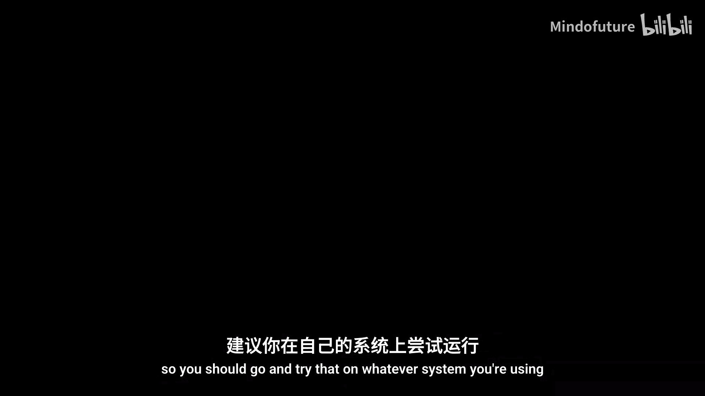

# 【加州大学】C语言编程基础-｜-C-For-Everyone-p18-P18_基本类型和sizeof_02_01_09--BV1Fqe7zDEVT_p18-

🎼，🎼，So let's continue to talk about the C fundamental types。

 there will be other types later on like pointer types instruct types and aum types。

But for the moment， we're going to concentrate on。A fairly simple set of types。Maybe not that simple。

And our early computations will do a lot with int and double and char。And。Intuitively。

 you can understand that a chaer might be a special character like a or a capital N or the character thus's the digit 5。

 which is going to be different than the value。Or an unprinted character。

That moves your screen aligned， so that's represented by backslash n。So the characters can represent。

What's called the ASCI。Table of characters。It's typically all the lowercase， all the uppercase。

 punctuation， operator characters， digits， and some special characters like。New line。The integers。

Are pretty much what youre used to since grade school。

There are numbers like zero or minus3 or plus 77。And then finally there are doubles。

 these are more like the scientific notation。And there you get numbers like 1。245 or 3。

2 with an E which designates that something is an exponent。The exponent is a power of 10。

 so it's 10 to the fifth。So that's going to be 320，000。Then。

We're going to allow the fundamental types to have further modifiers。

 The two critical modifiers are going to be unsigned and long。

The idea of unsigned is going to apply to strictly the integers。

 and that's going to mean that you're going to rule out the negative numbers。

Long is going to apply to both the energies and to the doubles， and they're going to mean。Well。

 we might have a range which typically for the energies is plus or minus 2 billion。

 and we want a longer range。So。呃。That will increase the range of those numbers significantly and we might need it for a。

A bigger calculation over bigger numbers。Finally， the same thing is true for doubles。

 we're actually going to have three kinds of doubles。We're going to have float。

Double and long double。And on a typical implementation。

These are going to be longer and longer and therefore capable of storing a bigger and bigger number。

Well。It's not like mathematics， it's not like you can imagine a number like pi in which there's an infinite number of decimal plays。

 so the mathematician's conception of pi。Is potentially this infinite string。That's not doable。

A computer memory of finite resources It organized in terms of bites， a bite。Is your unit memory。

 which is。Conventionally，8 Bs。And eight bits can only store so much information。Basically。

 they can store。To the eighth。So here's a number that could be stored。

Typically these things are bits， 0，0，0，10，10， remember。Computers are binary。And they store bis。

 they store them somehow electronically， magnetically。

Unless you are going to work with some kind of fancy quantum。But on all our actual digital computers。

 modern digital computer。Uses a base2 designation and bits to represent whatever you need to represent。

When running a piece of computer code。Well， if you look at this。This is the zero's place。This is。

This is two to the fourth， two to the third， two to the second， two to the first。Excuse me。So。

Two to the to the the。Yeah。I have this one。It says two to the fourth， which would be 16。And。2 to the。

2 squared is4， so we're going to actually get。The number is 20。

Very easy to make a mistake if you're not a computer。On a typical machine。An int is4 bytes。

 and an int can be used to represent between roughly 2 billion， minus 2 billion and plus 2 billion。

 this is more exact。Actually， this is equal to。Two to the 32。-1。

And that shows you four bytes can be used to store 32。Binary digits。

 one of the digits is going to be used for the sign。So that leaves。31 digits for everything else。

 and that's why this can be roughly two to the 32 minus one。Now， when you write your code。

 you need to know what is representable。The way you can find that out。

 you can see what a ty will stored by using a built in operator， one of your keywords in C。

 using size of。And we're going to show that。So one of the funky things about C is certain things can be system dependent。

Why is that？Because C attempts to be efficient in relation to the underlying computer。

So it's not attempting to have universally the same semantics because some computers have very big word sizes and some computers have small word sizes。

 and she wants to run efficiently on a computer that has an in size of two bytes。

As well as a supercomputer that might have an in size of 64。Excuse me， in size of two bytes。

 as well as supercomputer， which might have a 16 byte inch。So you do have to know and realize that。

You're running on a particular system。And you can even， if you're a very sophisticated program。

 ensure that your system has。Sizes that are appropriate for。Your computation。

And you can look at that dynamically by using this size of operating。 You see here。

 there's a size of。Print。The size of long int。A size of a char。 And here you see。

 you can use a variable。 I could have said char， but I can also use the variable。

 So size of will operate on either a variable name or on an actual type name。 Here's float。

 double and long double。 And let's execute that program for the system。 It's a Macintosh system。

And there on my system， an in is4 bytes， a long in is8 bys， a charge one by， a float is4 bytes。

A double is eight bytes and a long double is 16 bytes。

So you should go and try that on whatever system youre using。

