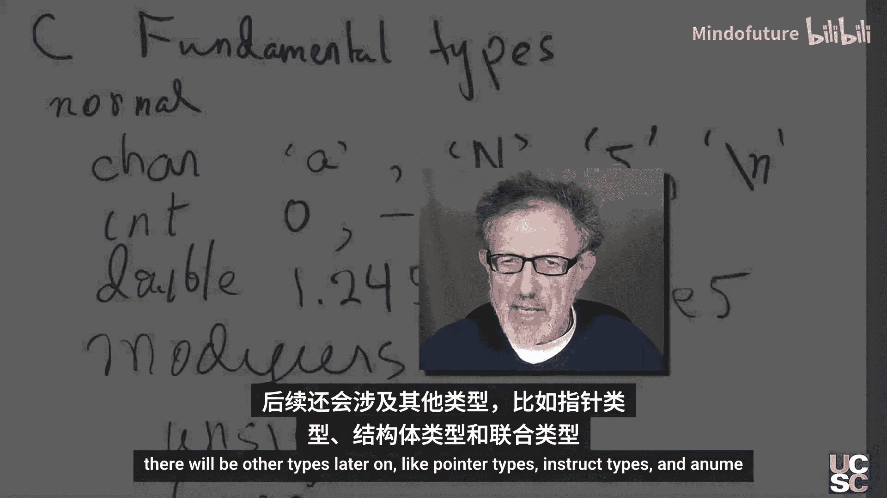
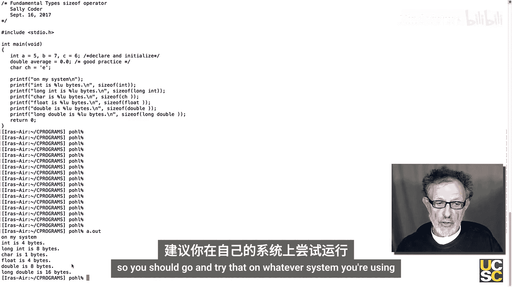
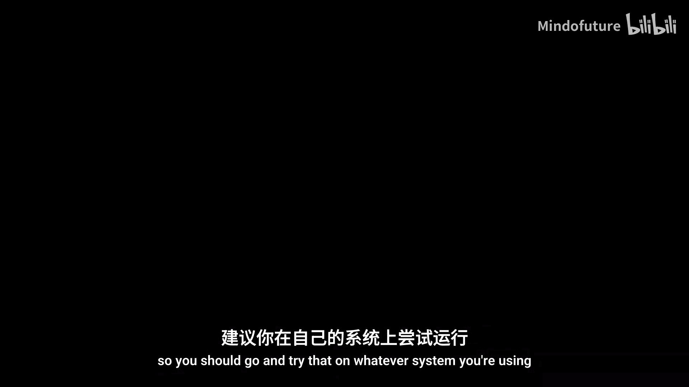

# C语言编程基础：P18：基本类型与sizeof运算符




在本节课中，我们将学习C语言中的基本数据类型，并了解如何使用`sizeof`运算符来获取这些类型在特定系统上所占用的内存大小。理解这些概念是编写高效且可移植代码的基础。

## 基本数据类型简介

上一节我们介绍了C语言编程的概览，本节中我们来看看其核心的基本数据类型。C语言包含多种类型，例如后续会学到的指针类型、结构体类型和枚举类型。但目前，我们将专注于一组相对简单的类型。

我们的早期计算将大量使用`int`、`double`和`char`类型。直观上，`char`可以表示特殊字符，如‘a’、‘N’或数字字符‘5’，这与数值5不同。它也可以表示不可打印的控制字符，如换行符`\n`。字符通常代表ASCII字符表中的内容，包括大小写字母、标点符号、运算符、数字以及换行符等特殊字符。

整数类型`int`与我们自小学以来使用的数字类似，例如0、-3或+77。

双精度浮点数`double`则更类似于科学计数法表示的数字，例如`1.245`或`3.2E5`（其中E表示指数，即10的5次方，所以结果是320,000）。

## 类型修饰符

接下来，我们将看到基本类型可以拥有进一步的修饰符。两个关键的修饰符是`unsigned`和`long`。

`unsigned`修饰符仅适用于整数类型，其含义是排除负数，只表示非负整数。

`long`修饰符可同时应用于整数和浮点数类型。它的作用是扩展数值的表示范围。例如，典型的`int`范围大约是±20亿，而`long int`可以提供更大的范围，以满足涉及更大数字的计算需求。

对于浮点数，我们实际上有三种类型：`float`、`double`和`long double`。在典型的实现中，它们的长度依次增加，因此能够存储越来越大的数字（以及更高的精度）。

## 计算机内存的表示限制

然而，计算机表示数字的方式与数学概念不同。例如，数学家概念中的π是一个无限不循环小数，但计算机的内存资源是有限的。内存以字节为单位组织，一个字节（byte）是内存的常规单位，通常由8个比特（bit）组成。

八个比特只能存储有限的信息。本质上，它们可以存储2的8次方种状态。计算机是二进制的，它们以某种电子或磁性方式存储比特（除非使用某些高级的量子计算机）。我们所有的现代数字计算机都使用以2为基数的比特来表示任何需要表示的内容。

例如，一个二进制序列`00010100`，从右向左，每一位代表2的幂次（2^0, 2^1, 2^2, 2^3...）。计算这个序列的值是20（`0*2^7 + 0*2^6 + 0*2^5 + 1*2^4 + 0*2^3 + 1*2^2 + 0*2^1 + 0*2^0 = 16 + 4 = 20`）。如果不是计算机，我们很容易算错。

## 类型大小与系统相关性

在典型机器上，一个`int`占用4个字节，可以用来表示大约从-20亿到+20亿的整数。更精确地说，其最大值是2^31 - 1（因为4字节对应32位二进制数，其中一位用于符号位，剩下31位用于数值部分，所以范围大约是±2^31）。

当你编写代码时，需要知道什么是可表示的。你可以使用C语言的一个内置运算符（关键字）`sizeof`来查明一个类型存储所需的大小。我们将演示这一点。

C语言的一个特点是，某些属性可能依赖于具体的系统。这是因为C语言试图针对底层计算机实现高效运行。它并不追求在所有平台上都有完全相同的语义，因为有些计算机的字长很大，有些则很小。C语言希望能在`int`大小为2字节的计算机上高效运行，同样也能在`int`大小为16字节的超级计算机上运行。

因此，你必须了解并意识到你正在特定的系统上运行。如果你是一个经验丰富的程序员，甚至可以通过编程来确保你的系统拥有适合你计算任务的数据类型大小，并且你可以使用`sizeof`运算符动态地查看这些大小。

## 使用sizeof运算符

以下是如何使用`sizeof`运算符的示例。你可以对类型名或变量名使用`sizeof`。

```c
#include <stdio.h>

int main() {
    printf("Size of long int: %zu bytes\n", sizeof(long int));
    printf("Size of char: %zu bytes\n", sizeof(char));
    
    char c;
    printf("Size of variable c: %zu bytes\n", sizeof(c)); // 也可以对变量使用
    
    printf("Size of float: %zu bytes\n", sizeof(float));
    printf("Size of double: %zu bytes\n", sizeof(double));
    printf("Size of long double: %zu bytes\n", sizeof(long double));
    
    return 0;
}
```

在演示者使用的Macintosh系统上执行该程序，得到以下结果：
*   `int`：4字节
*   `long int`：8字节
*   `char`：1字节
*   `float`：4字节
*   `double`：8字节
*   `long double`：16字节

你应该在你使用的任何系统上尝试运行这段代码，以了解其类型大小。

## 总结





本节课中我们一起学习了C语言的基本数据类型（`char`, `int`, `double`）及其修饰符（`unsigned`, `long`）。我们理解了计算机内存以有限字节存储数据的本质，以及由此带来的数值表示限制。最重要的是，我们掌握了`sizeof`运算符的用法，它可以返回类型或变量在**当前系统**上占用的内存字节数，这是编写可移植和高效C程序的关键工具。记住，类型的具体大小可能因系统而异，使用`sizeof`是获取准确信息的可靠方法。