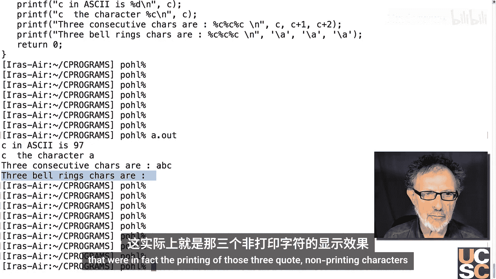

# 【加州大学】C语言编程基础-｜-C-For-Everyone-p19-P19_char类型-包含文件_02_01_10--BV1Fqe7zDEVT_p19-

🎼TheYeah。

So we're going to discuss the fundamental type char。

Char is going to let us do a lot of text processing。

And char is the constituent in a string。 though later we're going to understand how strings are just。

Series of char， actually， when we learn more about that。

 we'll see that a string is basically an array of char。With a sentinel character at the end。

 this is basically a zero。So chaAR is a fundamental data type。

And a literal or constant cha includes things like the lowercase letters。

There's a represented in your。Code as。呃。Single quote， X single quote。

But also you could have a digit like seven。And it would be represented again， unlike。

 it wouldn't be seven because if seven was without the quotes。

 then it would be the literal or constant int。And then for example。

 there are also and we've already used them。啊。Non printing characters， characters that don't show up。

Directly on the screen， but do something and the most common one is backslash N。

 which tells you to advance to a new line。Now you don't have to memorize this。

 but in most texts or online， you can find the values of。Standard，0 to 10 and。27。

 so it's actually 1 table of 128 characters that can be printed or the non printing characters that will do some action on your computer system and among those characters。

Are， for example， the uppercase。 And what's nice about the uppercase， if you remember， capital A。

Is an integer value 65。Then they actually appear in the ASI table adjacent to each other。

 and capital B is 66 and capital C is 67 and so on until you reach capital C。

 which is 90 and similarly with the lower case， though they're in a different place in the table。

 So a lower case A is 97。 And then it sequences all the way to lower K C， which is 122。

This is a bit confusing digits。When you use them as char。Have a value。 so it's digit zero。

As a character is actually integer value 48。 and it is also a sequence from 0 to 9。

 So you have all the decimal digits available。For purposes of using them as char or internally in a string。

 and they range from the integer value 48 to 57。And then there are others。

 all the other characters you find on the keyboard。

 and these are punctuation characters and operator characters and special characters like Dollar sign。

 And they're all available in the ASII table， and they all have a particular integer value， except。

Unless you are a memorization freak。呃。You're going to have to look them up。But of course。

 you can quote them and then。They will indeed also have this internal integer value。

And one of the things about this is you can store these in a bite so you can use。

8 Bs and store the entire any of the ASI values。Now。

9 printing characters are very important as well because they promote actions on your computer system。

Backslash n。See you can't have n because that would。Be printed as N。

 but backslash N sort of escapes it。 So the idea is backslash N is a special non printing character。

 And indeed， when you put it in a printer F。Integer value is 10。

 but what it does is advances to the next line on the screen。

Backslash A is also a non printed character， and as value as seven。

 and if you were to use it inside a program， it would on your system， ring a bell or make a sound。

So that's the character set you can use and now let's show a simple program。For how that may be used。

So I wrote this program to show how。Would be used in a very simple way and just show how。Characters。

When printed as a percent C。See here。Precent C is in that format string。

That's going to print out as a character notice， the character。

Is declared the variable C is a character valuable。And we're going to assign it。Again， quote。

 single quote， a single quote。And now we're going to print it in two different ways。

 and the first way we'll print it as a percent D。So it should show up as an integer。

In the second print， it should show up as a character。

And then we're going to do the following to show you that。These values the。

ABCs are going to be sequential， so we have three characters to print。And they're going to be C。

 C plus 1 and C plus2。That that your？Integer expressions， but they're interpreted as a character。

 So in effect， the theaski table gets used to show what gets printed。And here。

If you run this on your local system， you should hear something。

 You should hear three distinct noises or bells。And here you have this back slash A。

 which I talked about is a non printing character。 Of course， there's a non printing character here。

 too， and that's in the string， and that's interpreted by print F。

 So print F knows how to interpret that。And if I had put that over here。

If I had made that a character。To be printed using the percent C。

 then what I see is nothing but an advance of the screen。So let's run this。 I already。Compiled it。

And。You see its output。The character C has an ASI value 97。

 as I said in the beginning of the lecture。That's the character A。 So when I printed as an in。

 printed as 97， I printed as a character， Princess A， the three consecutive。Characters。

That got printed or ABC， just as we expect， the three bell rings。Nothing got printed but。

🎼I heard them locally。 I don't know if the microphone picked them up， but there was a bing。

 bing bing。That were， in fact， the printing of those three quote， non printing characters。

