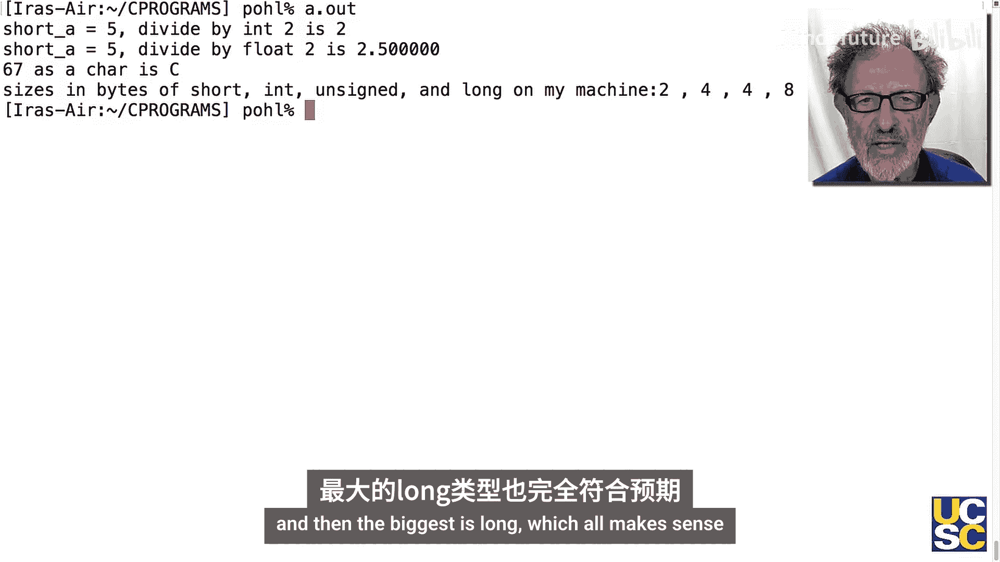

# 【加州大学】C语言编程基础-｜-C-For-Everyone-p20-P20_int类型_02_01_11--BV1Fqe7zDEVT_p20-

🎼TheYeah。

We're discussing further material on data types。Probably the most important data type in the language is int。

So int gives us a basic way of manipulating integer data。

 and that data type includes variations on it， and they will be explained shortly。

 There is a short form， a long form， and an unsigned form。So。

Let me give you my understanding of how to approach learning a difficult subject like programming in programming。

 you have lots and lots of stuff。Much of it is obscure。

But if you concentrate on the things that are typical。An int as typical as a data type。

Then you can get 90% of the value of your study or your。A work。By only looking at 10%。Of。

 of the entire language。 So this is one of the places where the 910 rule shows up。

 Really make an effort to understand the data type in。

 and that will help you with all the all the other and more complicated data types。

 such as the floating types。On your typical modern machine， an int is stored in 32 bits。

That's 32 zeros and ones。And it's even worthwhile， especially if you're going to go into computer science。

 too。Learn how to work。In binary。That's the base base 2， as opposed to how we're writing most things。

 which are base 10。 So's also worth while to learn how to write an octo。

 which is base 8 and hexiddesal， which is base 16。 And we may show some of this later on。Now。

 when you're working with an in stored in 32 Bs。Then。

What you can represent is limited and it's limited to plus or -2 billion。

 And I've written it out here explicitly。You can go positively up to 2147 million436，647。

And your smallest number， your largest negative number， another way to put it is 2 billion。147， 483。

648。It's not symmetric because of the fancy way people represent integers on the machine。

 you can there it's called a two complement representation， typically the first bit。Is， in fact。

 the bit that affects。How you interpret thes？So you also have these other forms of events。Short。

 long and unsigned。 Short， it means use less。Data。Long means you use more。Bigger range。

So short can mean a smaller range。 Typically， you're using fewer bys。

 You'll see in a second when I write an example that for my machine short is 2 bys。

 ordinarydary nus4 Bs。 So we've already said。 And then long will be 8 bys。

 And then there's a further。Type， which is called unsigned and in unsigned。

 you want the data to only be interpreted as positive。So in effect。

 if you have four bytes and you only interpret it as positive。

 you now have range from zero to a little more than 4 billion。So again。

 this can be very helpful and it also can mean in a。Domain where you don't need negative integers。

You have an ability to use the machine to。Work only with that type。Now for each of these types。

 there's a way to present。感して。And。I'm just showing you here。 There's， here's 35。

 That's an ordinary endt。 Here's 35 long。And it also can be a lower case L。 This is 35 unsigned。

 which can also be a lower case U or an upper case U。 And this is 35 unsigned long。

 So you should have all of these available on your machine。

This is quite important to know which type you're using。Both for input and output。

 because an input and output， the different types take different。Formats。

And you may find yourself mixing the types。 And if you mix the types。

 you have to know what domain you're in， and you have to know how the operations。A。

Value is taken from that domain。So a classic problem。

In programming with language like C is the fact that the。

Operator divide can be either an integer operator or a floating point operator。

 and if you have two integers， it's two divided by three， which is zero。There's no remainder。

If it was 2。0 divided by 3 or 2。0 divided by 3。0 or 2 divided by 3。0。

 where one of the arguments or both the arguments are double。

 then indeed you would be in the floating point type。

You would have a type of floater double and your result would be 0。666。

 so this mistake gets made often。When。You are thinking you want to do something like average over some intert data and you forget that。

Dividing。Can be either。An enter your operation or a floating point operation， you can get a mistake。

Okay。Let's look at some code。So here's some code that I wrote。To illustrate some of these ideas。

 and you can play with code like this， you should play with code like this of these ideas。

Are novel to you and you should extend it。And you can see in this code， I have a short。

 short it's a key word， and it really means short int。

 I could say short int just this by just saying short。I'm typing less。 So here's my variable name。

 and I assign it a 5。 Here's a normal integer in normal A， and I've assigned it 67。

 Here's an unsigned integer， and I use in that literal67 to have a U。This is a long and again。

 in order to make sure that the literal is in the right domainome。I say， 67。L。

And then here I'm doing some things to show you what the effects of using that。

 So here's that divide by two problem where at first， I divide by integer 2， and then I'll divide by。

Floating point2， and you'll see a difference show up。You'll also see that here， for short， I use the。

啊。Format HD。Where has。Normally， I could have just used D。

And here's another place where you'll see that the use of the。

Format type will affect how something is represented。So 67， which is the value of normal A。

 when presented with the format type C。Should show up as some kind of character。

You'll see it in the ASCI table。And here is where we can print on my machine。

 because this is a dynamic operation where size of looks up the type and says a short A。

 which is type short。 What size is being stored in on this machine under the system。

 And well see those values as well。Let me run that。And there we are。

 Short a was 5 divided by integer 2， and we get not two and a half but 2。

 but short a divided by the float 2。 that should be 2。0 will be 2。5。67。

 as interpreted as a character from the ASi table， would be a capital C。

And then sizes and the bytes on my machines are 24，4。

The second floor is for unsigned and then the biggest is long， which all makes sense。

