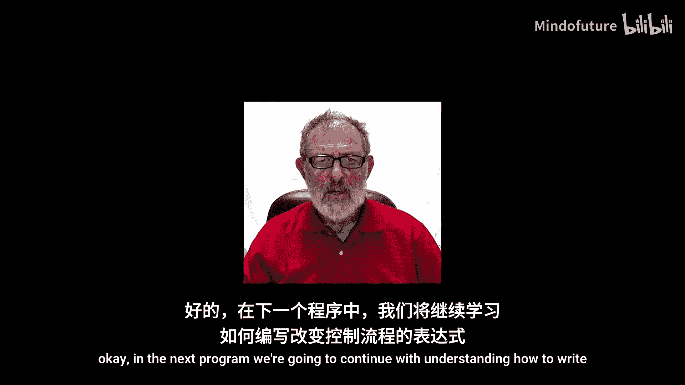
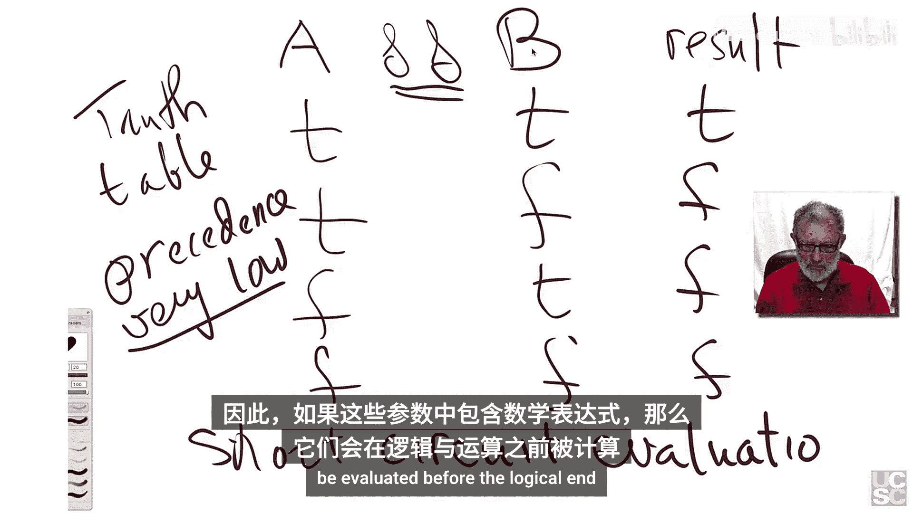
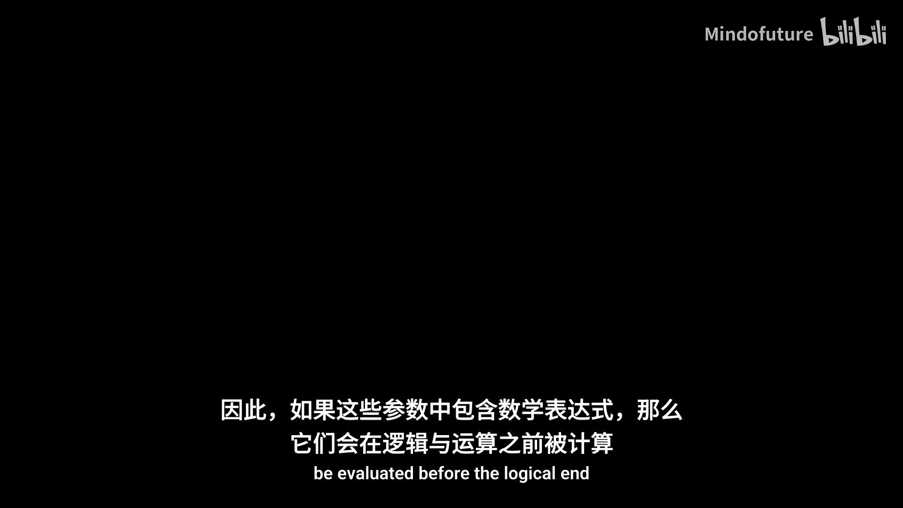

# 【加州大学】C语言编程基础-｜-C-For-Everyone-p22-P22_逻辑运算符、表达式和短路求值_03_01_01--BV1Fqe7zDEVT_p22-

🎼Yeah。🎼，🎼The。🎼最为的。

In the next program， we're going to continue with understanding。Out a right。Expressions。

That changed the flow of control。So we're going to continue to use the FL logic。

But we're going to change the kind of expression we test for。

And the kind of expression we will test for is a logical。And expression。

So you'll see in the heading here。This program is。About logical operators。

And to understand them properly， short circuit evaluation。

This is a program that's going to tell us whether to take an umbrella when we go outside or not。

So first off， where you have to know whether we're outside。

 we'd' need an umbrella on the inside and where have to know whether and we're just going to use。

Very simple values。For whether're inside or outside， outside is going to be assigned one。

 if we're outside。zero， if we're inside。Weather is going to be a one if it's raining and zero if it's not raining。

So in the program， we're asking a user。Tell us whether you're inside or outside。Enter if outside one。

1 representing true，0 representing false。So recall。In an expression in which you test for an effect。

True or false。 What you're really testing for is 0 and none0。So zero represents false。

 one represents true。And the same is going to be the case for the variable weather。

So here we ask for the weather。And then， depending on。What out。

 whether we're outside and whether the rain。It's raining。We're going to write。

 please use an umbrella or dress normally。Well， if you recall anything about elementary logic。

The only time。A logical ancapment is true。Where there are two clauses。

 A and B is when both clauses are true。So outside has to be true。 namely one， weather has to be。One。

 namely rain。And only then would you print F， please use an umbrella。The other three cases。

All involve dressed normally。So you should try to review that。

Or makes sense out of that if you're not familiar with that。Now。We're going to talk about。

A very interesting。Efficiency hack in the C programming language， which is。In this expression。

A foul side is false， namely0。Then it doesn't matter what weather is。We're going to dress normally。

So when outside is false。The expression is already false。

So that means he else dressed normally will be printed。 That's called short circuit evaluation。

 Imagine that these two things are very complicated expressions。

 Then they actually would save you a lot of computation。Again。

 this is the idea behind short circuit evaluation。 You needn't evaluate this part of the expression。

 If the first part of the expression already determines the result。I want to look at some detail。

And the detail is。How to evaluate a。And， and B。And this is just a review， hopefully。And in logic。

 there are four cases。The A can be true。The be can be true。The A can be true。The be can be false。

The a can be false。The be can be true。This is what's called the truth table。And， finally。

Both arguments are false。The result。True。False。False。False。And again。

 if we recall on short circuit evaluation。Any time the first argument determines the overall result in this case。

 when the first argument evaluates the false， we needn't evaluate the second argument。

 So we avoid evaluating the second argument。That's called。Short。Circuit。Evaluation。

One last thing about this operator。Is this precedence？Very low。

And I'm going to go over the whole precede table。 But by very low， I mean。

 it's below any kind of mathematical expression。So there's a mathematical expression involved in these arguments。

🎼Then they would be evaluated before the logical hand。

🎼Yeah。

