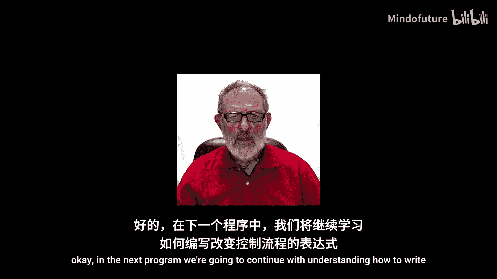
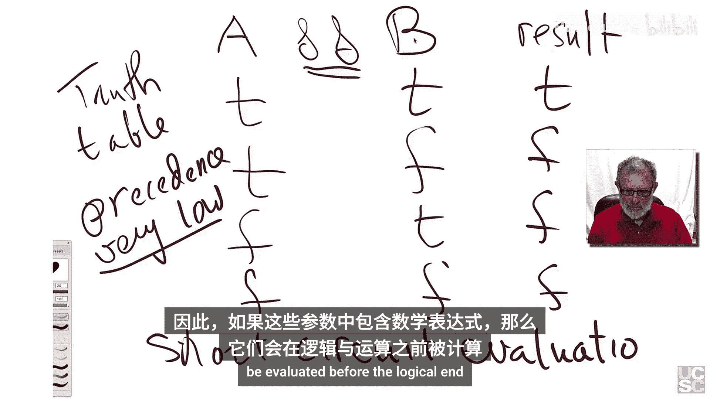
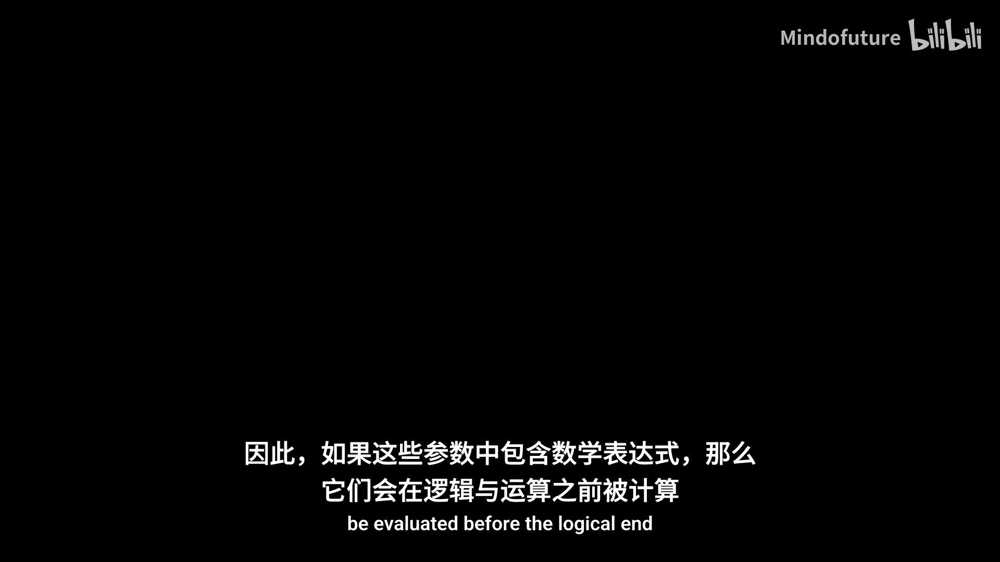

# C语言编程基础：P22：逻辑运算符、表达式和短路求值



在本节课中，我们将学习逻辑运算符、逻辑表达式以及C语言中一个重要的概念——短路求值。我们将通过一个决定是否带雨伞的程序来理解这些概念。

上一节我们介绍了控制流的基本概念，本节中我们来看看如何使用逻辑运算符来构建更复杂的条件判断。

## 程序概述：是否带伞

这个程序将根据用户是否在室外以及天气是否下雨，来决定是否建议携带雨伞。我们使用两个变量：
*   `outside`：1 代表在室外（真），0 代表在室内（假）。
*   `weather`：1 代表下雨（真），0 代表不下雨（假）。

程序的核心逻辑是：只有当我们在**室外**（`outside` 为真）**并且**正在**下雨**（`weather` 为真）时，才需要带伞。这正是一个逻辑“与”运算。

## 逻辑“与”运算符

逻辑“与”运算符在C语言中用 `&&` 表示。其运算规则是：只有当运算符两边的表达式都为真时，整个表达式的结果才为真。

以下是逻辑“与”运算的真值表：

*   **A 为真，B 为真**：`A && B` 结果为 **真**。
*   **A 为真，B 为假**：`A && B` 结果为 **假**。
*   **A 为假，B 为真**：`A && B` 结果为 **假**。
*   **A 为假，B 为假**：`A && B` 结果为 **假**。

在我们的程序中，条件判断可以写为：
```c
if (outside && weather) {
    printf("Please use an umbrella.\n");
} else {
    printf("Dress normally.\n");
}
```
只有当 `outside` 和 `weather` 都为 1（真）时，才会执行打印“请带伞”的语句。其他三种情况都会执行“正常着装”。

## 短路求值

C语言在计算逻辑表达式时采用“短路求值”策略。对于逻辑“与”运算 `A && B`：
*   如果表达式 **A** 的求值结果为**假**，那么无论表达式 **B** 的结果是什么，整个 `A && B` 表达式的结果都已经是**假**。
*   因此，编译器将**不会**再去计算表达式 **B**。

这被称为**短路求值**。它不仅能提升程序效率（避免不必要的计算），在某些情况下还能防止因计算B而可能引发的错误（例如，当B包含除以零的操作时）。

在我们的例子中，如果 `outside` 为 0（假，表示在室内），程序会立即判定整个条件为假，直接跳转到 `else` 分支，而完全不会去检查 `weather` 变量的值。

## 运算符优先级

关于 `&&` 运算符，还需要了解它的优先级。它的优先级**非常低**，低于所有的算术运算符（如 `+`, `-`, `*`, `/`）和关系运算符（如 `>`, `<`, `==`）。

这意味着，如果逻辑表达式的参数中包含数学运算，这些数学运算会**先于**逻辑“与”运算被执行。你通常不需要刻意记忆优先级表，在编写复杂表达式时，使用括号 `()` 来明确指定运算顺序是最清晰、最安全的方式。

例如：
```c
if ((x + 5) > 10 && (y - 2) < 5) {
    // 先计算 x+5 和 y-2，再进行大小比较，最后进行逻辑与判断
}
```





本节课中我们一起学习了逻辑“与”运算符 `&&` 的用法及其真值表，并通过一个生活化的例子理解了C语言中“短路求值”的工作原理。记住，短路求值是一种重要的优化和安全机制。最后，我们提到 `&&` 的优先级较低，在复杂表达式中使用括号可以确保逻辑清晰无误。