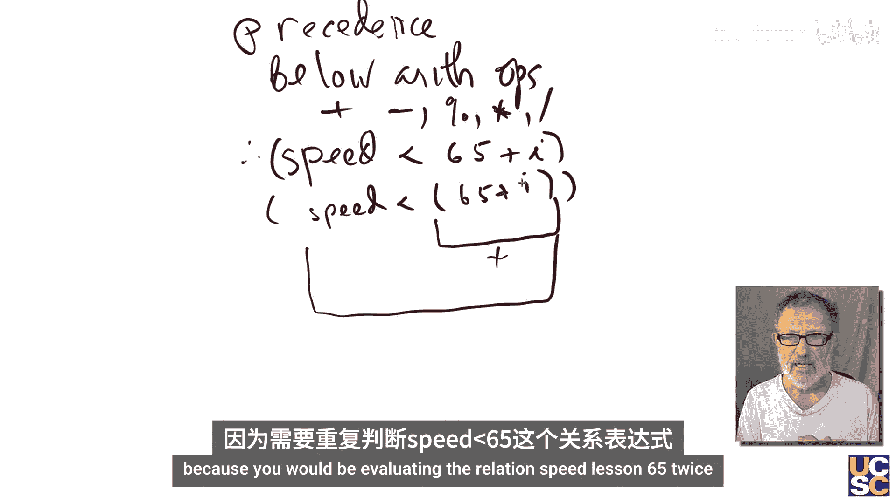
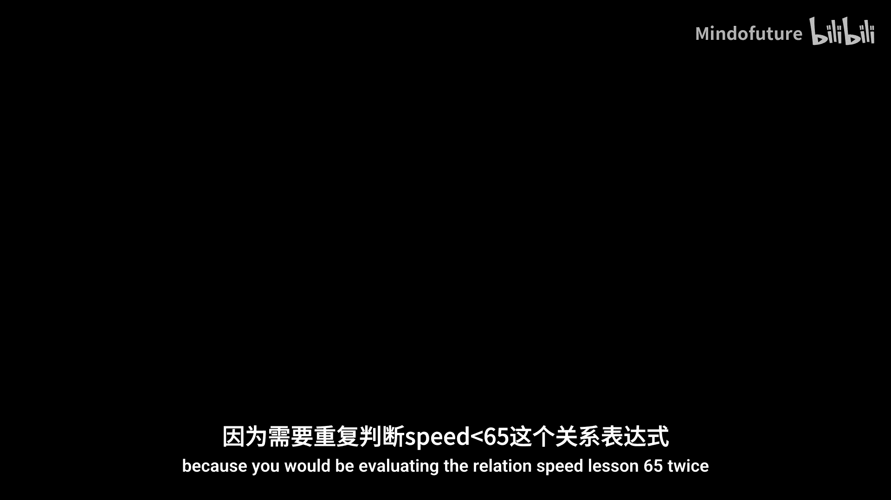

# 【加州大学】C语言编程基础-｜-C-For-Everyone-p23-P23_条件语句-if和if-else_03_02_01--BV1Fqe7zDEVT_p23-

🎼TheYeah。🎼Okay。We're going to have our first example of a non linear program so far the program weened。

Writing and executing。Or do the first line， then do the second line then do the third line。

 Keep going until you do a return of zero。And you end the program。

Not all programs can be that simple。So it's。Very useful to have the ability to。

Test something and then decide whether to do one of a number of things。啊。

Simple one would be one of two alternatives and that's what we're going to study right now。

 and later we'll also study how to do things that are looping as well。But this is fundamental。

We're going either do action1 or action 2， but not both。So this is our first program to use。

An if statement， so looking at the program。We have what's an if L statement at the heart of what we're doing。

And the program is very simple。It asks the user for a speed and asks you to enter your speed as an integer。

And then。Depending on what is ses your speed， it executes that。

And says you have no speeding ticket or a speeding ticket。I think I've already compiled this。

 let's just make sure。So it says enterter your speed as an integer down at the bottom。

 and let's say my speed is 78。Sure enough， I get a speeding ticket。Now let me do that again。

Sa enterter my speed as an integer。They say 62 and it says no speeding ticket。Okay。

Let's go into more detail on。The qualities you get。In using how to properly use this kind of if else。

Expression。So the program。Which I just called the file is C4 E week 3 P1 if。

And we can see how to use NflLs。 The critical thing is the general syntax for it。

Is if expression in between parentheses？Then you do what I will call the true statement。

Else you'll do what I call the false statement。And these expressions can be arbitrary。

But they're frequently what we'll call relational。So the expression gets evaluated。

And if it sees a value of0， it thinks false， and if it sees a vow that's non zero， it thinks true。

And in the program we just wrote， the relation was speed less than 65。 And， for example。

 if you had entered for the speed 50。Then that would be less than 65。 Then that was true。

 which means that that expression evaluates to one， which means that the print f is going to。Print。

New line， no speeding ticket。Similarly， if you had a speed。Again。

 this relations speed less than 65 where you entered exactly 65 or more。Then this would。Not be true。

That means the expression would evaluate to zero。 That means the false alternative would be taken。

 that means you would get your speeding ticket。Now this could be altered。

 what if you made a mistake and you said， no， no， exactly at 65， you're not speeding。

And you see in California， a lot of highways have a 65 maximum。So。

If you speed at less than or equal to 65。 So this is a different relation， it includes 65。

And then 65 remains true。The relational operators。Are four of them。

Less than greater than less than or equal， greater than or equal。

 And you should be used to them from。High school math。So also important to know their precedents。

Their precedence comes out below athic operators。 So operators like P and times and modulo。

Binds more strongly than the relational operators， so that if you saw a speed less than 65 plus I。

The subexpress，65 plus I。Would go first。 That would be done。 That addition would be done。

 It would be as if you had parenthesized this。 You don't need to。

 but you have to understand what precedence is。 It's probably a little clearer to do the parentheization。

 But that means this plus is done first。 So youd add an I。Then you would do。Speed。

 so I might be some increment where the highway police gives you leeway。

And so maybe typically in your neighborhood， that's four or more miles。

 so that kind of increment might be more realistic about when you've got a speeding tip。All right。

 so they're a very elementary program。You should get out of it how to use an if else。 By the way。

 a simpler kind of statement is just an if。 And in the S statement， you have if expression。

And then you execute the statement on if it's true。So if you have an expression that evaluates zero。

 then you allit the state。And indeed， you could have turned that if else。

 into two if statements that that would be。呃。🎼Not as elegant and also somewhat inefficient because you would be evaluating the relation speedless 6。

Twice。

