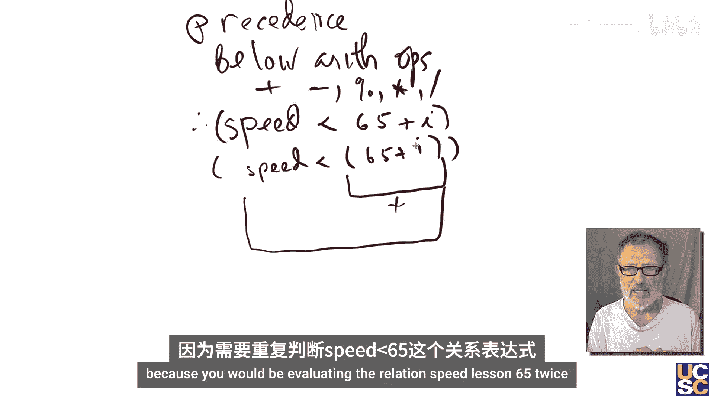
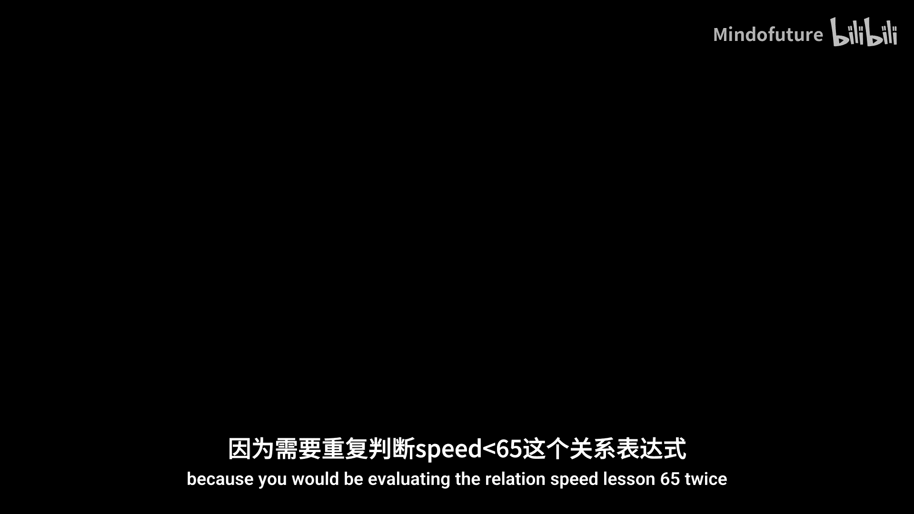

# C语言编程基础：P23：条件语句-if和if-else


## 概述
在本节课中，我们将要学习C语言中的条件语句，特别是`if`和`if-else`语句。这是编写非线性程序的基础，它允许程序根据特定条件决定执行不同的代码路径。

到目前为止，我们编写的程序都是线性的，即从第一行开始，顺序执行到`return 0;`结束。但并非所有程序都如此简单。能够测试某个条件，并根据结果决定执行不同的操作，是非常有用的功能。本节课我们将学习最简单的形式：在两个备选方案中选择其一。这是编程的基础，后续我们还将学习循环结构。

## 第一个非线性程序示例
我们将编写第一个使用`if`语句的程序。这个程序的核心是一个`if-else`语句。程序非常简单：它要求用户输入一个整数速度值，然后根据输入的速度值，判断用户是否会收到超速罚单。

以下是程序代码：
```c
#include <stdio.h>

int main() {
    int speed;
    printf("Enter your speed as an integer: ");
    scanf("%d", &speed);
    if (speed < 65) {
        printf("\nNo speeding ticket.\n");
    } else {
        printf("\nSpeeding ticket.\n");
    }
    return 0;
}
```
假设我已经编译好了这个程序。在程序底部，它会提示“Enter your speed as an integer:”。如果我输入78，程序会输出“Speeding ticket.”。如果我再次运行程序并输入62，程序则会输出“No speeding ticket.”。

## `if-else`语句详解
现在，让我们更详细地探讨如何正确使用`if-else`表达式。

`if-else`语句的一般语法结构如下：
```c
if (expression) {
    // 条件为真时执行的语句
} else {
    // 条件为假时执行的语句
}
```
其中的`expression`可以是任意表达式，但通常是我们所说的**关系表达式**。这个表达式会被求值。如果其结果为`0`，则被视为**假**；如果结果为非零值，则被视为**真**。

在我们刚刚编写的程序中，关系表达式是`speed < 65`。例如，如果你输入速度50，那么`50 < 65`为真，表达式求值结果为1，程序将执行`printf("\nNo speeding ticket.\n");`。同样，如果你输入的速度恰好是65或更大，那么`speed < 65`不为真，表达式求值结果为0，程序将执行`else`分支的代码，输出“Speeding ticket.”。

这个条件可以修改。假设你犯了个错误，认为恰好65不算超速（在加州，许多高速公路限速65英里/小时）。那么条件可以改为`speed <= 65`。这是一个不同的关系，它包含了65。这样，输入65时条件依然为真。

## 关系运算符
C语言提供了四种基本的关系运算符：
*   `<` （小于）
*   `>` （大于）
*   `<=` （小于或等于）
*   `>=` （大于或等于）

你应该在高中数学中熟悉它们。了解它们的**优先级**也很重要。关系运算符的优先级低于算术运算符（如`+`、`-`、`*`、`/`、`%`）。这意味着，如果你看到表达式`speed < 65 + i`，子表达式`65 + i`会先被计算，然后再与`speed`进行比较。这相当于你给`65 + i`加上了括号。虽然你不必显式地加括号，但必须理解优先级规则。不过，为了代码更清晰，显式地加上括号可能更好。

这种写法意味着先进行加法运算，加上一个增量`i`，然后再与`speed`比较。这个`i`可能是交警给予的宽容增量，例如在你的社区可能是4英里或更多。这样设置条件可能更符合实际收到超速罚单的情况。

## 简单的`if`语句
顺便提一下，还有一种更简单的条件语句：只有`if`。在`if`语句中，语法是`if (expression) { statement; }`。如果表达式求值为真（非零），则执行后面的语句；如果求值为假（0），则跳过该语句。

实际上，你可以将`if-else`语句拆分成两个独立的`if`语句来实现类似功能，但这通常不够优雅，并且效率稍低，因为你需要对关系表达式（如`speed < 65`）求值两次。





## 总结
本节课中，我们一起学习了C语言中`if`和`if-else`条件语句的基础知识。我们了解了如何编写非线性程序，使程序能够根据条件（通常是关系表达式的结果）做出决策。我们探讨了`if-else`语句的语法、关系运算符的使用及其优先级，并比较了`if-else`与单独使用`if`语句的区别。这是控制程序流程的第一步，为后续学习更复杂的循环和分支结构打下了基础。