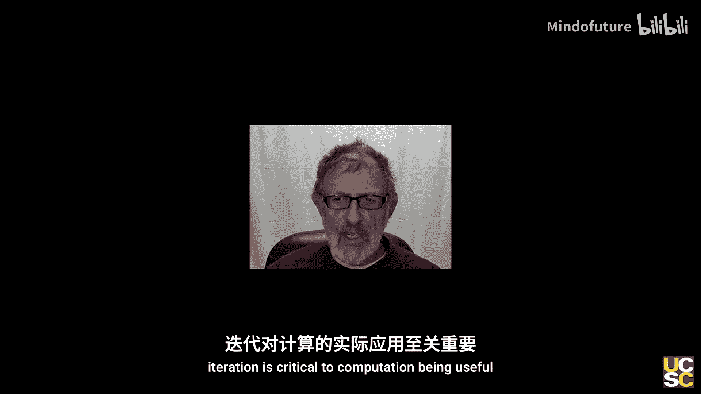
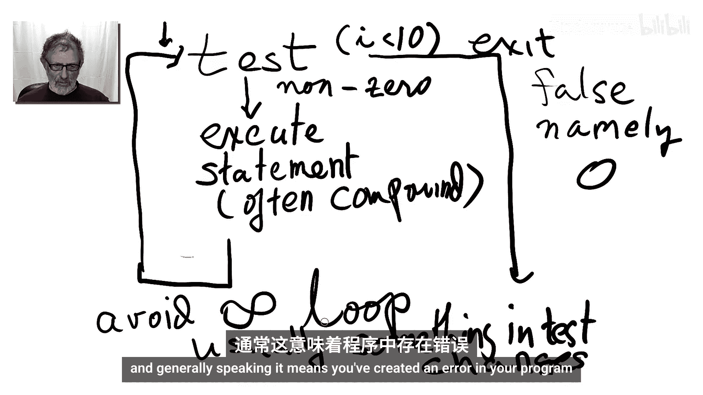
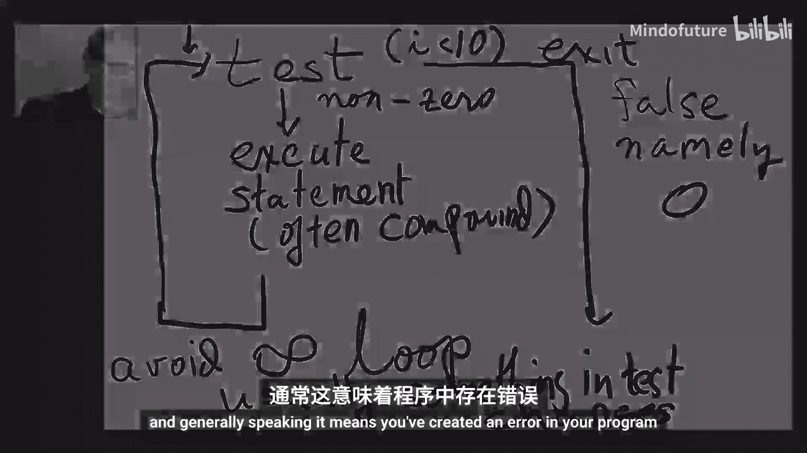
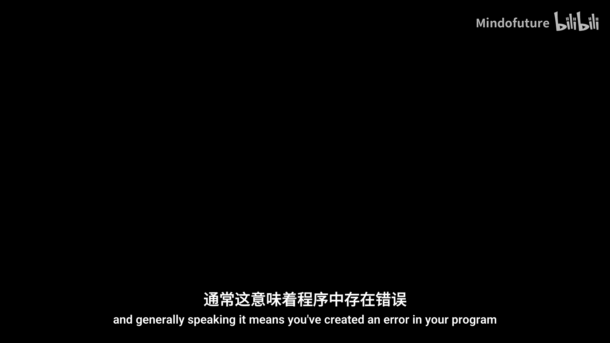

# 【加州大学】C语言编程基础-｜-C-For-Everyone-p24-P24_迭代语句-while_03_02_02--BV1Fqe7zDEVT_p24-

🎼Yeah。🎼The。So in this topic we're going to deal with iteration iteration is critical to。

Computation being useful。If everything was simple and a few lines of direction。

Where we could finish them one step at a time。We largely wouldn't need computers。

 The reason computers are so powerful is they can do。Tionzor。

Millions of trillions of operations in a relatively short time。

 which is impossible for humans or even humans aided with mechanical calculators to do。

So this is a true critical。topic and if you master this topic。You have。

An enormous amount of the utility of writing code。And programming。

And here we're going to study the wild statement， the wild statement is。Fundamental。

 it's the simplest form of iteration statement we're going to see in a little bit。

A more sophisticated form， which will be the fourth statement。

But it's best to understand the wild statement that'll make it very easy to understand the fourth statement as well。

So the while is syntactically while paren with some expression。Cllosed paren with some statement。

 And most normally， that statement is what's called a block or compound statement namely。

 it's really。A statement that is an open brace and a closed brace with a bunch of statements in between。

 so you can do more than one statement action that makes it very useful。Here are the semantics。

What we do is wecheck first to see if the expression is zero， the expression is zero。

 the statement is not done。It's omitted。 And we just skip to whatever is next。

We can think of that as false。Though really in sea。False is zero and true is nonze。However。

 if the expression is non zero， then we execute the statement。That's sitting under the while。

And then we repeat， we go back and ask as the expression zero， we continue。

And that just keeps going until we see the expression is zero。Here's an example。While I less than 10。

So that kind of expression is relational expression， so thats as frequently what we'll see as a test。

And also， this is idiomatic in the sense that very frequently in an iteration。

 you do something that is involved counting and counting normally uses integer variables。

 So in this case， I is assumed to have been declared as an int。Of some value。

 typically less than 10 Otherwise， this wouldn't be executed。 And we'll check if I is less than 10。

 then we continue into this compound or block statement。We do the print F I equals。

 and we print out the current value of I。 And then again。

 very common in iterative statements is we see an auto increment of I。 So here's auto increment of I。

 We add one to it。 Why， because we want repeated behavior。 But ultimately， we want to exit the loop。

 So let's say I starts with 0。 We will print 0， and then we will print  one。

 then we will print 2 and so forth。Until I hit 10， and then we will stop。

So this is canonically a very simple loop， but it still has many of the characteristics of even in the most sophisticated loop as。

 There's something where there might be a count variable。 There's some action。

 This may be actually a whole series of actions， a series of calculations。

 And this ch goes on and on until we exit this loop。In the old days。

 we used to exhibit this behavior what we called a flow chart。

 So here's a flow chart for this while loop。We have a test the text is false。 This is the false part。

Let me indicate that。So false again， keep in mind， false is zero。And otherwise， none false。

 we execute。Non zero。So。A statement， often a compound statement。And then we go back from here。

And retest whatever this test expression is。In that case， it was I less than 10。In that example。

So we enter the loop at S wild statement， we do a test。

 we either exit when false or we continue and do some execution， and then we loop。Test。Exit maybe。

 if not exit， repeat and keep going。 If we avoid exiting。

 we get into what is called an infinite loop。 And that's something that you would have to make sure。

You don't want it。It eats up。Computer time。And。Generally speaking。

 it means you've created an era in your program。

🎼。

