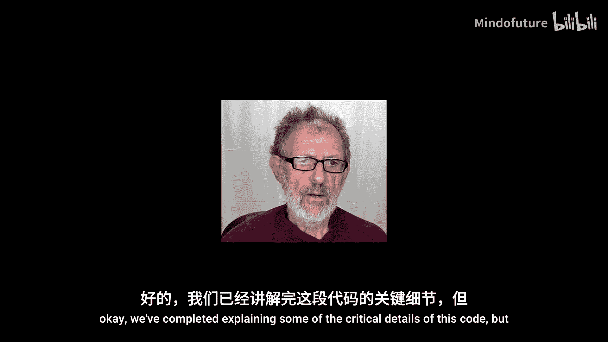
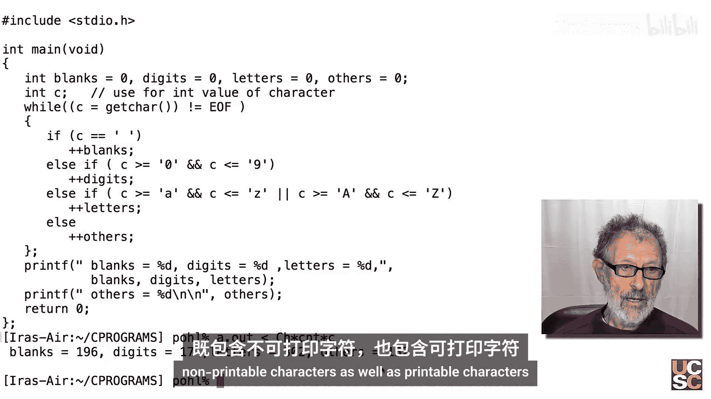
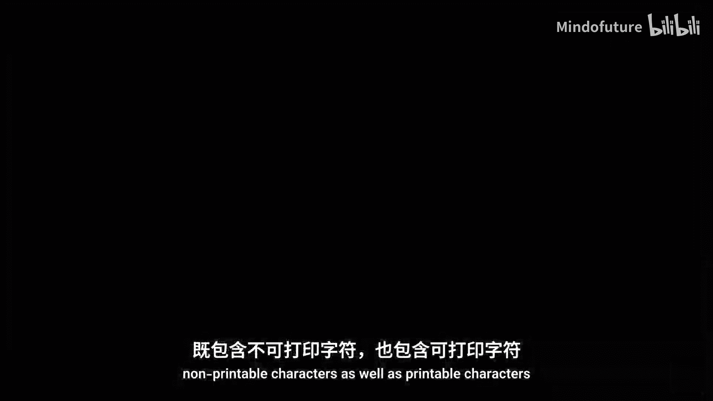
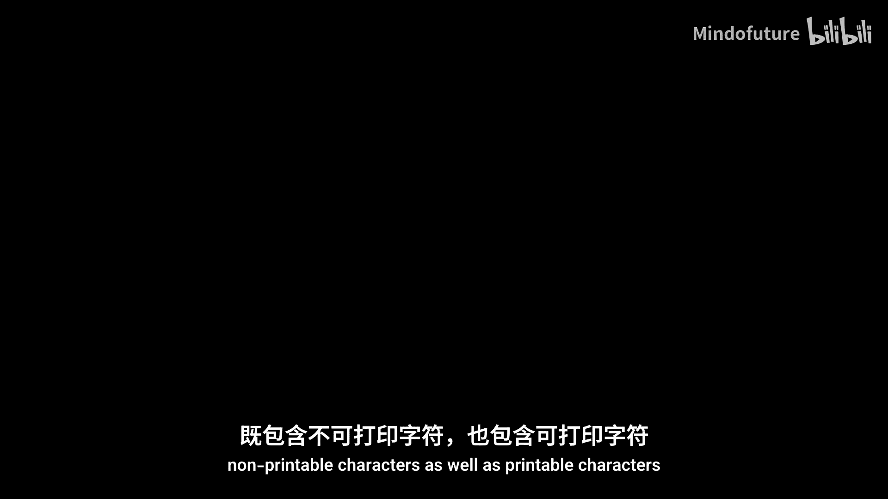

# 【加州大学】C语言编程基础-｜-C-For-Everyone-p25-P25_while-cnt-char-解释_03_02_03--BV1Fqe7zDEVT_p25-

🎼TheYeah。

Okay， we've completed explaining some of the critical details of this code。

 but now let's see the code in detail and make sure it works。So。

We're going to create a variable for each kind of item wherere each character we're trying to。

Count blanks。Digits， letters， others since we。Don't have a account yet。

 All of them will be initialized to0。And then we're going to use C。To indicate。

The interger value of the character and remember。Characters are。

Ordinary C are somewhere between zero and 127。And that's the standard ASCII character table。

 which you should get familiar with if you haven't until now。And this is。

A very convenient thing we're going to find from the standard library。

 We can find it in standard I O。And that is the get cha function。

No arguments and what it does is it obtains from standard input。Which is in this case。

 going to end up being a file because we're going to redirect。啊。But。It could also be。A。

Typing from the keyboard if we don't do redirection。

And here we test to see if we're at the end of file， and this is。See。Any end of file。

 and that's a constant。It's typically minus one， but it's a。Previously， defined constant。

Which is a special value that would otherwise not be in the file。

 So -1 is outside the range of the ASI characters。And we're just continuing that iteration。

 that loop until we hit the end of the file。Here we see a complex if else if statement。

Inside the for， inside the while loop。Notice I'd made the while loop a compound statement。

 but that was unnecessary。It's just stylististically nice。

 even though this is actually a single if L statement。 so it was unnecessary。

Here's if C equal blanks， then we order increment blanks。If it isn't a blank we test to see if it's。

The integers between0 and9， those are， and that's。That range is strictly if you go to the ASI table。

 strictly those values。 And here is a more complicated expression。 Talk a little bit about it。It's。

The lower case letters， but somewhere else are the uppercase letters。 We couldn't just say if C。

 lowercase， A up to Z， shouldd be a lot of stuff in between。 But these are all contiguous。 Again。

 the only way you know that is' by looking at it in the ASCI table。

So this is one range and also you'll notice。That the double ampersand is logical and and that takes precedence over the double。

Single bar， which is the logical ore。So this sub expression gets done first。If that's true。

Then this doesn't get done again， the way these expressions work。

 this is what's called short circuit evaluation。You could look that up。

You don't remember an explanation， it just means we only need to test this if it's true then。

And or expression will always be true， if this fails， then we have to test the second part。

And similarilely， short circuit works with the ant parts， if this part is false。

 then if this part is false。Well有。Its little part， iss false。

 Then it fails for the entire expression。 that's called short circuits。

 so we don't have to do the extra work。And we have blanks， increment digits， in letters， in others。

 and you can do something even more elaborate if you had some interest in developing this program further。

And then here we just print out their values。So I'm going to run this program。

As I showed in the previous segment。I'm going to use redirection。And I'm going to。Run it on a file。

 which indeed is。The program you saw at the beginning。And that program had 196 blanks， 17 digits。

 302 leathers， and otherwise。Had 152 other things。Sitting in as characters。

 which could include things like new lines and tabs。

 so they could be non printable characters as well as printable characters。

🎼Oh。

🎼Yeah。