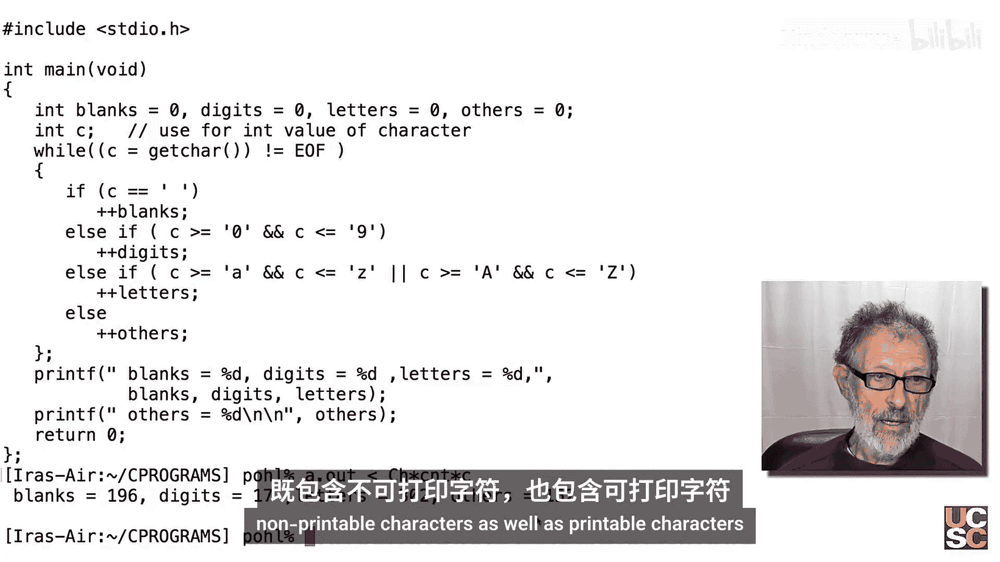

# C语言编程基础：P25：while循环与字符计数程序详解


在本节课中，我们将详细解析一个使用`while`循环进行字符分类统计的C语言程序。我们将学习如何读取输入、判断字符类型以及使用逻辑表达式进行计数。

## 概述

我们将创建一个程序，用于统计输入文本中空格、数字、字母以及其他字符的数量。程序的核心是使用`getchar()`函数读取字符，并通过一系列`if-else if`条件判断进行分类计数。

## 代码结构详解

上一节我们讨论了程序的基本逻辑，本节中我们来看看具体的代码实现细节。

首先，程序需要为每种待统计的字符类型创建变量。由于初始时没有任何计数，所有变量都将被初始化为0。

```c
int blanks = 0, digits = 0, letters = 0, others = 0;
```

接下来，程序使用变量`c`来存储读取到的字符的整数值。在C语言中，字符本质上是介于0到127之间的整数，对应标准的ASCII字符表。熟悉这个字符表对编程很有帮助。

程序从标准库中调用一个非常方便的函数`getchar()`。该函数定义在`stdio.h`头文件中，无需参数，其作用是从标准输入（通常是键盘或重定向的文件）获取一个字符。

```c
#include <stdio.h>
...
int c;
while ((c = getchar()) != EOF) {
    // 处理字符
}
```

这里，我们通过一个`while`循环持续读取字符，直到遇到文件结束符（EOF）。`EOF`是一个预定义的常量，通常值为-1，它位于ASCII字符范围之外，用于标识输入流的结束。

## 字符分类逻辑

在`while`循环内部，我们使用一个复杂的`if-else if`语句链来判断字符类型。虽然这个`while`循环体被写成了复合语句（用花括号包裹），但从语法上讲，即使内部只有一个`if-else if`结构，不写花括号也是可以的，使用花括号主要是为了风格清晰。

以下是判断逻辑的核心部分：

```c
if (c == ' ') {
    ++blanks;
} else if (c >= '0' && c <= '9') {
    ++digits;
} else if ((c >= 'a' && c <= 'z') || (c >= 'A' && c <= 'Z')) {
    ++letters;
} else {
    ++others;
}
```

*   第一个条件判断字符是否为空格。
*   第二个条件判断字符是否为数字（‘0’到‘9’）。在ASCII表中，这些数字字符的编码是连续递增的。
*   第三个条件判断字符是否为字母。这里使用了一个更复杂的逻辑表达式。需要注意的是，在ASCII表中，小写字母‘a’到‘z’是连续的，大写字母‘A’到‘Z’也是连续的。因此，我们可以用两个子条件通过逻辑或（`||`）连接起来进行判断。

关于逻辑表达式，需要理解运算符优先级和“短路求值”：
*   逻辑与（`&&`）的优先级高于逻辑或（`||`）。
*   “短路求值”意味着：在逻辑或表达式中，如果第一个子条件为真，整个表达式已确定为真，第二个子条件将不再被计算。在逻辑与表达式中，如果第一个子条件为假，整个表达式已确定为假，第二个子条件也将不再被计算。这提高了程序效率。

## 程序输出与运行

所有字符处理完毕后，程序简单地打印出各类字符的统计结果。

```c
printf("blanks = %d, digits = %d, letters = %d, others = %d\n", blanks, digits, letters, others);
```

运行此程序时，可以使用输入重定向功能使其从一个文件中读取数据，而不是从键盘输入。例如，对程序自身的源代码文件运行此程序，可能会得到类似这样的输出：`blanks = 196, digits = 17, letters = 302, others = 152`。

“其他字符”的计数可能包括换行符、制表符等不可打印字符，以及所有既不是空格、数字，也不是字母的可打印字符。

## 总结




本节课我们一起学习了如何构建一个字符统计程序。我们掌握了使用`while`循环和`getchar()`读取输入流，利用ASCII码值的连续特性以及`if-else if`语句链和逻辑表达式对字符进行分类，并通过变量递增完成计数。理解“短路求值”有助于编写更高效的逻辑判断代码。这个程序是学习基础I/O操作和流程控制的经典示例。