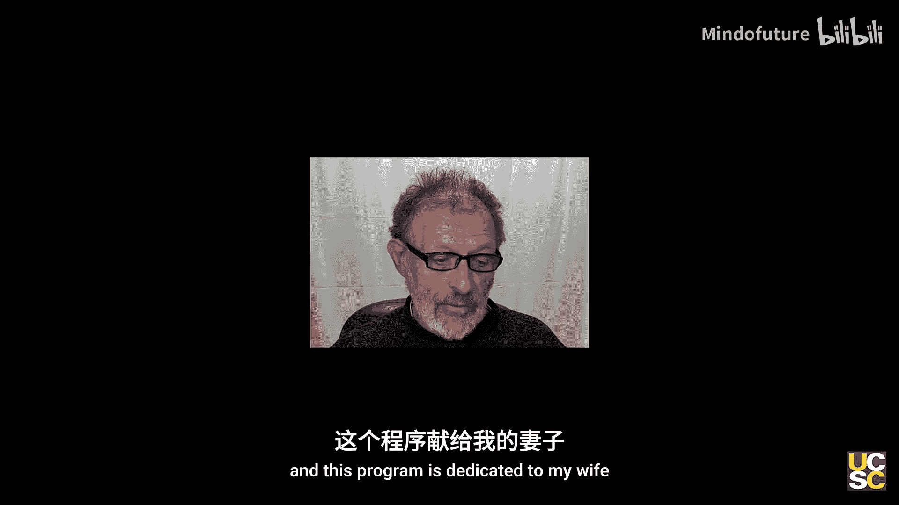
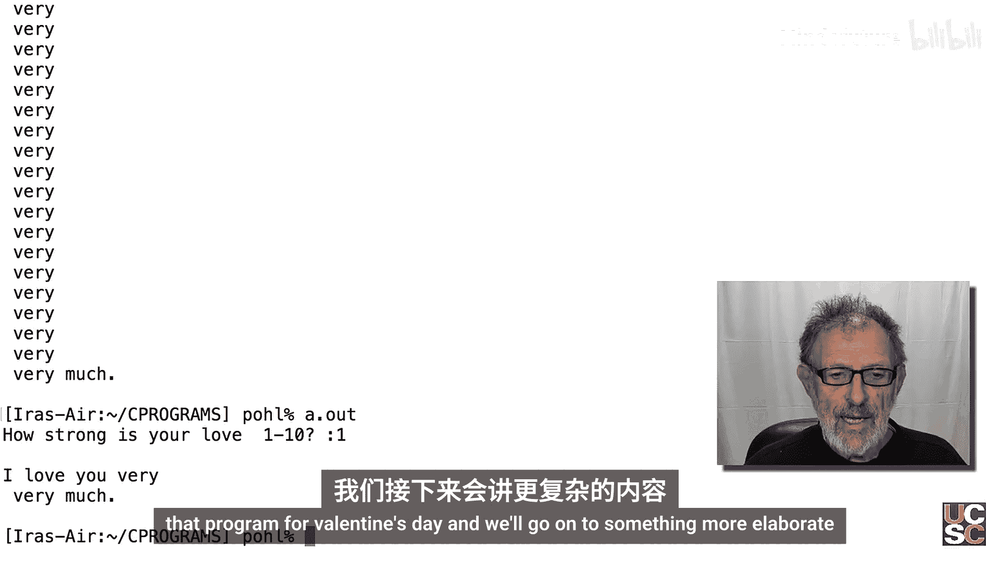

# 【加州大学】C语言编程基础-｜-C-For-Everyone-p26-P26_while代码示例_03_02_04--BV1Fqe7zDEVT_p26-

🎼TheYeah。We're going to do more with the while loop because it's so central to iteration。

And we're going to show a simple program in this segment。

 and then we're going to go on to show more complicated programs in the next segment。

 and then we will do a bit of a quiz。So in the following program。

 I'm going to write an iteration that's going to ask a question。

 this is what I call my Valentine Day。Program。So put your loved one in front of the screen。あ。

And then start your executable and it'll ask you how much。Your loves。That person。

And then depending on a score。Once you input， it will print out your Valentine's message。

So you can see that I just want to emphasize。And that's where repetition is going to come and I'm going to emphasize how much I love you。

And this program is dedicated to my wife。

So let's look at some critical parts of the program。呃。First off。

 there's going to be this declaration for the Integer Peteat。 and that's going to tell us。

How often the loop is to be repeated？Now。The Y loop is the fundamental loop。

 it's the simplest form of loop。In the C language， later we're going to see a more sophisticated form of loop four。

 but if you understand the Y loop， in fact， you can do everything with the Y loop that you can do with the four loop。

 it just requires a little more。呃。A few more statements。

So the integer repeat is going to be a repetition。Now。Here's we're asking how much I love you。

 that can be changed， you can try to write your own version of this。Here's our input。Of course。

 idiomatic， we have to ask for the address of repeat， and we're expecting input between 1 and 10。

 and now we're going to print out， I love you very。 and here is the actual loop construction。

Here is your。Comparison statement， so repeat as long as it's。Greater than zero。Will continue。

When it's equal to or less than zero， then this will terminate。We check repeat。 it was0。

 but here we're going to enter something else。 ostensibly is going to be between one and 10。

 So for example， if it was one， one is greater than0， and then we're going to print very。And then。

 we're going to decrement。The autoderement。Of repeat。Very common。Something to iterate on。

 something to either auto decrement or auto increment。

And so the loop ultimately would stop because if we enter a number， whatever， a positive integer。

This will， ultimately。Reachs zero， if we enter a negative integer or zero。

 then it'll stop immediately and then we end with print much。Let's execute this program。

Already compiled it。Says how strong is your love？I'm going to put in 10。Well I love you very， very。

 very， very much， I think。呃。That should be your goal， let's try one more time。

What if I put zero in there？I've just print it that once。even though it said how strong is your love。

 so I didn't really test for this。Indeed， I can use out of range values， I didn't intend to。

 and then you get an even longer thing。Of course， if I use the value。One， I get one very。All right。

So。Try and play with such a program or write your own version of that program for Valentine's Day。

And we'll go on to something more elaborate。

🎼。